<div align="center">

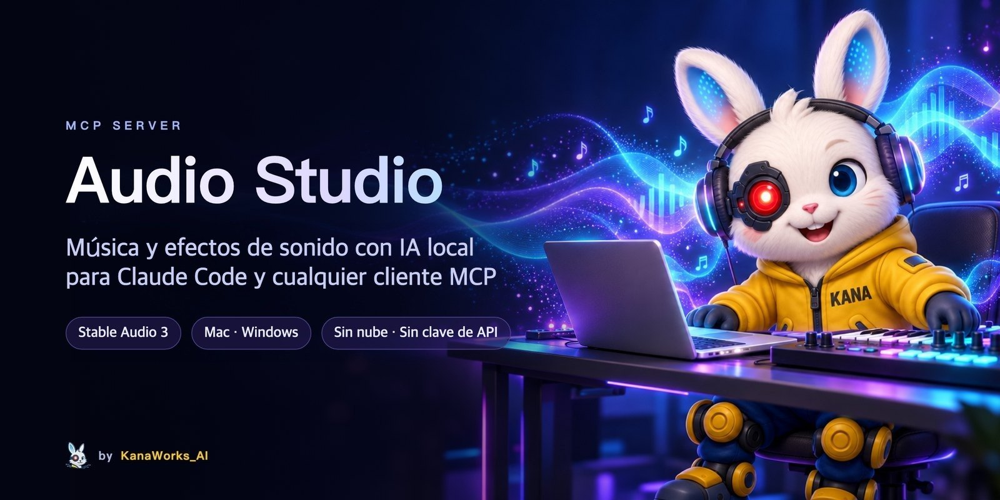

<p>
  <a href="LICENSE"></a>
  
  
  <a href="https://modelcontextprotocol.io"></a>
  
  <a href="https://github.com/kanaworksai-hue/audio-studio-mcp/actions/workflows/tests.yml"></a>
  <a href="https://github.com/kanaworksai-hue/audio-studio-mcp/stargazers"></a>
</p>

<p><a href="https://github.com/kanaworksai-hue"></a>&nbsp;<a href="https://github.com/kanaworksai-hue"><b>Un proyecto de KanaWorks_AI</b></a></p>

[English](README.md) | [简体中文](README.zh-CN.md) | [日本語](README.ja.md) | [한국어](README.ko.md) | [Português (Brasil)](README.pt-BR.md) | **Español**

<!-- mcp-name: io.github.kanaworksai-hue/audio-studio-mcp -->

[🎧 Escucha los ejemplos](https://kanaworksai-hue.github.io/audio-studio-mcp/) · [Inicio rápido](#-inicio-rápido) · [Herramientas](#-herramientas) · [Interfaz web](#-interfaz-web) · [Preguntas frecuentes](#-preguntas-frecuentes) · [⭐ Dale una estrella](#-te-gusta-dale-una-estrella)

</div>

**Audio Studio MCP** le da a Claude Code, Claude Desktop, Cursor y cualquier otro cliente [MCP](https://modelcontextprotocol.io) un estudio de sonido que se ejecuta en tu propia Mac o PC con Windows. Pide música de fondo o un efecto de sonido en lenguaje natural; el modelo lo genera localmente con [Stable Audio 3](https://github.com/Stability-AI/stable-audio-3). Después puede convertirlo en loop, normalizar la sonoridad y exportarlo para tu motor de juego o editor de video. No hay servicio en la nube ni clave de API, y generar no cuesta nada.

<p align="center">
  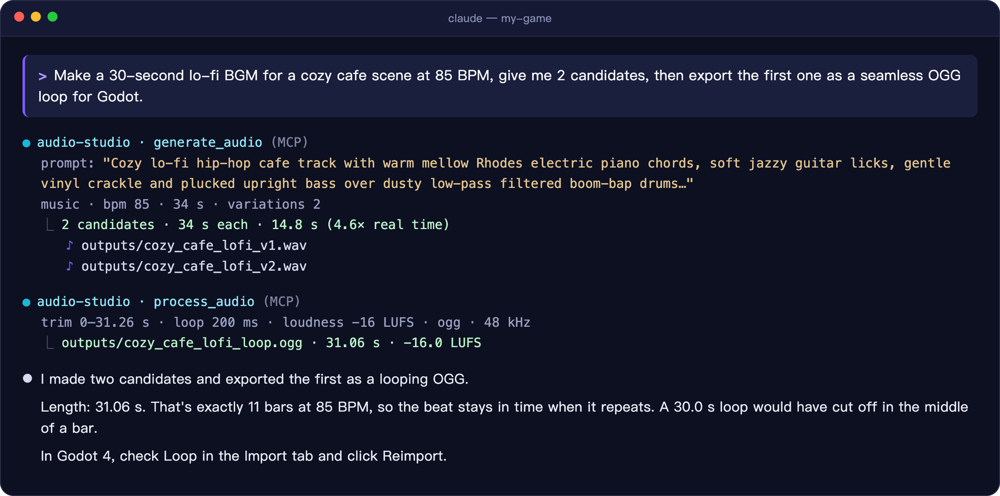
  <br><sub>Una sesión real (en inglés), resumida. Claude eligió una duración de loop de exactamente 11 compases para que el ritmo no se desfase al repetirse.</sub>
</p>

## ✨ Lo más destacado

<table>
<tr>
<td align="center" width="25%">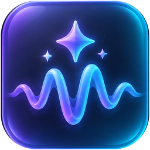<br><b>Generar</b><br><sub>Música de fondo, loops de instrumentos y efectos de sonido a partir de una sola frase, de 1 a 4 candidatos por llamada</sub></td>
<td align="center" width="25%">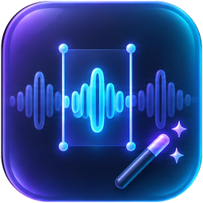<br><b>Editar</b><br><sub>Cambia el estilo de un clip entero, regenera un rango de tiempo o extiende una pista</sub></td>
<td align="center" width="25%">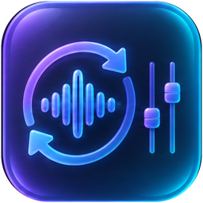<br><b>Finalizar</b><br><sub>Loops sin cortes, fundidos, sonoridad (LUFS), WAV / OGG / FLAC a 48 kHz</sub></td>
<td align="center" width="25%">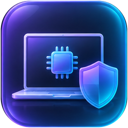<br><b>Local</b><br><sub>Funciona en Apple Silicon (MLX) o en una GPU NVIDIA (PyTorch). No se sube nada</sub></td>
</tr>
</table>

- **Reproducible:** cada archivo incluye un `.json` complementario con su prompt, su semilla y su configuración.
- **Prompts integrados:** el servidor le enseña al cliente el formato de prompt oficial de Stable Audio 3, así que una petición como "que suene como una puerta que rechina" se convierte en un prompt que el modelo entiende.
- **La misma salida que el proyecto original:** en una Mac, los resultados con la misma semilla son idénticos bit a bit a los del CLI oficial `sa3`. En Windows llama a la API oficial de PyTorch de Stable Audio 3.

## 🎧 Escúchalo

Todos estos ejemplos los generó este servidor en una Mac M1 y no se editaron a mano. **[Abrir la página de ejemplos →](https://kanaworksai-hue.github.io/audio-studio-mcp/)**

| | Ejemplo | Prompt |
|---|---|---|
| 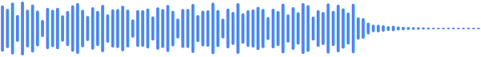 | [**Café lo-fi**](https://kanaworksai-hue.github.io/audio-studio-mcp/#lofi_cafe)<br><sub>música · 30 s · 85 BPM</sub> | Lo-fi hip-hop chill track with mellow electric piano, soft vinyl crackle, low-pass filtered drums… |
|  | [**Orquestal épico**](https://kanaworksai-hue.github.io/audio-studio-mcp/#epic_orchestral)<br><sub>música · 30 s</sub> | Epic cinematic orchestral trailer music with thundering taiko drums, soaring French horns… |
|  | [**Aventura chiptune**](https://kanaworksai-hue.github.io/audio-studio-mcp/#chiptune_adventure)<br><sub>música · 20 s · 150 BPM</sub> | Upbeat 8-bit chiptune adventure theme with a bright square wave lead… |
| 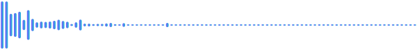 | [**Vidrio que se rompe**](https://kanaworksai-hue.github.io/audio-studio-mcp/#glass_shatter)<br><sub>efecto · 3 s</sub> | source: glass bottle · action: shattering on impact · material: thick green glass · space: concrete floor |
|  | [**Lluvia y truenos**](https://kanaworksai-hue.github.io/audio-studio-mcp/#rain_thunder)<br><sub>efecto · 12 s</sub> | source: heavy rain and distant thunder · space: outdoor forest at night, wide stereo |
| 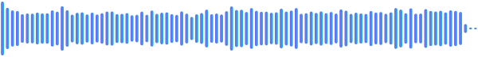 | [**Synthwave, extendido**](https://kanaworksai-hue.github.io/audio-studio-mcp/#synthwave_drive_extended)<br><sub>edición · 20 s → 40 s</sub> | `edit_audio` continue: una pista de 20 segundos extendida a 40 segundos |

Los MP3 están en [`docs/samples/`](docs/samples), y los prompts y las semillas, en [`samples.json`](docs/samples/samples.json).

## 🧭 Cómo funciona

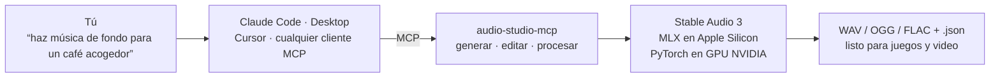

## 🚀 Inicio rápido

Necesitas [uv](https://docs.astral.sh/uv/) 0.9.20 o posterior y [ffmpeg](https://ffmpeg.org). No hay nada que clonar: `uvx` descarga y ejecuta el paquete publicado.

| | macOS | Windows |
|---|---|---|
| **Hardware** | Apple Silicon (M1 o posterior), se recomiendan 16 GB de RAM | GPU NVIDIA con 8 GB de VRAM o más y un controlador actualizado. Probado en una RTX 3060 de 12 GB |
| **Disco** | Unos 8 GB (modelo ~6.9 GB) | Unos 14 GB (modelo ~10.4 GB, PyTorch) |
| **uv y ffmpeg** | `brew install uv ffmpeg` | `winget install astral-sh.uv` y `winget install Gyan.FFmpeg` |
| **Licencia del modelo** | No hay que hacer nada | Necesitas una cuenta gratuita de [Hugging Face](https://huggingface.co): abre [stabilityai/stable-audio-3-medium](https://huggingface.co/stabilityai/stable-audio-3-medium) y acepta la licencia una vez |

**1. Configúralo una sola vez, en una terminal.** Esto revisa tu computadora, obtiene el runtime oficial de Stable Audio 3 en un commit probado, te dice cuánto pesa la descarga del modelo y te pregunta antes de descargarlo. Puedes volver a ejecutarlo sin problema; las descargas terminadas se conservan.

```bash
# macOS
uvx --python 3.11 audio-studio-mcp setup
```

```powershell
# Windows
uvx --python 3.11 --torch-backend cu126 audio-studio-mcp setup
```

`--torch-backend cu126` hace que uv instale la versión de PyTorch con CUDA (en PyPI solo está la versión para CPU en Windows), y `--python 3.11` evita que uv elija un Python que PyTorch todavía no admite. Si uvx responde `unexpected argument '--torch-backend'`, tu uv es demasiado antiguo: actualízalo con `winget upgrade astral-sh.uv` (o `uv self update`). En Windows, si aún no has iniciado sesión en Hugging Face, setup muestra los pasos: acepta la licencia en la página del modelo, luego inicia sesión **en tu propia terminal** con `uvx --from huggingface_hub hf auth login` y vuelve a ejecutar setup.

Setup descarga el modelo **medium**. Para los modelos pequeños y rápidos, agrega `--model sm-music`, `--model sm-sfx` o `--model all`, y define `AUDIO_STUDIO_SA3_MODEL` en la configuración de tu cliente (consulta [Configuración](#️-configuración)).

**2. Regístralo en tu cliente MCP.** Usa el mismo comando sin `setup`:

```bash
# Claude Code, macOS
claude mcp add --scope user audio-studio -- uvx --python 3.11 audio-studio-mcp
# Claude Code, Windows
claude mcp add --scope user audio-studio -- uvx --python 3.11 --torch-backend cu126 audio-studio-mcp
```

<details>
<summary><b>Claude Desktop, Codex, VS Code, Cursor y otros clientes</b></summary>

En Windows, agrega `"--torch-backend", "cu126"` después de `"3.11"` en cada uno de los ejemplos de abajo.

**Claude Desktop** (`claude_desktop_config.json`), **Cursor** (`.cursor/mcp.json`) y la mayoría de los demás clientes:

```json
{
  "mcpServers": {
    "audio-studio": {
      "command": "uvx",
      "args": ["--python", "3.11", "audio-studio-mcp"]
    }
  }
}
```

Si el cliente dice que no encuentra `uvx`, pon su ruta completa en `command` (`which uvx` en macOS, `where uvx` en Windows). Reinicia Claude Desktop después de editar el archivo.

**Codex** (`~/.codex/config.toml`). De forma predeterminada, Codex solo espera 10 segundos a que arranque un servidor y 60 segundos a que termine una llamada a una herramienta; las pistas largas necesitan más:

```toml
[mcp_servers.audio-studio]
command = "uvx"
args = ["--python", "3.11", "audio-studio-mcp"]
startup_timeout_sec = 60
tool_timeout_sec = 900
```

**VS Code** (`.vscode/mcp.json`, o **MCP: Open User Configuration**):

```json
{
  "servers": {
    "audio-studio": {
      "type": "stdio",
      "command": "uvx",
      "args": ["--python", "3.11", "audio-studio-mcp"]
    }
  }
}
```
</details>

Los archivos generados se guardan en `~/AudioStudio` (define `AUDIO_STUDIO_OUTPUT_DIR` para cambiarlo). uvx conserva la versión que instaló; para actualizar, ejecuta `uv cache clean audio-studio-mcp` y luego vuelve a ejecutar setup.

> [!TIP]
> **Deja que tu agente lo instale.** Pega esto en Claude Code:
> *"Instala el servidor Audio Studio MCP (https://github.com/kanaworksai-hue/audio-studio-mcp) siguiendo su README, incluidas las notas para agentes de IA."*
>
> **Notas para agentes de IA:**
> - Ejecuta tú mismo el comando de setup que corresponde al sistema operativo del usuario, agregando `-y`, y dale un tiempo de espera largo: descarga unos 7 GB en macOS y unos 13 GB en Windows (modelo y PyTorch). Si se interrumpe, vuelve a ejecutarlo; los archivos ya descargados se conservan. Después registra el servidor como se muestra arriba.
> - En Windows, los pesos del modelo tienen acceso restringido y requieren que el usuario inicie sesión con su propia cuenta de Hugging Face. Si setup se detiene mostrando los pasos para iniciar sesión, pásaselos al usuario y espera a que te diga que terminó; luego vuelve a ejecutar setup. Nunca le pidas al usuario que pegue su token en el chat.
> - Antes de que setup termine, el servidor arranca, pero cada llamada a una herramienta responde con el comando de setup que hay que ejecutar.

### Alternativa: instalar desde el código fuente

Los scripts de instalación de versiones anteriores siguen funcionando. Clonan el repositorio, ponen el runtime en `vendor/` y el audio en `outputs/` dentro de él, y se ejecutan desde `.venv/`.

#### macOS (Apple Silicon)

**Requisitos:**

- Mac con Apple Silicon (M1 o posterior), se recomiendan 16 GB de RAM
- Unos 8 GB de disco (modelo ~6.9 GB)
- `git` y [`ffmpeg`](https://ffmpeg.org) (`brew install ffmpeg`)

```bash
git clone https://github.com/kanaworksai-hue/audio-studio-mcp.git
cd audio-studio-mcp
./install.sh
```

El instalador configura [`uv`](https://docs.astral.sh/uv/) si hace falta, clona el runtime oficial de Stable Audio 3 en `vendor/` en un commit probado, crea `.venv/` y descarga el modelo **medium** (1.4B, ~6.9 GB) desde [Hugging Face](https://huggingface.co/stabilityai/stable-audio-3-optimized). Al terminar, muestra el comando exacto para registrar el servidor:

```bash
claude mcp add --scope user audio-studio -- /path/to/audio-studio-mcp/.venv/bin/audio-studio-mcp
```

#### Windows (GPU NVIDIA)

**Requisitos:**

- Windows 10 u 11 de 64 bits con una GPU NVIDIA (8 GB de VRAM o más) y un controlador actualizado. Probado en una RTX 3060 de 12 GB
- Unos 14 GB de disco para el modelo y PyTorch
- `git` (`winget install Git.Git`) y [`ffmpeg`](https://ffmpeg.org) (`winget install Gyan.FFmpeg`)
- Una cuenta gratuita de [Hugging Face](https://huggingface.co). Los pesos de PyTorch tienen acceso restringido: abre [stabilityai/stable-audio-3-medium](https://huggingface.co/stabilityai/stable-audio-3-medium) y acepta la licencia una vez

```powershell
git clone https://github.com/kanaworksai-hue/audio-studio-mcp.git
cd audio-studio-mcp
powershell -ExecutionPolicy Bypass -File install.ps1
```

El instalador sigue los mismos pasos que en macOS, pero instala PyTorch con CUDA y descarga el checkpoint oficial de PyTorch del modelo **medium** (~10.4 GB). Si aún no has iniciado sesión en Hugging Face, te pide un token de acceso con permiso de lectura ([créalo aquí](https://huggingface.co/settings/tokens)). Cuando se ejecuta sin consola (por ejemplo, si lo inicia un agente de IA), nunca pregunta: muestra los pasos para iniciar sesión y se detiene, y tú lo vuelves a ejecutar después de iniciar sesión. Al terminar, muestra el comando para registrar el servidor:

```powershell
claude mcp add --scope user audio-studio -- "C:\path\to\audio-studio-mcp\.venv\Scripts\audio-studio-mcp.exe"
```

Flash Attention no es necesario. Sin él, el runtime usa la atención integrada de PyTorch.

<details>
<summary><b>Claude Desktop, Cursor y otros clientes</b></summary>

Agrega esto a `claude_desktop_config.json`, `.cursor/mcp.json` o la configuración MCP de tu cliente:

```json
{
  "mcpServers": {
    "audio-studio": {
      "command": "/path/to/audio-studio-mcp/.venv/bin/audio-studio-mcp"
    }
  }
}
```

En Windows, el comando es `C:\\path\\to\\audio-studio-mcp\\.venv\\Scripts\\audio-studio-mcp.exe` (con las barras invertidas duplicadas en JSON).
</details>

<details>
<summary><b>Opciones del instalador</b></summary>

| macOS | Windows | Efecto |
|---|---|---|
| `--model all` | `-Model all` | Descarga también los modelos pequeños y rápidos `sm-music` y `sm-sfx` (+2.6 GB en macOS, +7 GB en Windows) |
| `--skip-weights` | `-SkipWeights` | No descarga los pesos ahora; se descargan en la primera generación |
| `-y` | `-Yes` | Instala `uv` sin preguntar |

En macOS, las descargas son anónimas; iniciar sesión con `hf auth login` aumenta el límite de solicitudes de Hugging Face. En Windows, los pesos de PyTorch tienen acceso restringido: acepta la licencia en la página de cada modelo que descargues ([medium](https://huggingface.co/stabilityai/stable-audio-3-medium), [small-music](https://huggingface.co/stabilityai/stable-audio-3-small-music), [small-sfx](https://huggingface.co/stabilityai/stable-audio-3-small-sfx)) e inicia sesión.
</details>

Después, solo tienes que pedirlo:

- "Crea un loop lo-fi de música de fondo de 60 segundos a 85 BPM para una escena en una cafetería; dame 3 opciones."
- "Necesito el sonido de una pesada puerta de madera cerrándose de golpe en un pasillo de piedra. Expórtalo como OGG para Godot."
- "Extiende esta pista a 90 segundos y normalízala a −16 LUFS."

## 🧰 Herramientas

| Herramienta | Qué hace |
|---|---|
| `generate_audio` | De texto a música de fondo, loop/stem de instrumento o efecto de sonido. De 1 a 4 candidatos por llamada, `bpm`, campos estructurados para efectos de sonido |
| `edit_audio` | `variation` (cambia el estilo del clip entero), `inpaint` (regenera un rango de tiempo), `continue` (extiende). De 1 a 4 candidatos |
| `process_audio` | Recorte → recorte de silencios → mono → remuestreo / sonoridad → loop sin cortes → fundidos → normalización de picos o techo → WAV / OGG / FLAC. Nunca modifica el archivo de entrada |
| `unload_models` | Libera de inmediato la memoria de los modelos |

<details>
<summary><b>Notas sobre los parámetros</b></summary>

- **`audio_type`**: `music` / `instrument` / `sfx` / `raw`. El servidor agrega el prefijo con el que se entrenó el modelo (`TrackType: Music, VocalType: Instrumental,` …). Sin el prefijo de SFX, los efectos de sonido suelen salir como música.
- **`variations`**: de 1 a 4 candidatos con las semillas `seed, seed+1, …`. Usa `seed: -1` u omítelo para obtener una semilla aleatoria.
- **`sound_source` / `sound_action` / `sound_material` / `sound_space`**: describen un efecto de sonido según qué lo produce, cómo evoluciona, su textura y el espacio en el que suena.
- **`peak_ceiling_db`** (predeterminado −1): un techo de seguridad. Los picos que lo superan se bajan y el audio más silencioso nunca se amplifica. Usa `process_audio` para normalizar.
- **Normalización de `process_audio`**: `peak` es lo habitual para efectos de sonido. `loudness` normaliza a un LUFS objetivo: −14 para streaming/video, −16 para música de fondo de juegos, −23 para transmisión (broadcast).

Los archivos generados son WAV estéreo de 44.1 kHz y 24 bits, y se escriben en la carpeta de salida (`~/AudioStudio`, o `outputs/` en una instalación desde el código fuente; consulta `AUDIO_STUDIO_OUTPUT_DIR`). Cada uno tiene un `<name>.json` al lado. Los archivos procesados conservan la información de generación original en `source`.
</details>

## 🌐 Interfaz web

¿Prefieres hacer clic en lugar de chatear? El mismo servidor incluye una página web local. Genera música de fondo y efectos de sonido, compara los candidatos, edítalos (crea una variación, reemplaza una parte, extiéndelos), expórtalos para tu juego o video y explora en la biblioteca todo lo que has creado.

<p align="center">
<picture>
  <source media="(prefers-color-scheme: dark)" srcset="docs/assets/webui-generate-en-dark.png">
  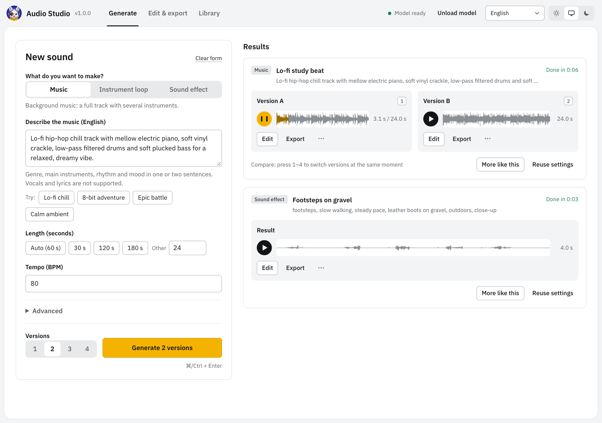
</picture>
<br><br>
<picture>
  <source media="(prefers-color-scheme: dark)" srcset="docs/assets/webui-edit-en-dark.png">
  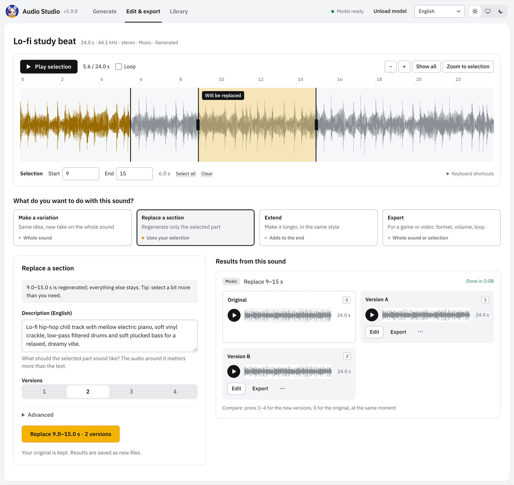
</picture>
</p>

```bash
uvx --python 3.11 audio-studio-mcp --web 8765
```

Se abre http://127.0.0.1:8765/ en tu navegador. Agrega `--no-browser` para iniciarlo sin abrir el navegador, o `--preload` para cargar el modelo al arrancar. Presiona Ctrl+C para detenerlo. En Windows, agrega `--torch-backend cu126` después de `3.11`. Si instalaste desde el código fuente: `.venv/bin/audio-studio-mcp --web 8765` (Windows: `.venv\Scripts\audio-studio-mcp.exe --web 8765`).

La página y tus clientes MCP pueden compartir un solo proceso y un solo modelo cargado: el mismo puerto también sirve MCP en `/mcp`. Regístralo una vez y usa ambos al mismo tiempo. Las solicitudes de la página y las de los agentes esperan en una misma cola.

```bash
claude mcp add --scope user --transport http audio-studio http://127.0.0.1:8765/mcp
```

- Los archivos se escriben en la carpeta de salida (`~/AudioStudio`, `outputs/` en una instalación desde el código fuente, o `AUDIO_STUDIO_OUTPUT_DIR`). La biblioteca muestra esa carpeta y el editor trabaja con los archivos que contiene.
- La interfaz web está disponible en inglés, japonés y chino, y sigue el idioma de tu navegador; puedes cambiarlo en la configuración. Las capturas de pantalla la muestran en inglés, porque no está disponible en español.

> [!WARNING]
> La interfaz web es solo para tu propia computadora. Solo escucha en `127.0.0.1` y no tiene inicio de sesión. No la hagas accesible desde otras máquinas (redirección de puertos, un proxy inverso o un túnel): cualquiera que pueda abrirla puede usar tu GPU y escribir archivos en tu carpeta de salida.

## ⚙️ Configuración

<details>
<summary><b>Variables de entorno</b></summary>

| Variable | Valor predeterminado | Significado |
|---|---|---|
| `AUDIO_STUDIO_OUTPUT_DIR` | `~/AudioStudio` (instalación desde el código fuente: `<repo>/outputs`) | Dónde se escriben los archivos de audio |
| `AUDIO_STUDIO_IDLE_UNLOAD_MIN` | `10` | Libera los modelos tras esta cantidad de minutos de inactividad (`0` = nunca) |
| `AUDIO_STUDIO_SA3_MODEL` | `medium` | `medium` (mejor calidad, hasta 380 s), `sm-music` o `sm-sfx` (pequeños y rápidos, hasta 120 s) |
| `AUDIO_STUDIO_MLX_CACHE_GB` | `1` | macOS: límite de la caché de búferes de MLX. Sin él, una generación larga puede dejar ~6 GB en caché |
| `AUDIO_STUDIO_DEVICE` | `cuda` si está disponible | Windows/Linux: dispositivo de PyTorch, p. ej. `cuda`, `cuda:1` o `cpu` |
| `AUDIO_STUDIO_SA3_DIR` | lo descarga setup (instalación desde el código fuente: `<repo>/vendor/stable-audio-3`) | Usa otro checkout de stable-audio-3 |
| `AUDIO_STUDIO_HOME` | macOS `~/Library/Application Support/audio-studio-mcp`, Windows `%LOCALAPPDATA%\audio-studio-mcp` | Dónde guarda setup el runtime de Stable Audio 3 (~1 MB). Los pesos se quedan en la caché de Hugging Face |
| `AUDIO_STUDIO_BACKEND` | `auto` | `auto`, `sa3-mlx` (Apple Silicon) o `sa3-torch` (PyTorch, NVIDIA) |
| `AUDIO_STUDIO_FFMPEG` | `ffmpeg` en `PATH` | Ruta a ffmpeg |

Pásalas con `claude mcp add ... -e NAME=value` o en el bloque `env` de la configuración de tu cliente.
</details>

<details>
<summary><b>Compartir un servidor entre sesiones</b></summary>

Normalmente, cada sesión de cliente inicia su propio proceso de servidor. Los modelos se cargan en la primera llamada y se liberan después del tiempo de inactividad. Para mantener un único proceso con el modelo listo para todas las sesiones, ejecútalo como servidor HTTP local. Solo escucha en `127.0.0.1`.

```bash
uvx --python 3.11 audio-studio-mcp --http 8765 --preload
claude mcp add --scope user --transport http audio-studio http://127.0.0.1:8765/mcp
```

En Windows, agrega `--torch-backend cu126` después de `3.11`. Si instalaste desde el código fuente, inicia `.venv/bin/audio-studio-mcp` (Windows: `.venv\Scripts\audio-studio-mcp.exe`) con las mismas opciones.

`--web 8765` hace lo mismo y además agrega la [interfaz web](#-interfaz-web) en el mismo puerto.
</details>

## ⚡ Rendimiento

Modelo medium en una Mac M1 con 16 GB:

| Tarea | Tiempo |
|---|---|
| Dos efectos de sonido de 3 s, arranque en frío | ~13 s |
| 20 s de música, en caliente | ~10 s (2× tiempo real) |
| Continuar hasta 35 s, incl. la carga del codificador | ~27 s |
| 15 s de música con `sm-music`, en caliente | ~1 s |

Modelo medium en Windows con una RTX 3060 de 12 GB:

| Tarea | Tiempo |
|---|---|
| Dos efectos de sonido de 3 s, arranque en frío (incl. ~20 s de carga del modelo) | ~25 s |
| 20 s de música, en caliente | ~1.3 s |
| Continuar hasta 30 s, en caliente | ~2.2 s |
| 380 s de música (el máximo), en caliente | ~15 s |
| 15 s de música con `sm-music`, en caliente | ~0.7 s |

En una Mac, los modelos cargados usan unos 5–7 GB de memoria. En la RTX 3060, el modelo medium alcanzó un pico de unos 5.3 GB de VRAM. Los modelos se liberan tras el tiempo de inactividad o con `unload_models`.

## 📝 Consejos para escribir prompts

<details>
<summary><b>De la guía oficial de prompts de Stable Audio 3</b></summary>

1. **En inglés, 1–2 oraciones, hasta ~45 palabras.** Evita palabras relacionadas con la voz, como vocals, singer o lyrics.
2. **Música:** género + adjetivos → instrumentos principales → capas de apoyo → batería/ritmo → estado de ánimo. Indica el tempo en `bpm`.
   > Lo-fi hip-hop chill track with mellow electric piano, soft vinyl crackle, low-pass filtered drums and soft plucked bass for a relaxed, dreamy vibe.
3. **Efectos de sonido:** completa la fuente (source), la acción (action), el material (material) y el espacio (space).
   > source: glass bottle / action: shattering on impact, fragments scattering / material: thick green glass, sharp bright transient / space: concrete floor, close-up, dry
4. **Ajusta la duración al contenido:** impactos 1–3 s, acciones 3–6 s, ambientes 6–15 s o más, loops 6–20 s, pistas completas 120–300 s (máx. 380 s).
5. **Las indicaciones de tiempo** como "clímax a los 15 s" no se respetan de forma fiable. Genera primero y luego usa `inpaint` o `continue`.
6. Los valores predeterminados `steps=8` y `cfg=1.0` son la configuración oficial. Para que el resultado siga el prompt con más fidelidad, o para usar `negative_prompt`, prueba `cfg` entre 3 y 7 (aprox. 2× más lento).
7. Los resultados varían mucho según la semilla. Pide 2–4 `variations` y elige la mejor.

La guía completa también se envía al cliente como parte de las instrucciones del servidor.
</details>

## ❓ Preguntas frecuentes

<details>
<summary><b>¿Funciona en Windows, Linux o en Mac con Intel?</b></summary>

**Windows:** sí, con una GPU NVIDIA. Consulta [Inicio rápido](#-inicio-rápido).

**Linux:** con una GPU NVIDIA usa el mismo backend de PyTorch y debería funcionar, pero no se ha probado. Usa el extra `cuda`: `uvx --python 3.11 --torch-backend cu126 --from "audio-studio-mcp[cuda]" audio-studio-mcp setup`, e inicia sesión en Hugging Face igual que en Windows.

**Las Mac con Intel y las GPU AMD** no son compatibles.
</details>

<details>
<summary><b>¿Aparece "Intel Macs are not supported" en una Mac con Apple Silicon?</b></summary>

El entorno se creó con un Python x86_64 (por ejemplo, un Homebrew antiguo para Intel en `/usr/local`) que se ejecuta bajo Rosetta, así que MLX no se instaló. Con uvx, pide el Python arm64 propio de uv, tanto en setup como en la configuración de tu cliente: `uvx --python cpython-3.11-macos-aarch64 audio-studio-mcp`. Con el script de instalación, vuelve a ejecutar `./install.sh`: le pide a uv un Python arm64 y vuelve a crear ese `.venv`. Si tú mismo defines `UV_PYTHON`, haz que apunte a una compilación arm64: `UV_PYTHON=cpython-3.11-macos-aarch64 ./install.sh`.
</details>

<details>
<summary><b>¿Puede crear canciones con voz?</b></summary>

No. Stable Audio 3 genera música instrumental y efectos de sonido. No puede producir canto ni letras inteligibles.
</details>

<details>
<summary><b>¿Puedo usar el audio generado con fines comerciales?</b></summary>

El código de este proyecto tiene licencia MIT. Los pesos del modelo están bajo la [Stability AI Community License](https://huggingface.co/stabilityai/stable-audio-3-optimized), que establece los términos para el modelo y para lo que genera. Léela antes de usarlo comercialmente. Al momento de escribir esto, permite el uso comercial a personas y organizaciones con menos de US$1M de ingresos anuales totales.
</details>

<details>
<summary><b>¿Funciona en una Mac de 8 GB?</b></summary>

No se ha probado. El modelo medium necesita unos 5–7 GB mientras está cargado, así que se recomiendan 16 GB. Los modelos pequeños `sm-music` / `sm-sfx` son más ligeros.
</details>

<details>
<summary><b>Se oye un clic en el punto de unión del loop.</b></summary>

Usa WAV u OGG para los loops. MP3 agrega relleno al principio y al final, así que no puede repetirse sin cortes. También prueba un `loop_crossfade_ms` más largo, o pídele al modelo que corte justo al final de un compás.
</details>

## 🗺️ Hoja de ruta

- [x] Backend para Apple Silicon (Stable Audio 3, MLX)
- [x] Backend para Windows con GPU NVIDIA (Stable Audio 3, PyTorch)
- [x] Interfaz web local (`--web`)
- [x] Instalación con un solo comando usando `uvx`
- [ ] Compatibilidad con LoRA (el runtime original ya la tiene)

Los issues y los pull requests son bienvenidos.

## ⭐ ¿Te gusta? Dale una estrella

Si Audio Studio creó un sonido que terminaste usando, haz clic en **⭐ Star** en la parte superior de la [página del repositorio](https://github.com/kanaworksai-hue/audio-studio-mcp). Es gratis, toma un segundo y ayuda más de lo que parece:

- **Más gente lo descubre.** Las estrellas hacen que el proyecto sea más fácil de encontrar en GitHub, así que más desarrolladores de juegos y creadores de video pueden usarlo.
- **Mantiene vivas las actualizaciones.** Cada estrella me dice que a alguien le resulta útil. Eso es lo que me motiva a seguir trabajando en la próxima actualización, como la compatibilidad con LoRA.

Otras formas de ayudar: [abre un issue](https://github.com/kanaworksai-hue/audio-studio-mcp/issues) para reportar un error o proponer una idea, o comparte en X un sonido que hayas creado y etiqueta a [@KanaWorks_AI](https://x.com/KanaWorks_AI).

## 🛠️ Desarrollo

```bash
uv run pytest                              # pruebas sin conexión, no necesitan el modelo
.venv/bin/python scripts/smoke_test.py     # de extremo a extremo con el modelo real (~30 s en una M1)
rm -rf dist && uv build && WHL=$(ls dist/*.whl)   # lo mismo con el wheel compilado, tal como lo ejecuta uvx:
uvx --python 3.11 --from "$WHL" audio-studio-mcp setup -y
.venv/bin/python scripts/smoke_test.py --server "uvx --python 3.11 --from $WHL audio-studio-mcp"
```

En Windows: `.venv\Scripts\python scripts\smoke_test.py` (~45 s en una RTX 3060, incluida la carga del modelo).

```
src/audio_studio_mcp/
  server.py            herramientas MCP (independientes del backend)
  runtime.py           dónde están el runtime y las salidas; obtiene el runtime en instalaciones con uvx
  firstrun.py          `audio-studio-mcp setup`
  weights.py           pesos del modelo: qué está descargado y cómo se descarga
  prompts.py           construcción de prompts y las instrucciones que se envían a los clientes
  post.py              posprocesamiento y exportación
  backends/base.py     interfaz de backend
  backends/sa3_mlx.py  Stable Audio 3 en Apple Silicon (MLX)
  backends/sa3_torch.py  Stable Audio 3 en GPU NVIDIA (PyTorch)
  web.py               servidor de la interfaz web (--web) y su API JSON
  static/              interfaz web (HTML/JS/CSS, sin paso de compilación)
```

Una nueva plataforma se agrega como otro backend en `backends/`.

## 📄 Licencia y créditos

- **Este proyecto:** [MIT](LICENSE).
- **Runtime de Stable Audio 3:** lo descarga `setup` (o los scripts de instalación, en `vendor/`) en un commit fijo. Es © Stability AI y tiene licencia MIT.
- **Pesos del modelo:** están bajo la [Stability AI Community License](https://huggingface.co/stabilityai/stable-audio-3-optimized). Se descargan desde Hugging Face (macOS: `stable-audio-3-optimized`; Windows: `stable-audio-3-medium` y los modelos pequeños) y no se distribuyen aquí.
- **Marca:** el nombre KanaWorks_AI, el logotipo y el personaje Kana son © 東京AI映像合同会社 (Tokyo AI Visuals LLC) y **no** están cubiertos por la licencia MIT. Consulta [docs/brand](docs/brand/README.md).
- **Fuentes:** la interfaz web incluye IBM Plex Sans, © IBM Corp., bajo la SIL Open Font License 1.1 ([`OFL.txt`](src/audio_studio_mcp/static/fonts/OFL.txt)). Las imágenes de Kana en la interfaz web ([`static/brand`](src/audio_studio_mcp/static/brand/README.md)) están cubiertas por la nota sobre la marca de arriba.
- **Basado en:** [Stable Audio 3](https://github.com/Stability-AI/stable-audio-3), [MLX](https://github.com/ml-explore/mlx), [PyTorch](https://pytorch.org) y el [Model Context Protocol](https://modelcontextprotocol.io).

Este es un proyecto independiente. No está afiliado a Stability AI, Apple, NVIDIA ni Anthropic, ni cuenta con su respaldo.

<br>

<div align="center">

<a href="https://x.com/KanaWorks_AI"></a>

<p><b>Hecho con ♥ por <a href="https://x.com/KanaWorks_AI">KanaWorks_AI</a></b></p>

<p><sub>Si Audio Studio te ahorra tiempo, una ⭐ mantiene vivas las actualizaciones y ayuda a que otros lo encuentren. Más proyectos: <a href="https://github.com/kanaworksai-hue">github.com/kanaworksai-hue</a></sub></p>

</div>
