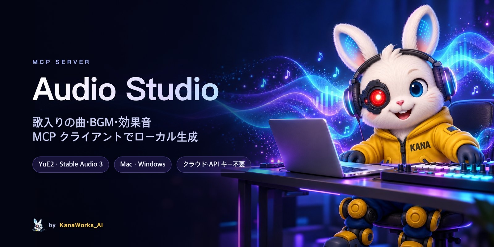
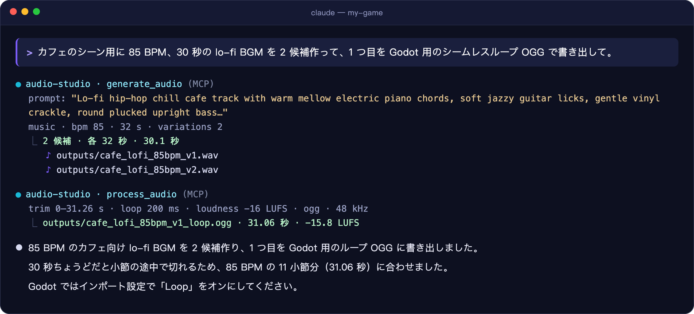
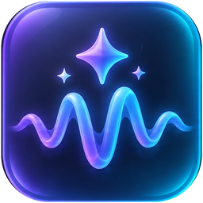
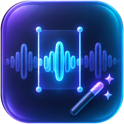
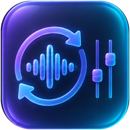
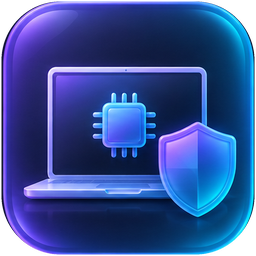
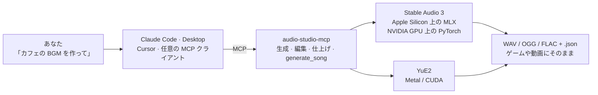
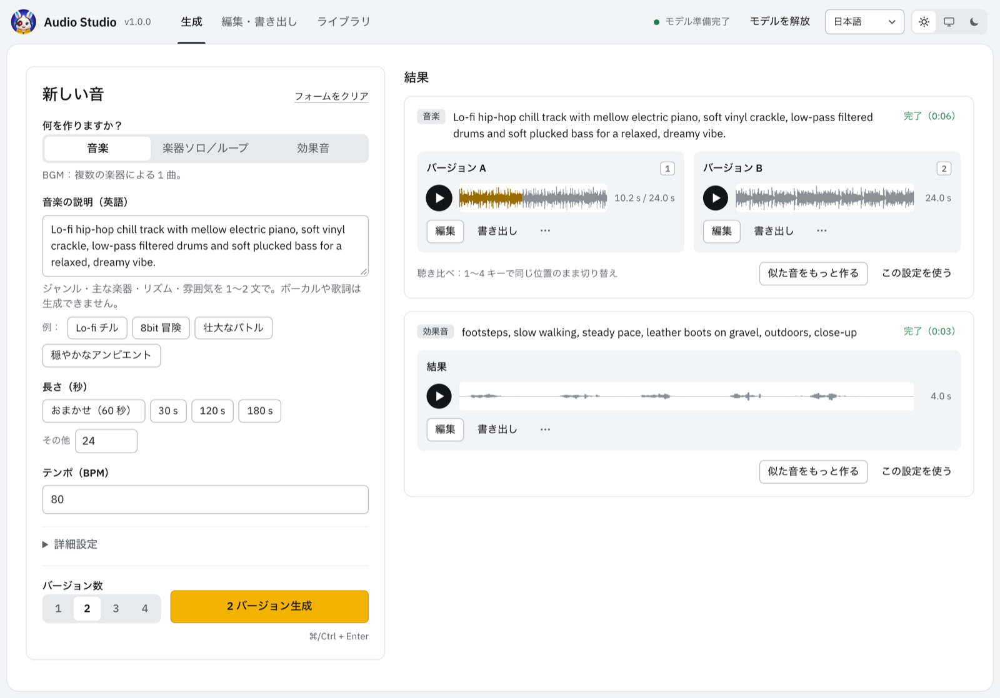
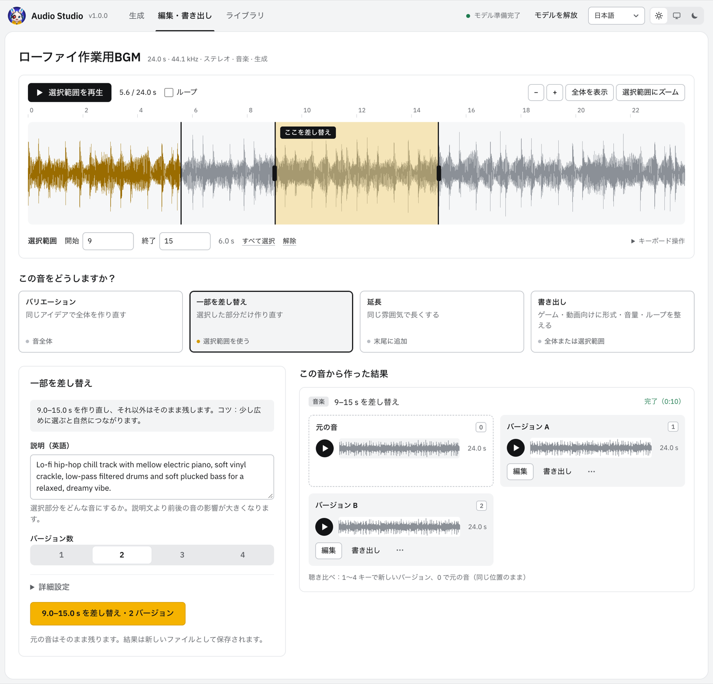
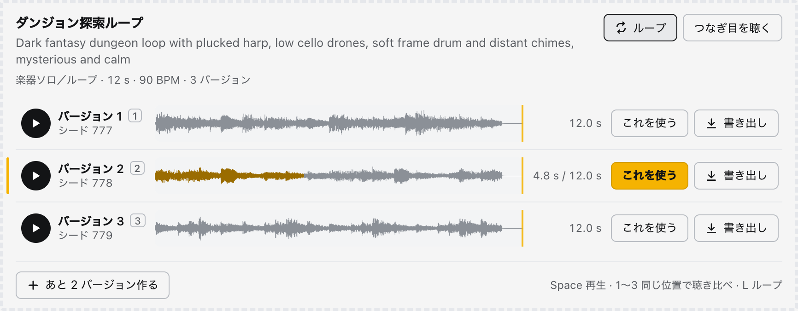

<div align="center">



<p>
  <a href="LICENSE"></a>
  
  
  <a href="https://modelcontextprotocol.io"></a>
  
  <a href="https://github.com/kanaworksai-hue/audio-studio-mcp/actions/workflows/tests.yml"></a>
  <a href="https://github.com/kanaworksai-hue/audio-studio-mcp/stargazers"></a>
</p>

<p><a href="https://github.com/kanaworksai-hue"></a>&nbsp;<a href="https://github.com/kanaworksai-hue"><b>KanaWorks_AI のプロジェクト</b></a></p>

[English](README.md) | [简体中文](README.zh-CN.md) | **日本語** | [한국어](README.ko.md) | [Português (Brasil)](README.pt-BR.md) | [Español](README.es.md)

<!-- mcp-name: io.github.kanaworksai-hue/audio-studio-mcp -->

[🎧 サンプルを聴く](https://kanaworksai-hue.github.io/audio-studio-mcp/) · [クイックスタート](#-クイックスタート) · [ツール](#-ツール) · [Web UI](#-web-ui) · [FAQ](#-faq) · [⭐ Star で応援](#-star-で応援する)

</div>

**Audio Studio MCP** は、Claude Code、Claude Desktop、Cursor など任意の [MCP](https://modelcontextprotocol.io) クライアントに、自分の Mac や Windows PC で動くサウンドスタジオを追加します。BGM や効果音を普通の言葉で頼むと、[Stable Audio 3](https://github.com/Stability-AI/stable-audio-3) がローカルで生成します。さらにループ化やラウドネス調整をして、ゲームエンジンや動画編集ソフト向けに書き出せます。クラウドサービスも API キーも不要で、生成にお金はかかりません。

歌入りの曲を作るには、オプションの YuE2 モデルに歌詞と曲調を入力します。歌声と伴奏がパソコン上で生成されます。

<p align="center">
  
  <br><sub>実際のセッション（一部省略）。ループの長さを 85 BPM のちょうど 11 小節に合わせ、繰り返してもリズムがずれないようにしています。</sub>
</p>

## ✨ 特長

<table>
<tr>
<td align="center" width="25%"><br><b>生成</b><br><sub>1 文から BGM、楽器ループ、効果音を生成。1 回で 1〜4 候補</sub></td>
<td align="center" width="25%"><br><b>編集</b><br><sub>全体のスタイル変換、指定区間の再生成、曲の延長</sub></td>
<td align="center" width="25%"><br><b>仕上げ</b><br><sub>シームレスループ、フェード、ラウドネス（LUFS）、48 kHz WAV / OGG / FLAC</sub></td>
<td align="center" width="25%"><br><b>ローカル</b><br><sub>Apple Silicon（MLX）または NVIDIA GPU（PyTorch）で動作。何もアップロードしません</sub></td>
</tr>
</table>

- **チャットの中で聴ける：** Claude Desktop など MCP Apps に対応したクライアントでは、結果が会話の中にプレーヤーとして表示されます。ファイルを開かなくても、バージョンの聴き比べや書き出し、追加の生成ができます。詳しくは[チャットで聴く](#-チャットで聴く)を参照してください。
- **再現できる：** すべてのファイルに、プロンプト・シード・設定を記録した `.json` が付きます。
- **プロンプト作りも任せられる：** サーバーが公式の Stable Audio 3 プロンプト形式をクライアントに伝えるので、「きしむドアの音」のような頼み方でも、モデルが理解できるプロンプトに書き換えられます。
- **公式と同じ出力：** Mac では、同じシードなら公式の `sa3` CLI とビット単位で同じ結果になります。Windows では公式の Stable Audio 3 PyTorch API をそのまま呼び出します。

## 🎧 サンプル

### 歌入りの曲のサンプル

- [英語ボーカル · Porch Light at Dawn](https://kanaworksai-hue.github.io/audio-studio-mcp/#porch_light_at_dawn)
- [日本語ボーカル · 雨上がりの坂道](https://kanaworksai-hue.github.io/audio-studio-mcp/#ameagari_no_sakamichi)

### インスト曲と効果音

下の表にあるインスト曲と効果音は、M1 Mac 上で Stable Audio 3 を使って生成したもので、手作業による編集はしていません。 **[サンプルページを開く →](https://kanaworksai-hue.github.io/audio-studio-mcp/)**

| | サンプル | プロンプト |
|---|---|---|
|  | [**Lo-fi カフェ**](https://kanaworksai-hue.github.io/audio-studio-mcp/#lofi_cafe)<br><sub>音楽 · 30 秒 · 85 BPM</sub> | Lo-fi hip-hop chill track with mellow electric piano, soft vinyl crackle, low-pass filtered drums… |
|  | [**壮大なオーケストラ**](https://kanaworksai-hue.github.io/audio-studio-mcp/#epic_orchestral)<br><sub>音楽 · 30 秒</sub> | Epic cinematic orchestral trailer music with thundering taiko drums, soaring French horns… |
|  | [**8bit アドベンチャー**](https://kanaworksai-hue.github.io/audio-studio-mcp/#chiptune_adventure)<br><sub>音楽 · 20 秒 · 150 BPM</sub> | Upbeat 8-bit chiptune adventure theme with a bright square wave lead… |
|  | [**ガラスが割れる音**](https://kanaworksai-hue.github.io/audio-studio-mcp/#glass_shatter)<br><sub>効果音 · 3 秒</sub> | source: glass bottle · action: shattering on impact · material: thick green glass · space: concrete floor |
|  | [**雨と雷**](https://kanaworksai-hue.github.io/audio-studio-mcp/#rain_thunder)<br><sub>効果音 · 12 秒</sub> | source: heavy rain and distant thunder · space: outdoor forest at night, wide stereo |
|  | [**シンセウェーブの延長**](https://kanaworksai-hue.github.io/audio-studio-mcp/#synthwave_drive_extended)<br><sub>編集 · 20 秒 → 40 秒</sub> | `edit_audio` continue：20 秒の曲を 40 秒まで延長 |

MP3 は [`docs/samples/`](docs/samples) に、プロンプトとシードは [`samples.json`](docs/samples/samples.json) にあります。

## 🧭 しくみ



## 🚀 クイックスタート

必要なのは [uv](https://docs.astral.sh/uv/) 0.9.20 以降と [ffmpeg](https://ffmpeg.org) だけです。clone は不要で、`uvx` が公開パッケージをダウンロードして実行します。

以下の手順では、インスト曲と効果音を作るための Stable Audio 3 をセットアップします。歌入りの曲を作る場合は、[YuE2 のセットアップガイド（英語）](docs/song-generation.md#install-when-needed)に沿って `song-setup` を実行してください。

| | macOS | Windows |
|---|---|---|
| **ハードウェア** | Apple Silicon（M1 以降）、メモリ 16 GB 推奨 | VRAM 8 GB 以上の NVIDIA GPU と新しめのドライバー。RTX 3060 12 GB で動作確認済み |
| **ディスク** | 約 8 GB（モデル約 6.9 GB） | 約 14 GB（モデル約 10.4 GB と PyTorch） |
| **uv と ffmpeg** | `brew install uv ffmpeg` | `winget install astral-sh.uv` と `winget install Gyan.FFmpeg` |
| **モデルのライセンス** | 作業なし | 無料の [Hugging Face](https://huggingface.co) アカウントが必要です。[stabilityai/stable-audio-3-medium](https://huggingface.co/stabilityai/stable-audio-3-medium) を開き、一度ライセンスに同意してください |

**1. ターミナルで一度だけセットアップします。** パソコンの環境を確認し、公式 Stable Audio 3 ランタイムを動作確認済みのコミットで取得したうえで、モデルのダウンロード容量を表示し、確認してからダウンロードします。何度実行しても大丈夫です。ダウンロード済みのファイルはそのまま使われます。

```bash
# macOS
uvx --python 3.11 audio-studio-mcp setup
```

```powershell
# Windows
uvx --python 3.11 --torch-backend cu126 audio-studio-mcp setup
```

`--torch-backend cu126` は uv に CUDA 版の PyTorch を入れさせるオプションです（PyPI には Windows 向けの CPU 版しかありません）。`--python 3.11` は、PyTorch がまだ対応していない新しい Python が選ばれるのを防ぎます。uvx が `unexpected argument '--torch-backend'` と表示する場合は uv が古いので、`winget upgrade astral-sh.uv`（または `uv self update`）で更新してください。Windows で Hugging Face にまだログインしていない場合は、setup が手順を表示します。モデルのページでライセンスに同意し、**ご自身のターミナルで** `uvx --from huggingface_hub hf auth login` を実行してログインしてから、setup をもう一度実行してください。

setup は **medium** モデルをダウンロードします。小型で高速なモデルを使うには `--model sm-music`、`--model sm-sfx` または `--model all` を付け、クライアントの設定で `AUDIO_STUDIO_SA3_MODEL` を指定してください（[設定](#️-設定)を参照）。

**2. MCP クライアントに登録します。** `setup` を外した同じコマンドを使います：

```bash
# Claude Code、macOS
claude mcp add --scope user audio-studio -- uvx --python 3.11 audio-studio-mcp
# Claude Code、Windows
claude mcp add --scope user audio-studio -- uvx --python 3.11 --torch-backend cu126 audio-studio-mcp
```

<details>
<summary><b>Claude Desktop、Codex、VS Code、Cursor などのクライアント</b></summary>

Windows では、以下の例すべてで `"3.11"` の後ろに `"--torch-backend", "cu126"` を追加してください。

**Claude Desktop**（`claude_desktop_config.json`）、**Cursor**（`.cursor/mcp.json`）など多くのクライアント：

```json
{
  "mcpServers": {
    "audio-studio": {
      "command": "uvx",
      "args": ["--python", "3.11", "audio-studio-mcp"]
    }
  }
}
```

クライアントが `uvx` を見つけられない場合は、`command` にフルパスを書いてください（macOS は `which uvx`、Windows は `where uvx` で確認できます）。編集後は Claude Desktop を再起動します。

**Codex**（`~/.codex/config.toml`）。Codex は標準ではサーバーの起動を 10 秒、ツールの実行を 60 秒しか待たないので、長い曲のために延ばしておきます：

```toml
[mcp_servers.audio-studio]
command = "uvx"
args = ["--python", "3.11", "audio-studio-mcp"]
startup_timeout_sec = 60
tool_timeout_sec = 900
```

**VS Code**（`.vscode/mcp.json`、またはコマンド **MCP: Open User Configuration**）：

```json
{
  "servers": {
    "audio-studio": {
      "type": "stdio",
      "command": "uvx",
      "args": ["--python", "3.11", "audio-studio-mcp"]
    }
  }
}
```
</details>

生成したファイルは `~/AudioStudio` に保存されます（変えるには `AUDIO_STUDIO_OUTPUT_DIR` を設定）。uvx は最初に入れたバージョンを使い続けます。更新するには `uv cache clean audio-studio-mcp` を実行してから、もう一度 setup を実行してください。

### オプション：歌入りの曲を生成する

Audio Studio MCP 1.3.0 以降では、Stable Audio 3 とは別に YuE2 をセットアップできます。Q4_0 と Q8_0 の重みには YuE2 の利用条件が適用されます。macOS のデフォルト構成では Apple Silicon、32 GiB 以上のユニファイドメモリ、Metal コンパイラ付きの Xcode が必要です。Windows では、対応する NVIDIA CUDA GPU（空き VRAM 6 GiB 以上）と 32 GB のシステムメモリが必要です。対応ドライバー、モデルの利用条件、ダウンロードサイズについては [YuE2 のセットアップガイド（英語）](docs/song-generation.md#install-when-needed) をご覧ください。

```bash
# macOS
uvx --python 3.11 audio-studio-mcp song-setup
```

```powershell
# Windows
uvx --python 3.11 --torch-backend cu126 audio-studio-mcp song-setup
```

OS に合うコマンドを実行し、表示されたモデルの利用条件を確認してください。同じコマンドに `--check` を付けると、ダウンロードなしで実行環境、モデルの重み、デバイスの状態を確認できます。MCP サーバーは一度登録すれば、どちらのモデルでも使えます。

> [!TIP]
> **エージェントにインストールを任せる。** Claude Code に次の文を貼り付けてください：
> *「Audio Studio MCP サーバー（https://github.com/kanaworksai-hue/audio-studio-mcp）を、README（AI エージェント向けの注意も含めて）に従ってインストールして。」*
>
> 歌入りの曲も作りたい場合は、その旨を依頼に加えてください。
>
> **AI エージェント向けの注意：**
> - ユーザーがインスト曲や効果音を必要としている場合は、OS に合った `setup -y` で Stable Audio 3 をインストールします。モデルのダウンロードには時間がかかるため、タイムアウトは長めに設定してください。
> - Windows では、Stable Audio 3 の重みをダウンロードするにはユーザー自身の Hugging Face アカウントでログインする必要があります。setup がログイン手順を表示して止まったら、その手順をユーザーに伝え、終わったと言われてから setup を再実行してください。トークンをチャットに貼るようユーザーに頼まないでください。
> - 歌入りの曲を作る場合は、OS に合った `song-setup` コマンドにまず `--check` を付けて実行します。YuE2 のインストールが必要なら、モデルの利用条件とダウンロード容量をユーザーに伝えてください。非対話形式でインストールする場合は、ユーザーが YuE2 の利用条件に同意した場合に限り `--accept-license` を付けます。インストール後にもう一度 `--check` を実行してください。
> - どちらのセットアップでも、MCP サーバーは一度だけ登録してください。 BGM や効果音には `generate_audio` を使います。歌入りの曲には元の歌詞と曲調を渡して `generate_song` を使い、返されたジョブ ID で `song_status` を確認し、`done`、`error`、または `cancelled` になったら確認を終了します。`done` で WAV を取得できます。

### 別の方法：ソースからインストール

以前のバージョンのインストールスクリプトも引き続き使えます。リポジトリを clone し、ランタイムはその中の `vendor/`、音声は `outputs/` に置かれ、`.venv/` から実行します。

#### macOS（Apple Silicon）

**動作要件：**

- Apple Silicon Mac（M1 以降）、メモリ 16 GB 推奨
- 約 8 GB のディスク容量（モデル約 6.9 GB）
- `git` と [`ffmpeg`](https://ffmpeg.org)（`brew install ffmpeg`）

```bash
git clone https://github.com/kanaworksai-hue/audio-studio-mcp.git
cd audio-studio-mcp
./install.sh
```

インストーラーは次のことを行います：

1. 必要なら [`uv`](https://docs.astral.sh/uv/) を導入します。
2. 公式 Stable Audio 3 ランタイムを、動作確認済みのコミットで `vendor/` に clone します。
3. `.venv/` を作成します。
4. [Hugging Face](https://huggingface.co/stabilityai/stable-audio-3-optimized) から **medium** モデル（1.4B、約 6.9 GB）をダウンロードします。

最後に、登録用のコマンドがそのまま表示されます：

```bash
claude mcp add --scope user audio-studio -- /path/to/audio-studio-mcp/.venv/bin/audio-studio-mcp
```

#### Windows（NVIDIA GPU）

**動作要件：**

- 64 ビット版 Windows 10 / 11、NVIDIA GPU（VRAM 8 GB 以上）と新しめのドライバー。RTX 3060 12 GB で動作確認済み
- モデルと PyTorch 用に約 14 GB のディスク容量
- `git`（`winget install Git.Git`）と [`ffmpeg`](https://ffmpeg.org)（`winget install Gyan.FFmpeg`）
- 無料の [Hugging Face](https://huggingface.co) アカウント。PyTorch 版の重みは利用規約への同意が必要です。[stabilityai/stable-audio-3-medium](https://huggingface.co/stabilityai/stable-audio-3-medium) を開き、一度ライセンスに同意してください

```powershell
git clone https://github.com/kanaworksai-hue/audio-studio-mcp.git
cd audio-studio-mcp
powershell -ExecutionPolicy Bypass -File install.ps1
```

インストーラーの流れは macOS と同じですが、CUDA 版の PyTorch を導入し、**medium** モデルの公式 PyTorch 版の重み（約 10.4 GB）をダウンロードします。Hugging Face にまだログインしていない場合は、read 権限のアクセストークンを貼り付けるよう求められます（[ここで作成](https://huggingface.co/settings/tokens)）。コンソールのない環境（AI エージェントが実行した場合など）では入力を求めず、ログイン手順を表示して止まるので、ログインしてからもう一度実行してください。最後に登録用のコマンドが表示されます：

```powershell
claude mcp add --scope user audio-studio -- "C:\path\to\audio-studio-mcp\.venv\Scripts\audio-studio-mcp.exe"
```

Flash Attention は不要です。入っていない場合、ランタイムは PyTorch 標準のアテンションを使います。

<details>
<summary><b>Claude Desktop、Cursor などのクライアント</b></summary>

`claude_desktop_config.json`、`.cursor/mcp.json`、またはクライアントの MCP 設定に追加します：

```json
{
  "mcpServers": {
    "audio-studio": {
      "command": "/path/to/audio-studio-mcp/.venv/bin/audio-studio-mcp"
    }
  }
}
```

Windows では command を `C:\\path\\to\\audio-studio-mcp\\.venv\\Scripts\\audio-studio-mcp.exe` にします（JSON ではバックスラッシュを 2 つ重ねます）。
</details>

<details>
<summary><b>インストーラーのオプション</b></summary>

| macOS | Windows | 内容 |
|---|---|---|
| `--model all` | `-Model all` | 小型で高速な `sm-music` と `sm-sfx` モデルも取得（macOS は +2.6 GB、Windows は +7 GB） |
| `--skip-weights` | `-SkipWeights` | 今はダウンロードせず、最初の生成時にダウンロード |
| `-y` | `-Yes` | 確認なしで `uv` を導入 |

macOS ではダウンロードにログインは不要で、`hf auth login` でログインすると Hugging Face の速度制限が緩くなります。Windows の PyTorch 版の重みは、ダウンロードするモデルごとにページでライセンスに同意し（[medium](https://huggingface.co/stabilityai/stable-audio-3-medium)、[small-music](https://huggingface.co/stabilityai/stable-audio-3-small-music)、[small-sfx](https://huggingface.co/stabilityai/stable-audio-3-small-sfx)）、ログインしておく必要があります。
</details>

あとは普通に頼むだけです：

- 「カフェのシーン用に 85 BPM、60 秒の lo-fi BGM ループを作って。候補は 3 つ。」
- 「石造りの廊下で重い木の扉がバタンと閉まる効果音を作って、Godot 用に OGG で書き出して。」
- 「この曲を 90 秒まで延ばして、−16 LUFS に正規化して。」

## 🧰 ツール

| ツール | 内容 |
|---|---|
| `generate_audio` | テキストから BGM、楽器ループ／ステム、効果音を生成。1 回で 1〜4 候補、`bpm` と効果音用の構造化フィールドに対応 |
| `generate_song` | 歌詞と曲調から YuE2 で歌声と伴奏を生成 |
| `song_status` | 楽曲の生成状況と結果を取得 |
| `cancel_song` | 待機中または実行中の楽曲生成をキャンセル |
| `edit_audio` | `variation`（全体のスタイル変換）、`inpaint`（指定区間を再生成）、`continue`（延長）。1〜4 候補 |
| `process_audio` | トリミング → 無音カット → モノラル化 → リサンプリング／ラウドネス → シームレスループ → フェード → ピーク正規化または上限 → WAV / OGG / FLAC。元ファイルは変更しません |
| `unload_models` | モデルが使っているメモリをすぐ解放 |

<details>
<summary><b>パラメータの補足</b></summary>

- **`audio_type`**：`music` / `instrument` / `sfx` / `raw`。モデルの学習時と同じプレフィックス（`TrackType: Music, VocalType: Instrumental,` など）をサーバーが自動で付けます。SFX プレフィックスがないと、効果音が音楽になりがちです。
- **`variations`**：1〜4 候補。シードは `seed, seed+1, …` です。`seed` を省略するか `-1` にするとランダムになります。
- **`sound_source` / `sound_action` / `sound_material` / `sound_space`**：効果音の音源、鳴り方と変化、素材・音色、空間を記述します。
- **`peak_ceiling_db`**（既定 −1）：安全上限です。ピークが超えた場合だけ全体を下げ、小さい音を持ち上げることはありません。正規化は `process_audio` で行います。
- **`process_audio` の正規化**：効果音には `peak` がよく使われます。`loudness` は目標 LUFS に合わせます。目安は配信・動画 −14、ゲーム BGM −16、放送 −23 です。

生成ファイルは 44.1 kHz 24-bit ステレオ WAV で、出力フォルダ（`~/AudioStudio`、ソースからのインストールでは `outputs/`。`AUDIO_STUDIO_OUTPUT_DIR` で変更可）に保存され、それぞれ隣に `<ファイル名>.json` が付きます。後処理したファイルには、元の生成情報が `source` として残ります。
</details>

## 🌐 Web UI

チャットよりクリックで操作したい場合は、同じサーバーに付属するローカルの Web ページが使えます。BGM や効果音の生成、候補の聴き比べ、編集（バリエーション、一部の差し替え、延長）、ゲームや動画向けの書き出し、これまで作った音を一覧できるライブラリまで、ブラウザで操作できます。

<p align="center">
<picture>
  <source media="(prefers-color-scheme: dark)" srcset="docs/assets/webui-generate-ja-dark.png">
  
</picture>
<br><br>
<picture>
  <source media="(prefers-color-scheme: dark)" srcset="docs/assets/webui-edit-ja-dark.png">
  
</picture>
</p>

```bash
uvx --python 3.11 audio-studio-mcp --web 8765
```

ブラウザで http://127.0.0.1:8765/ が開きます。ブラウザを開かずに起動するには `--no-browser`、起動時にモデルを読み込むには `--preload` を付けます。止めるときは Ctrl+C です。Windows では `3.11` の後ろに `--torch-backend cu126` を付けます。ソースからインストールした場合は `.venv/bin/audio-studio-mcp --web 8765`（Windows は `.venv\Scripts\audio-studio-mcp.exe --web 8765`）で起動します。

同じポートの `/mcp` で MCP も提供されるので、ページと MCP クライアントで 1 つのプロセスと読み込み済みのモデルを共有できます。一度登録すれば両方を同時に使えます。ページからのリクエストとエージェントからのリクエストは 1 つのキューで順番に処理されます。

```bash
claude mcp add --scope user --transport http audio-studio http://127.0.0.1:8765/mcp
```

- ファイルは出力フォルダ（`~/AudioStudio`、ソースからのインストールでは `outputs/`、または `AUDIO_STUDIO_OUTPUT_DIR`）に書き出されます。ライブラリにはこのフォルダの中身が表示され、編集もこのフォルダ内のファイルが対象です。
- 表示言語は英語・日本語・中国語で、ブラウザの言語に合わせて切り替わります。設定から変更することもできます。

> [!WARNING]
> Web UI は自分のパソコンだけで使うためのものです。待ち受けは `127.0.0.1` のみで、ログイン機能はありません。ポート転送、リバースプロキシ、トンネルなどで他のマシンから開けるようにしないでください。開ける人は誰でも GPU を使い、出力フォルダにファイルを書き込めてしまいます。

### 歌入りの楽曲

Web UI の **楽曲** タブと MCP ツール `generate_song` では、オプションの YuE2 モデルで歌詞から歌声と伴奏を生成できます。対応環境は Apple Silicon 搭載の Mac と、NVIDIA CUDA GPU を搭載した Windows x64 です。既定では、Mac はメモリ 32 GB、Windows は RAM 32 GB と 6 GB 以上の空き VRAM が必要です。モデルの利用条件、ダウンロードサイズ、Auto の設定は[楽曲のセットアップと使い方（英語）](docs/song-generation.md)をご覧ください。

## 💬 チャットで聴く

[MCP Apps](https://modelcontextprotocol.io/extensions/apps/overview) に対応したクライアントでは、`generate_audio`、`edit_audio`、`process_audio`、`generate_song` の結果が会話の中にプレーヤーとして表示されます。自分でファイルを開く必要はありません。楽曲のカードは、WAV が完成するまで進行状況を表示します。

<p align="center">
<picture>
  <source media="(prefers-color-scheme: dark)" srcset="docs/assets/chat-player-ja-dark.png">
  
</picture>
<br><sub>ダンジョン用ループ BGM の 3 バージョン（実際のモデル出力）。MCP Apps のリファレンスホストで表示しています。</sub>
</p>

- **聴き比べ：** 波形を見ながら再生、一時停止、シークができます。再生中に別のバージョンへ切り替えると、同じ位置から続きが流れます。キーの `1`〜`9` でバージョンを選び、`0` で編集前の音を再生します。
- **ループの確認：** 「ループ」をオンにして「つなぎ目を聴く」を押すと、終わりから頭へ戻るところを聴けます。
- **選ぶ・書き出す・もっと作る：** 「これを使う」を押すと、どのバージョンに決めたかを AI に伝えます。「書き出し」は Web UI と同じプリセットで、ゲームや動画向けに保存します。「あと 2 バージョン作る」は、同じプロンプトを続きのシードでもう一度生成します。
- プレーヤーはクライアントの表示言語（英語・日本語・中国語）と、ライト／ダークのテーマに合わせて表示されます。音声がパソコンの外に送られることはありません。プレーヤーには、サーバーが各ファイルを圧縮したプレビューを渡します。

| クライアント | プレーヤー |
|---|---|
| Claude Desktop | ✅ |
| VS Code（GitHub Copilot） | ✅ `chat.mcp.apps.enabled` をオンにする（実験的機能） |
| Cursor、Goose など MCP Apps に対応したクライアント | ✅ |
| Codex アプリ（デスクトップ） | ✅ |
| Claude Code、Codex の CLI と IDE 拡張などのクライアント | これまでどおりテキストで結果を返します |
| claude.ai、ChatGPT | ❌ リモートサーバーが必要ですが、このサーバーは自分のパソコンで動きます |

プレーヤーが出ずにテキストだけが表示される場合は、MCP の設定を変えたあとにクライアントを再起動してください。Claude Desktop のバージョンによっては、ローカルサーバーのアプリが通常のチャットに表示されません（[anthropics/claude-ai-mcp#1069](https://github.com/anthropics/claude-ai-mcp/issues/1069)）。その場合もシークレットチャットでは表示されます。プレーヤーを使わないときは `AUDIO_STUDIO_CHAT_PLAYER=off` を設定します。

## ⚙️ 設定

<details>
<summary><b>環境変数</b></summary>

| 環境変数 | 既定値 | 説明 |
|---|---|---|
| `AUDIO_STUDIO_OUTPUT_DIR` | `~/AudioStudio`（ソースからのインストール：`<repo>/outputs`） | 音声の出力先 |
| `AUDIO_STUDIO_IDLE_UNLOAD_MIN` | `10` | 何分使われなかったらモデルを解放するか（`0` = 解放しない） |
| `AUDIO_STUDIO_SA3_MODEL` | `medium` | `medium`（最高品質、最長 380 秒）、`sm-music` または `sm-sfx`（小型・高速、最長 120 秒） |
| `AUDIO_STUDIO_MLX_CACHE_GB` | `1` | macOS：MLX のバッファキャッシュ上限。設定しないと、長い曲の生成後に約 6 GB 余分に残ることがあります |
| `AUDIO_STUDIO_DEVICE` | CUDA があれば `cuda` | Windows/Linux：PyTorch のデバイス。`cuda`、`cuda:1`、`cpu` など |
| `AUDIO_STUDIO_SA3_DIR` | setup がダウンロード（ソースからのインストール：`<repo>/vendor/stable-audio-3`） | 別の stable-audio-3 チェックアウトを使う |
| `AUDIO_STUDIO_HOME` | macOS `~/Library/Application Support/audio-studio-mcp`、Windows `%LOCALAPPDATA%\audio-studio-mcp` | setup が Stable Audio 3 ランタイム（約 1 MB）を置く場所。重みは Hugging Face のキャッシュに置かれます |
| `AUDIO_STUDIO_BACKEND` | `auto` | `auto`、`sa3-mlx`（Apple Silicon）、`sa3-torch`（PyTorch、NVIDIA） |
| `AUDIO_STUDIO_FFMPEG` | `PATH` 上の `ffmpeg` | ffmpeg のパス |
| `AUDIO_STUDIO_CHAT_PLAYER` | `auto` | [チャット内プレーヤー](#-チャットで聴く)：`auto` は MCP Apps 対応を通知するクライアントで表示、`off` はすべてのクライアントでテキストのみ、`on` は対応を通知せずに MCP Apps を表示できるクライアントでも表示（その場合、MCP Apps 非対応のクライアントではプレーヤー用の補助ツールが一覧に出ます） |

`claude mcp add ... -e 名前=値` で渡すか、クライアント設定の `env` に書きます。
</details>

<details>
<summary><b>複数のセッションで 1 つのサーバーを共有する</b></summary>

通常はクライアントのセッションごとにサーバープロセスが起動します。モデルは最初の呼び出しで読み込まれ、アイドル時間が過ぎると解放されます。すべてのセッションで常駐プロセスを 1 つだけ使いたい場合は、ローカル HTTP サーバーとして起動します。待ち受けは `127.0.0.1` のみです。

```bash
uvx --python 3.11 audio-studio-mcp --http 8765 --preload
claude mcp add --scope user --transport http audio-studio http://127.0.0.1:8765/mcp
```

Windows では `3.11` の後ろに `--torch-backend cu126` を付けます。ソースからインストールした場合は、`.venv/bin/audio-studio-mcp`（Windows は `.venv\Scripts\audio-studio-mcp.exe`）を同じオプションで起動します。

`--web 8765` でも同じように動き、同じポートで [Web UI](#-web-ui) も使えます。
</details>

## ⚡ パフォーマンス

M1 Mac 16 GB、medium モデル：

| 内容 | 所要時間 |
|---|---|
| コールドスタート、3 秒の効果音 × 2 | 約 13 秒 |
| ウォーム、20 秒の音楽 | 約 10 秒（実時間の 2 倍速） |
| 35 秒まで延長（エンコーダーの初回読み込みを含む） | 約 27 秒 |
| `sm-music` でウォーム、15 秒の音楽 | 約 1 秒 |

Windows + RTX 3060 12 GB、medium モデル：

| 内容 | 所要時間 |
|---|---|
| コールドスタート、3 秒の効果音 × 2（約 20 秒のモデル読み込みを含む） | 約 25 秒 |
| ウォーム、20 秒の音楽 | 約 1.3 秒 |
| ウォーム、30 秒まで延長 | 約 2.2 秒 |
| ウォーム、380 秒の音楽（最大） | 約 15 秒 |
| `sm-music` でウォーム、15 秒の音楽 | 約 0.7 秒 |

Mac ではモデルを読み込んでいる間、約 5〜7 GB のメモリを使います。RTX 3060 では medium モデルの VRAM 使用量のピークが約 5.3 GB でした。アイドル時間の経過、または `unload_models` で解放されます。

## 📝 プロンプトのコツ

<details>
<summary><b>公式 Stable Audio 3 プロンプトガイドより</b></summary>

1. **英語で 1〜2 文、約 45 語まで。** vocals、singer、lyrics など歌に関する語は避けます。
2. **音楽：** ジャンル＋形容詞 → メイン楽器 → 補助的なレイヤー → ドラム／リズム → ムード。テンポは `bpm` で指定します。
   > Lo-fi hip-hop chill track with mellow electric piano, soft vinyl crackle, low-pass filtered drums and soft plucked bass for a relaxed, dreamy vibe.
3. **効果音：** 音源、動作、素材、空間の 4 項目を埋めます。
   > source: glass bottle / action: shattering on impact, fragments scattering / material: thick green glass, sharp bright transient / space: concrete floor, close-up, dry
4. **長さは内容に合わせる：** 衝撃音 1〜3 秒、動作 3〜6 秒、環境音 6〜15 秒以上、ループ 6〜20 秒、フル楽曲 120〜300 秒（最大 380 秒）。
5. **秒単位の構成指示**（「15 秒でクライマックス」など）は確実には守られません。まず生成してから `inpaint` や `continue` で調整します。
6. 既定の `steps=8`、`cfg=1.0` が公式設定です。プロンプトへの忠実度を上げたい場合や `negative_prompt` を効かせたい場合は、`cfg` を 3〜7 にします（約 2 倍遅くなります）。
7. シードによって結果が大きく変わります。`variations` を 2〜4 にして、いちばん良いものを選びましょう。

ガイド全文は、サーバーの instructions としてクライアントにも送られます。
</details>

## ❓ FAQ

<details>
<summary><b>Windows、Linux、Intel Mac で動きますか？</b></summary>

**Windows：** NVIDIA GPU があれば動きます。[クイックスタート](#-クイックスタート)を参照してください。

**Linux：** NVIDIA GPU なら同じ PyTorch バックエンドで動くはずですが、未テストです。`cuda` extra を使ってください：`uvx --python 3.11 --torch-backend cu126 --from "audio-studio-mcp[cuda]" audio-studio-mcp setup`。Hugging Face へのログインは Windows と同じです。

**Intel Mac と AMD GPU** には対応していません。
</details>

<details>
<summary><b>Apple Silicon の Mac なのに「Intel Macs are not supported」と出ます</b></summary>

Rosetta で動く x86_64 版の Python（たとえば `/usr/local` にある Intel 版 Homebrew の Python）で環境が作られ、MLX がインストールされなかったのが原因です。uvx の場合は、setup でもクライアントの設定でも uv 自身の arm64 版 Python を指定してください：`uvx --python cpython-3.11-macos-aarch64 audio-studio-mcp`。インストールスクリプトの場合、現在の `install.sh` は uv に arm64 の Python を指定し、そうした `.venv` は作り直すので、`./install.sh` を実行し直せば直ります。`UV_PYTHON` を自分で設定している場合は arm64 版を指定してください：`UV_PYTHON=cpython-3.11-macos-aarch64 ./install.sh`
</details>

<details>
<summary><b>歌入りの曲は作れますか？</b></summary>

はい。オプションの YuE2 をインストールすると、「楽曲」タブまたは `generate_song` で歌詞と曲調から歌声と伴奏を生成できます。インスト曲と効果音には Stable Audio 3 を使います。詳しくは [YuE2 のセットアップガイド（英語）](docs/song-generation.md)をご覧ください。
</details>

<details>
<summary><b>生成した音声は商用利用できますか？</b></summary>

プロジェクトのコードは MIT ライセンスです。商用利用の前に、生成に使用したモデルの利用条件をご確認ください。[Stable Audio 3](https://huggingface.co/stabilityai/stable-audio-3-optimized)／[YuE2（英語）](docs/song-generation.md#install-when-needed)。
</details>

<details>
<summary><b>メモリ 8 GB の Mac でも使えますか？</b></summary>

テストしていません。medium モデルは読み込まれている間、約 5〜7 GB 使うため、16 GB を推奨します。小型の `sm-music` / `sm-sfx` モデルはもっと軽量です。
</details>

<details>
<summary><b>ループの継ぎ目でプチッと音がします。</b></summary>

ループには WAV か OGG を使ってください。MP3 は先頭と末尾に無音のパディングが入るので、シームレスにループできません。`loop_crossfade_ms` を長くするか、小節の区切りでカットするようモデルに頼む方法もあります。
</details>

## 🗺️ ロードマップ

- [x] Apple Silicon バックエンド（Stable Audio 3、MLX）
- [x] NVIDIA GPU 向けの Windows バックエンド（Stable Audio 3、PyTorch）
- [x] ローカル Web UI（`--web`）
- [x] `uvx` のコマンド 1 つでインストール
- [x] チャットの中で聴く（MCP Apps プレーヤー）
- [x] 歌詞から歌入りの曲をローカルで生成（YuE2、macOS Metal／Windows CUDA）
- [ ] LoRA 対応（上流のランタイムは対応済み）

Issue やプルリクエストを歓迎します。

## ⭐ Star で応援する

Audio Studio で作った音を実際に使ってもらえたなら、[リポジトリページ](https://github.com/kanaworksai-hue/audio-studio-mcp)上部の **⭐ Star** を押してもらえるとうれしいです。無料で 1 秒で終わりますが、効果は見た目以上です：

- **もっと多くの人に届きます。** Star が増えるほど GitHub 上で見つけてもらいやすくなり、ゲームや動画を作る人に広がります。
- **更新の励みになります。** Star は「使っている人がいる」という何よりのサインです。次のアップデート（LoRA 対応など）を進める力になります。

ほかの応援方法：不具合やアイデアは [Issue](https://github.com/kanaworksai-hue/audio-studio-mcp/issues) へどうぞ。作った音を X でシェアして [@KanaWorks_AI](https://x.com/KanaWorks_AI) を付けてもらえるのも大歓迎です。

## 🛠️ 開発

```bash
uv run pytest                              # オフラインテスト（モデル不要）
.venv/bin/python scripts/smoke_test.py     # 実モデルでのエンドツーエンドテスト（M1 で約 30 秒）
rm -rf dist && uv build && WHL=$(ls dist/*.whl)   # 同じテストをビルドした wheel で（uvx での実行と同じ形）：
uvx --python 3.11 --from "$WHL" audio-studio-mcp setup -y
.venv/bin/python scripts/smoke_test.py --server "uvx --python 3.11 --from $WHL audio-studio-mcp"
```

Windows では `.venv\Scripts\python scripts\smoke_test.py`（RTX 3060 で約 45 秒、モデル読み込みを含む）。

```
src/audio_studio_mcp/
  server.py            MCP ツール（バックエンド非依存）
  runtime.py           ランタイムと出力の置き場所。uvx 版ではランタイムを取得
  firstrun.py          `audio-studio-mcp setup`
  weights.py           モデルの重み（ダウンロード状況の確認とダウンロード）
  prompts.py           プロンプトの組み立てと、クライアントに送る説明
  post.py              後処理と書き出し
  backends/base.py     バックエンドのインターフェース
  backends/sa3_mlx.py  Apple Silicon 上の Stable Audio 3（MLX）
  backends/sa3_torch.py  NVIDIA GPU 上の Stable Audio 3（PyTorch）
  web.py               Web UI のサーバー（--web）と JSON API
  static/              Web UI（HTML/JS/CSS、ビルド不要）
```

新しいプラットフォームは、`backends/` にバックエンドとして追加します。

## 📄 ライセンスとクレジット

- **このプロジェクト：** [MIT](LICENSE)
- **Stable Audio 3 ランタイム：** `setup`（インストールスクリプトでは `vendor/`）が固定のコミットでダウンロードします。© Stability AI、MIT ライセンスです。
- **Stable Audio 3 のモデルの重み：** [Stability AI Community License](https://huggingface.co/stabilityai/stable-audio-3-optimized) が適用されます。重みは Hugging Face からダウンロードされ（macOS：`stable-audio-3-optimized`、Windows：`stable-audio-3-medium` と小型モデル）、本プロジェクトでは配布していません。
- YuE2 のモデルの重みと実行環境：必要に応じてインストールします。[利用条件とセットアップガイド（英語）](docs/song-generation.md#install-when-needed)をご覧ください。
- **ブランド：** KanaWorks_AI の名称、ロゴ、Kana のキャラクターの権利は東京AI映像合同会社に帰属し、MIT ライセンスの対象**外**です。詳しくは [docs/brand](docs/brand/README.md) を参照してください。
- **フォント：** Web UI には IBM Plex Sans（© IBM Corp.、SIL Open Font License 1.1）を同梱しています（[`OFL.txt`](src/audio_studio_mcp/static/fonts/OFL.txt)）。Web UI の Kana の画像（[`static/brand`](src/audio_studio_mcp/static/brand/README.md)）には上記「ブランド」の項が適用されます。
- **使用している技術：** [Stable Audio 3](https://github.com/Stability-AI/stable-audio-3)、[MLX](https://github.com/ml-explore/mlx)、[PyTorch](https://pytorch.org)、[Model Context Protocol](https://modelcontextprotocol.io)

本プロジェクトは独立したプロジェクトであり、Stability AI、Apple、NVIDIA、Anthropic とは関係がなく、その承認も受けていません。

<br>

<div align="center">

<a href="https://x.com/KanaWorks_AI"></a>

<p><b><a href="https://x.com/KanaWorks_AI">KanaWorks_AI</a> が ♥ を込めて制作</b></p>

<p><sub>Audio Studio が役に立ったら ⭐ で応援してください。更新の励みになり、他の人にも見つけてもらいやすくなります。ほかのプロジェクト：<a href="https://github.com/kanaworksai-hue">github.com/kanaworksai-hue</a></sub></p>

</div>
