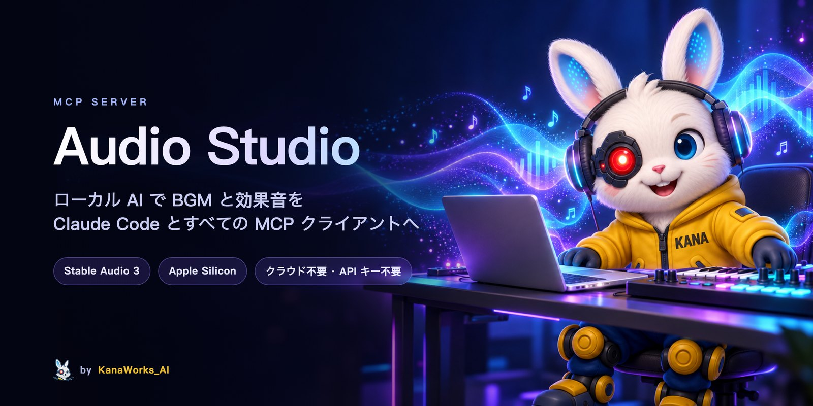
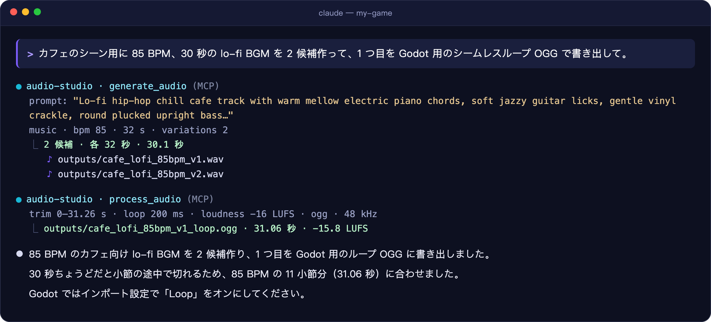
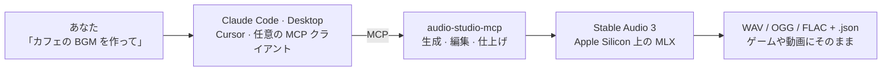

<div align="center">



<p>
  <a href="LICENSE"></a>
  
  <a href="https://modelcontextprotocol.io"></a>
  
  <a href="https://github.com/kanaworksai-hue/audio-studio-mcp/actions/workflows/tests.yml"></a>
  <a href="https://github.com/kanaworksai-hue/audio-studio-mcp/stargazers"></a>
</p>

<p><a href="https://github.com/kanaworksai-hue"></a>&nbsp;<a href="https://github.com/kanaworksai-hue"><b>KanaWorks_AI のプロジェクト</b></a></p>

[English](README.md) | [简体中文](README.zh-CN.md) | **日本語**

[🎧 サンプルを聴く](https://kanaworksai-hue.github.io/audio-studio-mcp/) · [クイックスタート](#-クイックスタート) · [ツール](#-ツール) · [FAQ](#-faq) · [⭐ Star で応援](#-star-で応援する)

</div>

**Audio Studio MCP** は、Claude Code、Claude Desktop、Cursor など任意の [MCP](https://modelcontextprotocol.io) クライアントに、自分の Mac で動くサウンドスタジオを追加します。BGM や効果音を普通の言葉で頼むと、[Stable Audio 3](https://github.com/Stability-AI/stable-audio-3) がローカルで生成します。さらにループ化やラウドネス調整をして、ゲームエンジンや動画編集ソフト向けに書き出せます。クラウドサービスも API キーも不要で、生成にお金はかかりません。

<p align="center">
  
  <br><sub>実際のセッション（一部省略）。ループの長さを 85 BPM のちょうど 11 小節に合わせ、繰り返してもリズムがずれないようにしています。</sub>
</p>

## ✨ 特長

<table>
<tr>
<td align="center" width="25%"><br><b>生成</b><br><sub>1 文から BGM、楽器ループ、効果音を生成。1 回で 1〜4 候補</sub></td>
<td align="center" width="25%"><br><b>編集</b><br><sub>全体のスタイル変換、指定区間の再生成、曲の延長</sub></td>
<td align="center" width="25%"><br><b>仕上げ</b><br><sub>シームレスループ、フェード、ラウドネス（LUFS）、48 kHz WAV / OGG / FLAC</sub></td>
<td align="center" width="25%"><br><b>ローカル</b><br><sub>Apple Silicon 上で MLX により動作。アカウント登録もアップロードも不要</sub></td>
</tr>
</table>

- **再現できる：** すべてのファイルに、プロンプト・シード・設定を記録した `.json` が付きます。
- **プロンプト作りも任せられる：** サーバーが公式の Stable Audio 3 プロンプト形式をクライアントに伝えるので、「きしむドアの音」のような頼み方でも、モデルが理解できるプロンプトに書き換えられます。
- **公式と同じ出力：** 同じシードなら、公式の `sa3` CLI とビット単位で同じ結果になります。

## 🎧 サンプル

すべてこのサーバーで M1 Mac 上で生成したもので、手作業での編集はしていません。**[サンプルページを開く →](https://kanaworksai-hue.github.io/audio-studio-mcp/)**

| | サンプル | プロンプト |
|---|---|---|
|  | [**Lo-fi カフェ**](https://kanaworksai-hue.github.io/audio-studio-mcp/#lofi_cafe)<br><sub>音楽 · 30 秒 · 85 BPM</sub> | Lo-fi hip-hop chill track with mellow electric piano, soft vinyl crackle, low-pass filtered drums… |
|  | [**壮大なオーケストラ**](https://kanaworksai-hue.github.io/audio-studio-mcp/#epic_orchestral)<br><sub>音楽 · 30 秒</sub> | Epic cinematic orchestral trailer music with thundering taiko drums, soaring French horns… |
|  | [**8bit アドベンチャー**](https://kanaworksai-hue.github.io/audio-studio-mcp/#chiptune_adventure)<br><sub>音楽 · 20 秒 · 150 BPM</sub> | Upbeat 8-bit chiptune adventure theme with a bright square wave lead… |
|  | [**ガラスが割れる音**](https://kanaworksai-hue.github.io/audio-studio-mcp/#glass_shatter)<br><sub>効果音 · 3 秒</sub> | source: glass bottle · action: shattering on impact · material: thick green glass · space: concrete floor |
|  | [**雨と雷**](https://kanaworksai-hue.github.io/audio-studio-mcp/#rain_thunder)<br><sub>効果音 · 12 秒</sub> | source: heavy rain and distant thunder · space: outdoor forest at night, wide stereo |
|  | [**シンセウェーブの延長**](https://kanaworksai-hue.github.io/audio-studio-mcp/#synthwave_drive_extended)<br><sub>編集 · 20 秒 → 40 秒</sub> | `edit_audio` continue：20 秒の曲を 40 秒まで延長 |

MP3 は [`docs/samples/`](docs/samples) に、プロンプトとシードは [`samples.json`](docs/samples/samples.json) にあります。

## 🧭 しくみ



## 🚀 クイックスタート

**動作要件：**

- Apple Silicon Mac（M1 以降）、メモリ 16 GB 推奨
- モデル用に約 6 GB のディスク容量
- `git` と [`ffmpeg`](https://ffmpeg.org)（`brew install ffmpeg`）

```bash
git clone https://github.com/kanaworksai-hue/audio-studio-mcp.git
cd audio-studio-mcp
./install.sh
```

インストーラーは次のことを行います：

1. 必要なら [`uv`](https://docs.astral.sh/uv/) を導入します。
2. 公式 Stable Audio 3 ランタイムを、動作確認済みのコミットで `vendor/` に clone します。
3. `.venv/` を作成します。
4. [Hugging Face](https://huggingface.co/stabilityai/stable-audio-3-optimized) から **medium** モデル（1.4B、約 5.9 GB）をダウンロードします。

最後に、登録用のコマンドがそのまま表示されます：

```bash
claude mcp add --scope user audio-studio -- /path/to/audio-studio-mcp/.venv/bin/audio-studio-mcp
```

<details>
<summary><b>Claude Desktop、Cursor などのクライアント</b></summary>

`claude_desktop_config.json`、`.cursor/mcp.json`、またはクライアントの MCP 設定に追加します：

```json
{
  "mcpServers": {
    "audio-studio": {
      "command": "/path/to/audio-studio-mcp/.venv/bin/audio-studio-mcp"
    }
  }
}
```
</details>

<details>
<summary><b>インストーラーのオプション</b></summary>

| オプション | 内容 |
|---|---|
| `--model all` | 小型で高速な `sm-music` と `sm-sfx` モデルも取得（+2.6 GB） |
| `--skip-weights` | 今はダウンロードせず、最初の生成時にダウンロード |
| `-y` | 確認なしで `uv` を導入 |

ダウンロードにログインは不要です。`hf auth login` でログインすると、Hugging Face の速度制限が緩くなります。
</details>

> [!TIP]
> **エージェントにインストールを任せる。** Claude Code に次の文を貼り付けてください：
> *「https://github.com/kanaworksai-hue/audio-studio-mcp の README に従ってインストールし、MCP サーバーとして登録して。」*

あとは普通に頼むだけです：

- 「カフェのシーン用に 85 BPM、60 秒の lo-fi BGM ループを作って。候補は 3 つ。」
- 「石造りの廊下で重い木の扉がバタンと閉まる効果音を作って、Godot 用に OGG で書き出して。」
- 「この曲を 90 秒まで延ばして、−16 LUFS に正規化して。」

## 🧰 ツール

| ツール | 内容 |
|---|---|
| `generate_audio` | テキストから BGM、楽器ループ／ステム、効果音を生成。1 回で 1〜4 候補、`bpm` と効果音用の構造化フィールドに対応 |
| `edit_audio` | `variation`（全体のスタイル変換）、`inpaint`（指定区間を再生成）、`continue`（延長）。1〜4 候補 |
| `process_audio` | トリミング → 無音カット → モノラル化 → リサンプリング／ラウドネス → シームレスループ → フェード → ピーク正規化または上限 → WAV / OGG / FLAC。元ファイルは変更しません |
| `unload_models` | モデルが使っているメモリをすぐ解放 |

<details>
<summary><b>パラメータの補足</b></summary>

- **`audio_type`**：`music` / `instrument` / `sfx` / `raw`。モデルの学習時と同じプレフィックス（`TrackType: Music, VocalType: Instrumental,` など）をサーバーが自動で付けます。SFX プレフィックスがないと、効果音が音楽になりがちです。
- **`variations`**：1〜4 候補。シードは `seed, seed+1, …` です。`seed` を省略するか `-1` にするとランダムになります。
- **`sound_source` / `sound_action` / `sound_material` / `sound_space`**：効果音の音源、鳴り方と変化、素材・音色、空間を記述します。
- **`peak_ceiling_db`**（既定 −1）：安全上限です。ピークが超えた場合だけ全体を下げ、小さい音を持ち上げることはありません。正規化は `process_audio` で行います。
- **`process_audio` の正規化**：効果音には `peak` がよく使われます。`loudness` は目標 LUFS に合わせます。目安は配信・動画 −14、ゲーム BGM −16、放送 −23 です。

生成ファイルは 44.1 kHz 24-bit ステレオ WAV で、このフォルダの `outputs/` に保存され、それぞれ隣に `<ファイル名>.json` が付きます。後処理したファイルには、元の生成情報が `source` として残ります。
</details>

## ⚙️ 設定

<details>
<summary><b>環境変数</b></summary>

| 環境変数 | 既定値 | 説明 |
|---|---|---|
| `AUDIO_STUDIO_OUTPUT_DIR` | `<repo>/outputs` | 音声の出力先 |
| `AUDIO_STUDIO_IDLE_UNLOAD_MIN` | `10` | 何分使われなかったらモデルを解放するか（`0` = 解放しない） |
| `AUDIO_STUDIO_SA3_MODEL` | `medium` | `medium`（最高品質、最長 380 秒）、`sm-music` または `sm-sfx`（小型・高速、最長 120 秒） |
| `AUDIO_STUDIO_MLX_CACHE_GB` | `1` | MLX のバッファキャッシュ上限。設定しないと、長い曲の生成後に約 6 GB 余分に残ることがあります |
| `AUDIO_STUDIO_SA3_DIR` | `<repo>/vendor/stable-audio-3` | 別の stable-audio-3 チェックアウトを使う |
| `AUDIO_STUDIO_BACKEND` | `auto` | `auto` または `sa3-mlx` |
| `AUDIO_STUDIO_FFMPEG` | `PATH` 上の `ffmpeg` | ffmpeg のパス |

`claude mcp add ... -e 名前=値` で渡すか、クライアント設定の `env` に書きます。
</details>

<details>
<summary><b>複数のセッションで 1 つのサーバーを共有する</b></summary>

通常はクライアントのセッションごとにサーバープロセスが起動します。モデルは最初の呼び出しで読み込まれ、アイドル時間が過ぎると解放されます。すべてのセッションで常駐プロセスを 1 つだけ使いたい場合は、ローカル HTTP サーバーとして起動します。待ち受けは `127.0.0.1` のみです。

```bash
.venv/bin/audio-studio-mcp --http 8765 --preload
claude mcp add --scope user --transport http audio-studio http://127.0.0.1:8765/mcp
```
</details>

## ⚡ パフォーマンス

M1 Mac 16 GB、medium モデル：

| 内容 | 所要時間 |
|---|---|
| コールドスタート、3 秒の効果音 × 2 | 約 13 秒 |
| ウォーム、20 秒の音楽 | 約 10 秒（実時間の 2 倍速） |
| 35 秒まで延長（エンコーダーの初回読み込みを含む） | 約 27 秒 |
| `sm-music` でウォーム、15 秒の音楽 | 約 1 秒 |

モデルを読み込んでいる間は約 5〜7 GB のメモリを使います。アイドル時間の経過、または `unload_models` で解放されます。

## 📝 プロンプトのコツ

<details>
<summary><b>公式 Stable Audio 3 プロンプトガイドより</b></summary>

1. **英語で 1〜2 文、約 45 語まで。** vocals、singer、lyrics など歌に関する語は避けます。
2. **音楽：** ジャンル＋形容詞 → メイン楽器 → 補助的なレイヤー → ドラム／リズム → ムード。テンポは `bpm` で指定します。
   > Lo-fi hip-hop chill track with mellow electric piano, soft vinyl crackle, low-pass filtered drums and soft plucked bass for a relaxed, dreamy vibe.
3. **効果音：** 音源、動作、素材、空間の 4 項目を埋めます。
   > source: glass bottle / action: shattering on impact, fragments scattering / material: thick green glass, sharp bright transient / space: concrete floor, close-up, dry
4. **長さは内容に合わせる：** 衝撃音 1〜3 秒、動作 3〜6 秒、環境音 6〜15 秒以上、ループ 6〜20 秒、フル楽曲 120〜300 秒（最大 380 秒）。
5. **秒単位の構成指示**（「15 秒でクライマックス」など）は確実には守られません。まず生成してから `inpaint` や `continue` で調整します。
6. 既定の `steps=8`、`cfg=1.0` が公式設定です。プロンプトへの忠実度を上げたい場合や `negative_prompt` を効かせたい場合は、`cfg` を 3〜7 にします（約 2 倍遅くなります）。
7. シードによって結果が大きく変わります。`variations` を 2〜4 にして、いちばん良いものを選びましょう。

ガイド全文は、サーバーの instructions としてクライアントにも送られます。
</details>

## ❓ FAQ

<details>
<summary><b>Windows、Linux、Intel Mac で動きますか？</b></summary>

まだ動きません。現在は Apple Silicon Mac が必要です。モデルの実行部分はバックエンドとして分離してあり、NVIDIA GPU 向けの Windows バックエンドを予定しています。
</details>

<details>
<summary><b>歌入りの曲は作れますか？</b></summary>

作れません。Stable Audio 3 が生成するのはインストと効果音だけで、聞き取れる歌詞は歌えません。
</details>

<details>
<summary><b>生成した音声は商用利用できますか？</b></summary>

このプロジェクトのコードは MIT ライセンスです。モデルの重みには [Stability AI Community License](https://huggingface.co/stabilityai/stable-audio-3-optimized) が適用され、モデルと生成物の利用条件はこのライセンスで決まります。商用利用の前に必ず確認してください。執筆時点では、個人および年間売上 100 万米ドル未満の組織による商用利用が認められています。
</details>

<details>
<summary><b>メモリ 8 GB の Mac でも使えますか？</b></summary>

テストしていません。medium モデルは読み込まれている間、約 5〜7 GB 使うため、16 GB を推奨します。小型の `sm-music` / `sm-sfx` モデルはもっと軽量です。
</details>

<details>
<summary><b>ループの継ぎ目でプチッと音がします。</b></summary>

ループには WAV か OGG を使ってください。MP3 は先頭と末尾に無音のパディングが入るので、シームレスにループできません。`loop_crossfade_ms` を長くするか、小節の区切りでカットするようモデルに頼む方法もあります。
</details>

## 🗺️ ロードマップ

- [x] Apple Silicon バックエンド（Stable Audio 3、MLX）
- [ ] NVIDIA GPU 向けの Windows バックエンド
- [ ] LoRA 対応（上流のランタイムは対応済み）

Issue やプルリクエストを歓迎します。

## ⭐ Star で応援する

Audio Studio で作った音を実際に使ってもらえたなら、[リポジトリページ](https://github.com/kanaworksai-hue/audio-studio-mcp)上部の **⭐ Star** を押してもらえるとうれしいです。無料で 1 秒で終わりますが、効果は見た目以上です：

- **もっと多くの人に届きます。** Star が増えるほど GitHub 上で見つけてもらいやすくなり、ゲームや動画を作る人に広がります。
- **更新の励みになります。** Star は「使っている人がいる」という何よりのサインです。次のアップデート（Windows バックエンドや LoRA 対応など）を進める力になります。

ほかの応援方法：不具合やアイデアは [Issue](https://github.com/kanaworksai-hue/audio-studio-mcp/issues) へどうぞ。作った音を X でシェアして [@KanaWorks_AI](https://x.com/KanaWorks_AI) を付けてもらえるのも大歓迎です。

## 🛠️ 開発

```bash
uv run pytest                              # オフラインテスト（モデル不要）
.venv/bin/python scripts/smoke_test.py     # 実モデルでのエンドツーエンドテスト（約 30 秒）
```

```
src/audio_studio_mcp/
  server.py            MCP ツール（バックエンド非依存）
  prompts.py           プロンプトの組み立てと、クライアントに送る説明
  post.py              後処理と書き出し
  backends/base.py     バックエンドのインターフェース
  backends/sa3_mlx.py  Apple Silicon 上の Stable Audio 3
```

新しいプラットフォームは、`backends/` にバックエンドとして追加します。

## 📄 ライセンスとクレジット

- **このプロジェクト：** [MIT](LICENSE)
- **Stable Audio 3 ランタイム：** インストール時に `vendor/` へダウンロードされます。© Stability AI、MIT ライセンスです。
- **モデルの重み：** [Stability AI Community License](https://huggingface.co/stabilityai/stable-audio-3-optimized) が適用されます。重みは Hugging Face からダウンロードされ、本プロジェクトでは配布していません。
- **ブランド：** KanaWorks_AI の名称、ロゴ、Kana のキャラクターの権利は KanaWorks_AI に帰属し、MIT ライセンスの対象**外**です。詳しくは [docs/brand](docs/brand/README.md) を参照してください。
- **使用している技術：** [Stable Audio 3](https://github.com/Stability-AI/stable-audio-3)、[MLX](https://github.com/ml-explore/mlx)、[Model Context Protocol](https://modelcontextprotocol.io)

本プロジェクトは独立したプロジェクトであり、Stability AI、Apple、Anthropic とは関係がなく、その承認も受けていません。

<br>

<div align="center">

<a href="https://x.com/KanaWorks_AI"></a>

<p><b><a href="https://x.com/KanaWorks_AI">KanaWorks_AI</a> が ♥ を込めて制作</b></p>

<p><sub>Audio Studio が役に立ったら ⭐ で応援してください。更新の励みになり、他の人にも見つけてもらいやすくなります。ほかのプロジェクト：<a href="https://github.com/kanaworksai-hue">github.com/kanaworksai-hue</a></sub></p>

</div>
