<div align="center">

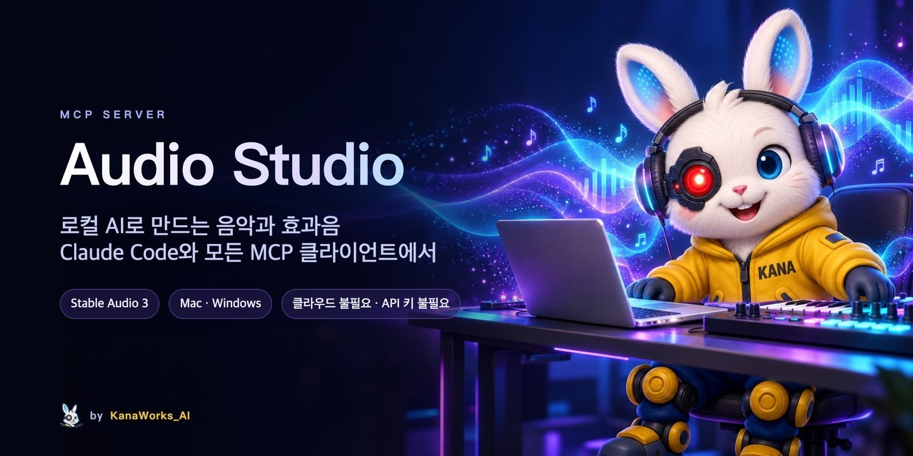

<p>
  <a href="LICENSE"></a>
  
  
  <a href="https://modelcontextprotocol.io"></a>
  
  <a href="https://github.com/kanaworksai-hue/audio-studio-mcp/actions/workflows/tests.yml"></a>
  <a href="https://github.com/kanaworksai-hue/audio-studio-mcp/stargazers"></a>
</p>

<p><a href="https://github.com/kanaworksai-hue"></a>&nbsp;<a href="https://github.com/kanaworksai-hue"><b>KanaWorks_AI 프로젝트</b></a></p>

[English](README.md) | [简体中文](README.zh-CN.md) | [日本語](README.ja.md) | **한국어** | [Português (Brasil)](README.pt-BR.md) | [Español](README.es.md)

<!-- mcp-name: io.github.kanaworksai-hue/audio-studio-mcp -->

[🎧 샘플 듣기](https://kanaworksai-hue.github.io/audio-studio-mcp/) · [빠른 시작](#-빠른-시작) · [도구](#-도구) · [Web UI](#-web-ui) · [자주 묻는 질문](#-자주-묻는-질문) · [⭐ Star로 응원하기](#-star로-응원하기)

</div>

**Audio Studio MCP**는 내 Mac이나 Windows PC에서 돌아가는 사운드 스튜디오를 Claude Code, Claude Desktop, Cursor 등 어떤 [MCP](https://modelcontextprotocol.io) 클라이언트에서든 쓸 수 있게 해 줍니다. 배경 음악이나 효과음을 평소 말하듯이 요청하면 [Stable Audio 3](https://github.com/Stability-AI/stable-audio-3) 모델이 로컬에서 생성합니다. 만든 소리는 루프로 다듬고 라우드니스를 맞춘 뒤 게임 엔진이나 영상 편집 툴에 맞게 내보낼 수도 있습니다. 클라우드도 API 키도 필요 없고, 아무리 생성해도 비용이 들지 않습니다.

보컬이 들어간 곡을 만들려면 선택 사항인 YuE2 모델에 가사와 곡 스타일을 입력하세요. 보컬과 반주는 사용 중인 컴퓨터에서 생성됩니다.

<p align="center">
  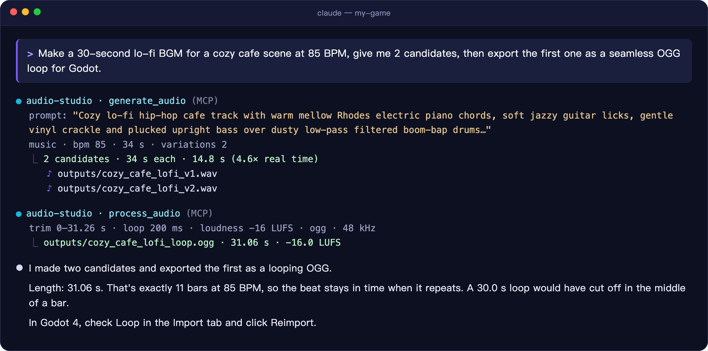
  <br><sub>실제 세션(영어, 일부 생략). Claude가 루프 길이를 정확히 11마디로 맞춰서 반복해도 박자가 어긋나지 않습니다.</sub>
</p>

## ✨ 주요 기능

<table>
<tr>
<td align="center" width="25%">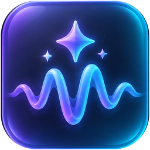<br><b>생성</b><br><sub>한 문장으로 BGM, 악기 루프, 효과음 생성. 한 번에 후보 1–4개</sub></td>
<td align="center" width="25%">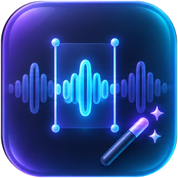<br><b>편집</b><br><sub>클립 전체 스타일 변경, 특정 구간 재생성, 트랙 연장</sub></td>
<td align="center" width="25%">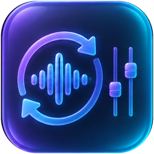<br><b>마무리</b><br><sub>심리스 루프, 페이드, 라우드니스(LUFS), 48 kHz WAV / OGG / FLAC</sub></td>
<td align="center" width="25%">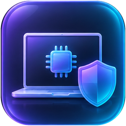<br><b>로컬</b><br><sub>Apple Silicon(MLX) 또는 NVIDIA GPU(PyTorch)에서 실행. 외부 업로드 없음</sub></td>
</tr>
</table>

- **채팅에서 바로 듣기:** Claude Desktop처럼 MCP Apps를 지원하는 클라이언트에서는 결과가 대화 안에 플레이어로 나타납니다. 파일을 열지 않고도 버전을 비교하고, 내보내고, 더 만들어 달라고 할 수 있습니다. [채팅에서 바로 듣기](#-채팅에서-바로-듣기)를 참고하세요.
- **재현 가능:** 모든 파일에 프롬프트, 시드, 설정을 기록한 `.json` 사이드카 파일이 함께 저장됩니다.
- **프롬프트 가이드 내장:** 서버가 클라이언트에 공식 Stable Audio 3 프롬프트 형식을 알려 주므로, "삐걱거리는 문 소리 느낌으로 해 줘" 같은 요청도 모델이 알아듣는 프롬프트로 바뀝니다.
- **업스트림과 동일한 결과:** Mac에서는 같은 시드라면 공식 `sa3` CLI와 비트 단위까지 동일한 결과가 나옵니다. Windows에서는 공식 Stable Audio 3 PyTorch API를 호출합니다.

## 🎧 들어 보기

### 보컬이 들어간 곡 샘플

- [영어 보컬 · Porch Light at Dawn](https://kanaworksai-hue.github.io/audio-studio-mcp/#porch_light_at_dawn)
- [일본어 보컬 · 雨上がりの坂道](https://kanaworksai-hue.github.io/audio-studio-mcp/#ameagari_no_sakamichi)

### 연주곡과 효과음

아래 표의 연주곡과 효과음은 M1 Mac에서 Stable Audio 3로 생성했으며 수동 편집을 거치지 않았습니다. **[샘플 페이지 열기 →](https://kanaworksai-hue.github.io/audio-studio-mcp/)**

| | 샘플 | 프롬프트 |
|---|---|---|
|  | [**Lo-fi 카페**](https://kanaworksai-hue.github.io/audio-studio-mcp/#lofi_cafe)<br><sub>음악 · 30초 · 85 BPM</sub> | Lo-fi hip-hop chill track with mellow electric piano, soft vinyl crackle, low-pass filtered drums… |
|  | [**웅장한 오케스트라**](https://kanaworksai-hue.github.io/audio-studio-mcp/#epic_orchestral)<br><sub>음악 · 30초</sub> | Epic cinematic orchestral trailer music with thundering taiko drums, soaring French horns… |
|  | [**칩튠 어드벤처**](https://kanaworksai-hue.github.io/audio-studio-mcp/#chiptune_adventure)<br><sub>음악 · 20초 · 150 BPM</sub> | Upbeat 8-bit chiptune adventure theme with a bright square wave lead… |
| 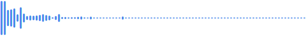 | [**유리 깨지는 소리**](https://kanaworksai-hue.github.io/audio-studio-mcp/#glass_shatter)<br><sub>효과음 · 3초</sub> | source: glass bottle · action: shattering on impact · material: thick green glass · space: concrete floor |
|  | [**비와 천둥**](https://kanaworksai-hue.github.io/audio-studio-mcp/#rain_thunder)<br><sub>효과음 · 12초</sub> | source: heavy rain and distant thunder · space: outdoor forest at night, wide stereo |
|  | [**신스웨이브 연장**](https://kanaworksai-hue.github.io/audio-studio-mcp/#synthwave_drive_extended)<br><sub>편집 · 20초 → 40초</sub> | `edit_audio` continue: 20초짜리 트랙을 40초로 연장 |

MP3 파일은 [`docs/samples/`](docs/samples)에, 프롬프트와 시드는 [`samples.json`](docs/samples/samples.json)에 있습니다.

## 🧭 작동 방식

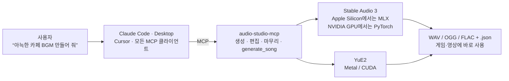

## 🚀 빠른 시작

[uv](https://docs.astral.sh/uv/) 0.9.20 이상과 [ffmpeg](https://ffmpeg.org)가 필요합니다. 저장소를 클론할 필요는 없습니다. `uvx`가 배포된 패키지를 내려받아 실행합니다.

아래 단계는 연주곡과 효과음에 쓰는 Stable Audio 3를 설치합니다. 보컬이 들어간 곡을 만들려면 [YuE2 설치 가이드(영어)](docs/song-generation.md#install-when-needed)에 따라 `song-setup`을 실행하세요.

| | macOS | Windows |
|---|---|---|
| **하드웨어** | Apple Silicon(M1 이상), RAM 16 GB 권장 | VRAM 8 GB 이상의 NVIDIA GPU와 최신 드라이버. RTX 3060 12 GB에서 테스트됨 |
| **디스크** | 약 8 GB(모델 약 6.9 GB) | 약 14 GB(모델 약 10.4 GB, PyTorch) |
| **uv와 ffmpeg** | `brew install uv ffmpeg` | `winget install astral-sh.uv` 및 `winget install Gyan.FFmpeg` |
| **모델 라이선스** | 따로 할 일 없음 | 무료 [Hugging Face](https://huggingface.co) 계정이 필요합니다. [stabilityai/stable-audio-3-medium](https://huggingface.co/stabilityai/stable-audio-3-medium) 페이지를 열고 라이선스에 한 번 동의하세요 |

**1. 터미널에서 한 번만 설정합니다.** 컴퓨터 환경을 확인하고, 검증된 커밋 기준으로 공식 Stable Audio 3 런타임을 가져온 뒤, 모델 다운로드 용량을 알려 주고 받을지 먼저 물어봅니다. 다시 실행해도 문제없고, 이미 받은 파일은 그대로 남습니다.

```bash
# macOS
uvx --python 3.11 audio-studio-mcp setup
```

```powershell
# Windows
uvx --python 3.11 --torch-backend cu126 audio-studio-mcp setup
```

`--torch-backend cu126`은 uv가 CUDA 빌드 PyTorch를 설치하도록 합니다(PyPI에는 Windows용 CPU 빌드만 있습니다). `--python 3.11`은 uv가 PyTorch에서 아직 지원하지 않는 Python 버전을 고르지 않게 막아 줍니다. uvx에서 `unexpected argument '--torch-backend'` 오류가 나면 uv가 너무 오래된 버전이니 `winget upgrade astral-sh.uv`(또는 `uv self update`)로 업데이트하세요. Windows에서 아직 Hugging Face에 로그인하지 않았다면 setup이 방법을 안내합니다. 모델 페이지에서 라이선스에 동의한 다음, **직접 연 터미널에서** `uvx --from huggingface_hub hf auth login`으로 로그인하고 setup을 다시 실행하세요.

setup은 기본으로 **medium** 모델을 받습니다. 작고 빠른 모델을 쓰려면 `--model sm-music`, `--model sm-sfx` 또는 `--model all`을 붙이고, 클라이언트 설정에서 환경 변수 `AUDIO_STUDIO_SA3_MODEL`을 지정하세요([설정](#️-설정) 참고).

**2. MCP 클라이언트에 등록합니다.** 명령은 같고 `setup`만 빼면 됩니다.

```bash
# Claude Code, macOS
claude mcp add --scope user audio-studio -- uvx --python 3.11 audio-studio-mcp
# Claude Code, Windows
claude mcp add --scope user audio-studio -- uvx --python 3.11 --torch-backend cu126 audio-studio-mcp
```

<details>
<summary><b>Claude Desktop, Codex, VS Code, Cursor 등 다른 클라이언트</b></summary>

Windows에서는 아래 모든 예시에서 `"3.11"` 뒤에 `"--torch-backend", "cu126"`을 추가하세요.

**Claude Desktop**(`claude_desktop_config.json`), **Cursor**(`.cursor/mcp.json`) 등 대부분의 클라이언트:

```json
{
  "mcpServers": {
    "audio-studio": {
      "command": "uvx",
      "args": ["--python", "3.11", "audio-studio-mcp"]
    }
  }
}
```

클라이언트에서 `uvx`를 찾지 못한다는 오류가 나면 `command`에 전체 경로를 적으세요(macOS는 `which uvx`, Windows는 `where uvx`로 확인). 설정을 바꾼 뒤에는 Claude Desktop을 재시작하세요.

**Codex**(`~/.codex/config.toml`). Codex는 기본적으로 서버 시작을 10초, 도구 호출을 60초까지만 기다립니다. 긴 트랙을 만들려면 더 길게 잡아야 합니다:

```toml
[mcp_servers.audio-studio]
command = "uvx"
args = ["--python", "3.11", "audio-studio-mcp"]
startup_timeout_sec = 60
tool_timeout_sec = 900
```

**VS Code**(`.vscode/mcp.json` 또는 **MCP: Open User Configuration**):

```json
{
  "servers": {
    "audio-studio": {
      "type": "stdio",
      "command": "uvx",
      "args": ["--python", "3.11", "audio-studio-mcp"]
    }
  }
}
```
</details>

생성된 파일은 `~/AudioStudio`에 저장됩니다(바꾸려면 `AUDIO_STUDIO_OUTPUT_DIR` 환경 변수를 설정하세요). uvx는 한 번 설치한 버전을 계속 씁니다. 업데이트하려면 `uv cache clean audio-studio-mcp`로 캐시를 비운 뒤 setup을 다시 실행하세요.

### 선택 사항: 보컬이 들어간 곡 생성 활성화

Audio Studio MCP 1.3.0부터 Stable Audio 3와 별도로 YuE2를 설치할 수 있습니다. Q4_0과 Q8_0 가중치에는 YuE2 이용 조건이 적용됩니다. macOS에서는 Apple Silicon과 Metal 컴파일러가 포함된 Xcode가 필요합니다. Windows x64에서는 지원되는 NVIDIA CUDA GPU가 필요합니다. 지원 드라이버와 모델 이용 조건, 다운로드 용량은 [YuE2 설치 가이드(영어)](docs/song-generation.md#install-when-needed)를 참고하세요.

```bash
# macOS
uvx --python 3.11 audio-studio-mcp song-setup
```

```powershell
# Windows
uvx --python 3.11 --torch-backend cu126 audio-studio-mcp song-setup
```

운영체제에 맞는 명령을 실행하고 화면에 표시되는 모델 이용 조건을 확인하세요. 같은 명령 끝에 `--check`를 붙이면 다운로드 없이 실행 환경, 가중치와 기기 상태를 확인할 수 있습니다. MCP 서버를 한 번만 등록하면 두 모델을 모두 사용할 수 있습니다.

> [!TIP]
> **에이전트에게 설치를 맡기세요.** Claude Code에 다음 문장을 붙여 넣으세요:
> *"Audio Studio MCP 서버(https://github.com/kanaworksai-hue/audio-studio-mcp) 설치해 줘. README대로 하되 AI 에이전트용 참고 사항도 꼭 따라 줘."*
>
> 보컬이 들어간 곡도 필요하면 요청에 함께 적어 주세요.
>
> **AI 에이전트용 참고 사항:**
> - 사용자가 연주곡이나 효과음을 원하면 운영체제에 맞는 `setup -y` 명령으로 Stable Audio 3를 설치하세요. 모델 다운로드에 충분한 시간을 두세요.
> - Windows에서는 접근이 제한된 Stable Audio 3 가중치를 받으려면 사용자가 자신의 Hugging Face 계정으로 로그인해야 합니다. setup이 로그인 절차를 출력하고 멈추면 그 내용을 사용자에게 전달하고, 사용자가 완료했다고 말할 때까지 기다린 뒤 setup을 다시 실행하세요. 사용자에게 토큰을 채팅에 붙여 넣으라고 절대 요청하지 마세요.
> - 보컬이 들어간 곡이 필요하면 먼저 해당 플랫폼의 `song-setup` 명령에 `--check`를 붙여 실행하세요. YuE2 설치가 필요하면 사용자에게 모델 이용 조건과 다운로드 용량을 알려 주세요. 비대화형 설치에서는 사용자가 YuE2 이용 조건에 동의한 뒤에만 `--accept-license`를 추가하세요. 설치 후 `--check`를 다시 실행하세요.
> - 두 설치 방식 모두 MCP 서버 등록은 한 번이면 됩니다. BGM과 효과음에는 `generate_audio`를 사용하세요. 보컬이 들어간 곡에는 원래 가사와 곡 스타일을 `generate_song`에 넘기고, 반환된 작업 ID로 `song_status`를 조회해 `done`, `error` 또는 `cancelled` 상태가 될 때까지 확인하세요. `done`이면 WAV 파일을 받을 수 있습니다.

### 다른 방법: 소스에서 설치

이전 버전에서 쓰던 설치 스크립트도 그대로 쓸 수 있습니다. 이 방식은 저장소를 클론해서 런타임은 저장소 안의 `vendor/`에, 오디오는 `outputs/`에 두고 `.venv/`에서 실행합니다.

#### macOS (Apple Silicon)

**요구 사항:**

- Apple Silicon Mac(M1 이상), RAM 16 GB 권장
- 디스크 공간 약 8 GB(모델 약 6.9 GB)
- `git`과 [`ffmpeg`](https://ffmpeg.org)(`brew install ffmpeg`)

```bash
git clone https://github.com/kanaworksai-hue/audio-studio-mcp.git
cd audio-studio-mcp
./install.sh
```

설치 스크립트는 필요하면 [`uv`](https://docs.astral.sh/uv/)를 설치하고, 공식 Stable Audio 3 런타임을 검증된 커밋으로 `vendor/`에 클론한 뒤 `.venv/`를 만들고, [Hugging Face](https://huggingface.co/stabilityai/stable-audio-3-optimized)에서 **medium** 모델(1.4B, 약 6.9 GB)을 다운로드합니다. 마지막에 서버를 등록할 명령을 그대로 출력해 줍니다:

```bash
claude mcp add --scope user audio-studio -- /path/to/audio-studio-mcp/.venv/bin/audio-studio-mcp
```

#### Windows (NVIDIA GPU)

**요구 사항:**

- NVIDIA GPU(VRAM 8 GB 이상)와 최신 드라이버를 갖춘 64비트 Windows 10 또는 11. RTX 3060 12 GB에서 테스트됨
- 디스크 공간 약 14 GB(모델과 PyTorch)
- `git`(`winget install Git.Git`)과 [`ffmpeg`](https://ffmpeg.org)(`winget install Gyan.FFmpeg`)
- 무료 [Hugging Face](https://huggingface.co) 계정. PyTorch 가중치에는 접근 제한(gated)이 걸려 있습니다. [stabilityai/stable-audio-3-medium](https://huggingface.co/stabilityai/stable-audio-3-medium) 페이지를 열고 라이선스에 한 번 동의하세요

```powershell
git clone https://github.com/kanaworksai-hue/audio-studio-mcp.git
cd audio-studio-mcp
powershell -ExecutionPolicy Bypass -File install.ps1
```

설치 스크립트는 macOS와 같은 단계를 거치되, CUDA 버전 PyTorch를 설치하고 **medium** 모델의 공식 PyTorch 체크포인트(약 10.4 GB)를 다운로드합니다. 아직 Hugging Face에 로그인하지 않았다면 읽기 권한 액세스 토큰을 입력하라고 합니다([여기서 만들기](https://huggingface.co/settings/tokens)). 콘솔 없이 실행되면(예: AI 에이전트가 실행한 경우) 입력을 묻지 않고 로그인 방법만 출력한 뒤 멈추니, 로그인하고 다시 실행하면 됩니다. 마지막에 서버를 등록할 명령을 출력합니다:

```powershell
claude mcp add --scope user audio-studio -- "C:\path\to\audio-studio-mcp\.venv\Scripts\audio-studio-mcp.exe"
```

Flash Attention은 필요 없습니다. 없으면 런타임이 PyTorch 내장 어텐션을 대신 사용합니다.

<details>
<summary><b>Claude Desktop, Cursor 등 다른 클라이언트</b></summary>

`claude_desktop_config.json`, `.cursor/mcp.json` 또는 사용하는 클라이언트의 MCP 설정에 다음을 추가하세요:

```json
{
  "mcpServers": {
    "audio-studio": {
      "command": "/path/to/audio-studio-mcp/.venv/bin/audio-studio-mcp"
    }
  }
}
```

Windows에서는 명령 경로가 `C:\\path\\to\\audio-studio-mcp\\.venv\\Scripts\\audio-studio-mcp.exe`입니다(JSON에서는 백슬래시를 두 번 씁니다).
</details>

<details>
<summary><b>설치 스크립트 옵션</b></summary>

| macOS | Windows | 설명 |
|---|---|---|
| `--model all` | `-Model all` | 작고 빠른 `sm-music`, `sm-sfx` 모델도 다운로드(macOS +2.6 GB, Windows +7 GB) |
| `--skip-weights` | `-SkipWeights` | 지금은 받지 않고 처음 생성할 때 다운로드 |
| `-y` | `-Yes` | 묻지 않고 `uv` 설치 |

macOS에서는 로그인 없이 익명으로 다운로드합니다. `hf auth login`으로 로그인하면 Hugging Face의 속도 제한이 완화됩니다. Windows에서는 PyTorch 가중치에 접근 제한이 걸려 있으므로, 다운로드할 각 모델 페이지([medium](https://huggingface.co/stabilityai/stable-audio-3-medium), [small-music](https://huggingface.co/stabilityai/stable-audio-3-small-music), [small-sfx](https://huggingface.co/stabilityai/stable-audio-3-small-sfx))에서 라이선스에 동의하고 로그인해야 합니다.
</details>

이제 이렇게 요청하기만 하면 됩니다:

- "카페 장면에 깔 lo-fi BGM 루프 만들어 줘. 85 BPM에 60초, 후보는 3개."
- "돌로 된 복도에서 무거운 나무 문이 쾅 닫히는 소리가 필요해. Godot에서 쓸 수 있게 OGG로 내보내 줘."
- "이 트랙 90초로 늘리고 −16 LUFS로 노멀라이즈해 줘."

## 🧰 도구

| 도구 | 기능 |
|---|---|
| `generate_audio` | 텍스트로 BGM, 악기 루프/스템, 효과음 생성. 한 번에 후보 1–4개, `bpm`, 구조화된 효과음 필드 지원 |
| `generate_song` | YuE2로 가사와 곡 스타일을 바탕으로 보컬과 반주 생성 |
| `song_status` | 노래 생성 작업의 진행 상황 및 결과 확인 |
| `cancel_song` | 대기 중이거나 실행 중인 노래 생성 작업 취소 |
| `edit_audio` | `variation`(클립 전체 스타일 변경), `inpaint`(특정 구간 재생성), `continue`(연장). 후보 1–4개 |
| `process_audio` | 자르기 → 무음 제거 → 모노 변환 → 리샘플링 / 라우드니스 → 심리스 루프 → 페이드 → 피크 노멀라이즈 또는 상한 → WAV / OGG / FLAC. 원본 파일은 건드리지 않습니다 |
| `unload_models` | 모델이 쓰는 메모리를 즉시 해제 |

<details>
<summary><b>파라미터 참고</b></summary>

- **`audio_type`**: `music` / `instrument` / `sfx` / `raw`. 서버가 모델 학습에 쓰인 접두사(`TrackType: Music, VocalType: Instrumental,` …)를 붙입니다. SFX 접두사가 없으면 효과음이 음악으로 나오는 경우가 많습니다.
- **`variations`**: 시드 `seed, seed+1, …`로 후보 1–4개를 만듭니다. 무작위 시드를 쓰려면 `seed: -1`로 지정하거나 생략하세요.
- **`sound_source` / `sound_action` / `sound_material` / `sound_space`**: 효과음을 음원(무엇이 소리를 내는지), 동작(소리가 어떻게 변하는지), 재질(질감), 공간(어디서 나는 소리인지)으로 나눠 묘사합니다.
- **`peak_ceiling_db`**(기본값 −1): 안전 상한입니다. 이를 넘는 피크만 낮추고, 작은 소리를 키우지는 않습니다. 노멀라이즈는 `process_audio`로 하세요.
- **`process_audio` 노멀라이즈**: 효과음에는 보통 `peak`를 씁니다. `loudness`는 목표 LUFS에 맞추며, 스트리밍/영상은 −14, 게임 BGM은 −16, 방송은 −23입니다.

생성된 파일은 44.1 kHz 24-bit 스테레오 WAV이며, 출력 폴더(`~/AudioStudio`, 소스 설치에서는 `outputs/`. `AUDIO_STUDIO_OUTPUT_DIR` 참고)에 저장됩니다. 각 파일 옆에는 `<name>.json`이 함께 생기고, 후처리한 파일에는 원본의 생성 정보가 `source` 항목에 남습니다.
</details>

## 🌐 Web UI

채팅보다 클릭이 편하신가요? 같은 서버에 로컬 웹 페이지도 들어 있습니다. BGM과 효과음 생성, 후보 비교, 편집(변형 만들기, 일부 교체, 연장), 게임·영상용 내보내기까지 브라우저에서 할 수 있고, 지금까지 만든 결과물은 라이브러리에서 한눈에 볼 수 있습니다.

<p align="center">
<picture>
  <source media="(prefers-color-scheme: dark)" srcset="docs/assets/webui-generate-en-dark.png">
  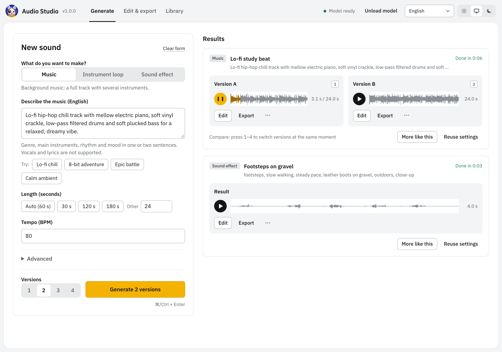
</picture>
<br><br>
<picture>
  <source media="(prefers-color-scheme: dark)" srcset="docs/assets/webui-edit-en-dark.png">
  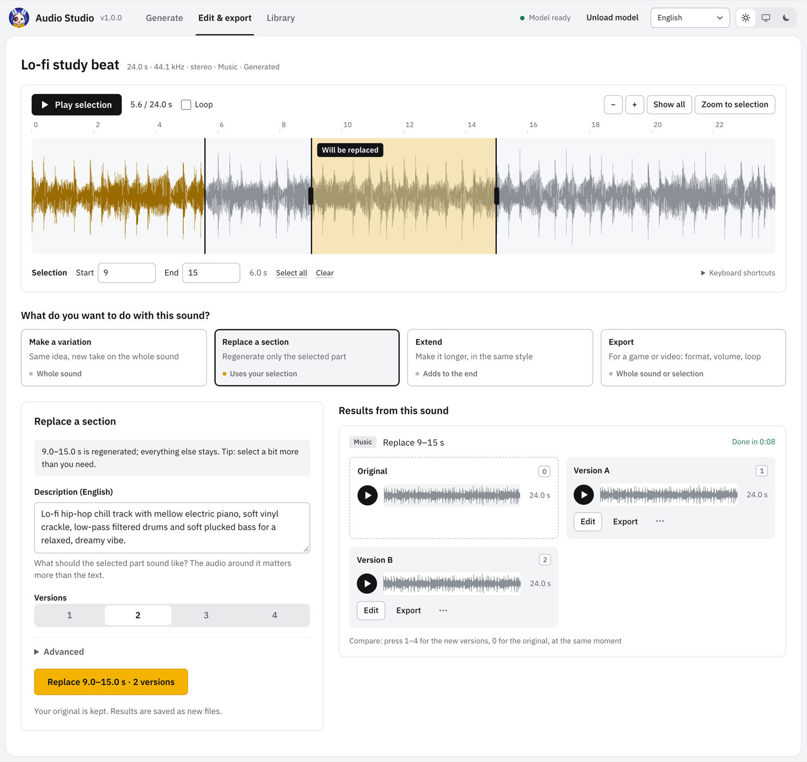
</picture>
</p>

```bash
uvx --python 3.11 audio-studio-mcp --web 8765
```

브라우저에서 http://127.0.0.1:8765/ 페이지가 열립니다. 브라우저를 열지 않고 시작하려면 `--no-browser`를, 시작할 때 모델을 미리 로드하려면 `--preload`를 추가하세요. 종료하려면 Ctrl+C를 누르세요. Windows에서는 `3.11` 뒤에 `--torch-backend cu126`을 추가하세요. 소스 설치에서는 `.venv/bin/audio-studio-mcp --web 8765`(Windows: `.venv\Scripts\audio-studio-mcp.exe --web 8765`)로 실행합니다.

같은 포트의 `/mcp`로 MCP도 제공하므로, 웹 페이지와 MCP 클라이언트가 프로세스 하나와 이미 로드된 모델을 함께 쓸 수 있습니다. 한 번 등록해 두면 둘을 동시에 쓸 수 있고, 페이지와 에이전트의 요청은 대기열 하나에서 순서대로 처리됩니다.

```bash
claude mcp add --scope user --transport http audio-studio http://127.0.0.1:8765/mcp
```

- 파일은 출력 폴더(`~/AudioStudio`, 소스 설치에서는 `outputs/`, 또는 `AUDIO_STUDIO_OUTPUT_DIR`)에 저장됩니다. 라이브러리는 이 폴더를 보여 주고, 편집기도 이 폴더 안의 파일을 다룹니다.
- 웹 UI는 영어, 일본어, 중국어를 지원하며 브라우저 언어를 따르고, 설정에서 바꿀 수도 있습니다. 한국어는 지원하지 않아서 위 스크린샷도 영어 화면입니다.

> [!WARNING]
> 웹 UI는 로컬 전용입니다. `127.0.0.1`에서만 접속을 받으며 로그인 기능도 없습니다. 포트 포워딩, 리버스 프록시, 터널 등으로 다른 컴퓨터에서 접속할 수 있게 열어 두지 마세요. 웹 UI에 접속할 수 있는 사람은 누구나 내 GPU를 사용하고 출력 폴더에 파일을 저장할 수 있습니다.

### 보컬이 있는 노래

웹 UI의 **Songs** 탭과 MCP 도구 `generate_song`으로, 선택 사항인 YuE2 모델을 사용해 가사로 보컬과 반주를 만들 수 있습니다. Apple Silicon Mac과 NVIDIA CUDA GPU가 있는 Windows x64에서 동작합니다. 메모리와 VRAM 측정값은 Auto의 추천에 사용됩니다. 설치된 프로필은 어느 쪽이든 수동으로 실행해 볼 수 있습니다. 모델 이용 조건, 다운로드 크기, Auto 설정은 [노래 설치 및 사용 가이드(영어)](docs/song-generation.md)를 참고하세요.

## 💬 채팅에서 바로 듣기

[MCP Apps](https://modelcontextprotocol.io/extensions/apps/overview)를 지원하는 클라이언트에서는 `generate_audio`, `edit_audio`, `process_audio`, `generate_song`의 결과가 대화 안에 플레이어로 바로 나타납니다. 파일을 직접 열 필요가 없습니다. 노래 카드는 WAV 파일이 완성될 때까지 진행 상황을 표시합니다.

<p align="center">
<picture>
  <source media="(prefers-color-scheme: dark)" srcset="docs/assets/chat-player-en-dark.png">
  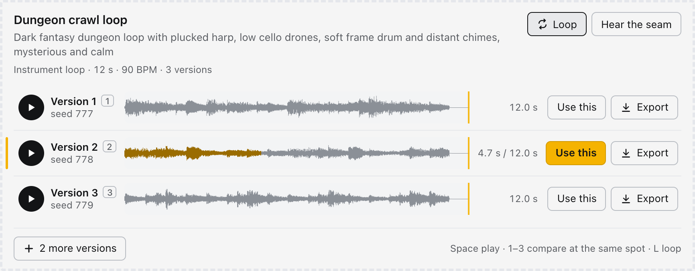
</picture>
<br><sub>던전 루프 세 버전. 실제 모델 출력을 MCP Apps 레퍼런스 호스트에서 표시한 화면입니다.</sub>
</p>

- **듣고 비교하기:** 파형을 보면서 재생, 일시 정지, 탐색을 할 수 있습니다. 재생 중에 버전을 바꾸면 새 버전이 같은 지점부터 이어서 재생됩니다. `1`–`9` 키로 버전을 고르고, `0` 키로 편집 전 오디오를 재생합니다.
- **루프 확인하기:** **Loop**를 켜고 **Hear the seam**을 누르면 끝부분이 시작 부분으로 이어지는 소리를 들을 수 있습니다.
- **고르고, 내보내고, 더 만들기:** **Use this**를 누르면 어떤 버전을 골랐는지 어시스턴트에게 알려 줍니다. **Export**는 웹 UI와 같은 프리셋으로 게임이나 영상용 파일을 저장합니다. **2 more versions**는 같은 프롬프트를 다음 시드로 다시 실행합니다.
- 플레이어는 클라이언트의 언어(영어, 일본어, 중국어)와 라이트/다크 테마를 따릅니다. 한국어는 지원하지 않아서 한국어 환경에서는 영어로 표시됩니다. 오디오는 내 컴퓨터 밖으로 나가지 않으며, 서버는 각 파일을 압축한 미리 듣기용 오디오를 플레이어에 보냅니다.

| 클라이언트 | 플레이어 |
|---|---|
| Claude Desktop | ✅ |
| VS Code(GitHub Copilot) | ✅ `chat.mcp.apps.enabled`를 켜야 함(실험적 기능) |
| Cursor, Goose 등 MCP Apps를 지원하는 클라이언트 | ✅ |
| Codex 앱(데스크톱) | ✅ |
| Claude Code, Codex CLI·IDE 확장 등 그 밖의 클라이언트 | 지금처럼 텍스트로 결과 표시 |
| claude.ai, ChatGPT | ❌ 원격 서버가 필요한데, 이 서버는 내 컴퓨터에서 실행됩니다 |

플레이어 없이 텍스트만 나오나요? MCP 설정을 바꾼 뒤 클라이언트를 재시작하세요. Claude Desktop 일부 버전에서는 로컬 서버의 앱이 일반 채팅에 표시되지 않습니다([anthropics/claude-ai-mcp#1069](https://github.com/anthropics/claude-ai-mcp/issues/1069)). 이때도 시크릿 채팅에서는 표시됩니다. 플레이어를 끄려면 `AUDIO_STUDIO_CHAT_PLAYER=off`로 설정하세요.

## ⚙️ 설정

<details>
<summary><b>환경 변수</b></summary>

| 변수 | 기본값 | 설명 |
|---|---|---|
| `AUDIO_STUDIO_OUTPUT_DIR` | `~/AudioStudio`(소스 설치: `<repo>/outputs`) | 오디오 파일을 저장할 위치 |
| `AUDIO_STUDIO_IDLE_UNLOAD_MIN` | `10` | 이 시간(분) 동안 사용하지 않으면 모델을 해제(`0` = 해제하지 않음) |
| `AUDIO_STUDIO_SA3_MODEL` | `medium` | `medium`(최고 품질, 최대 380초), `sm-music` 또는 `sm-sfx`(작고 빠름, 최대 120초) |
| `AUDIO_STUDIO_MLX_CACHE_GB` | `1` | macOS: MLX 버퍼 캐시 상한. 제한하지 않으면 긴 생성 후 캐시에 약 6 GB가 남을 수 있습니다 |
| `AUDIO_STUDIO_DEVICE` | 사용 가능하면 `cuda` | Windows/Linux: PyTorch 디바이스. 예: `cuda`, `cuda:1`, `cpu` |
| `AUDIO_STUDIO_SA3_DIR` | setup이 받은 런타임(소스 설치: `<repo>/vendor/stable-audio-3`) | 다른 stable-audio-3 체크아웃 사용 |
| `AUDIO_STUDIO_HOME` | macOS `~/Library/Application Support/audio-studio-mcp`, Windows `%LOCALAPPDATA%\audio-studio-mcp` | setup이 Stable Audio 3 런타임(약 1 MB)을 두는 위치. 가중치는 Hugging Face 캐시에 그대로 있습니다 |
| `AUDIO_STUDIO_BACKEND` | `auto` | `auto`, `sa3-mlx`(Apple Silicon) 또는 `sa3-torch`(PyTorch, NVIDIA) |
| `AUDIO_STUDIO_FFMPEG` | `PATH`의 `ffmpeg` | ffmpeg 경로 |
| `AUDIO_STUDIO_CHAT_PLAYER` | `auto` | [채팅 플레이어](#-채팅에서-바로-듣기): `auto`는 MCP Apps 지원을 알리는 클라이언트에서 사용, `off`는 모든 클라이언트에서 텍스트만, `on`은 지원을 알리지 않지만 MCP Apps를 표시하는 클라이언트에서도 사용(이때 MCP Apps를 지원하지 않는 클라이언트의 도구 목록에는 플레이어용 보조 도구가 나타남) |

`claude mcp add ... -e NAME=value`로 전달하거나 클라이언트 설정의 `env` 블록에 넣으세요.
</details>

<details>
<summary><b>여러 세션에서 서버 하나 공유하기</b></summary>

보통은 클라이언트 세션마다 서버 프로세스가 따로 시작됩니다. 모델은 첫 호출 때 로드되고 유휴 시간이 지나면 해제됩니다. 모든 세션이 모델을 올려 둔 프로세스 하나를 같이 쓰게 하려면 로컬 HTTP 서버로 띄우세요. `127.0.0.1`에서만 접속을 받습니다.

```bash
uvx --python 3.11 audio-studio-mcp --http 8765 --preload
claude mcp add --scope user --transport http audio-studio http://127.0.0.1:8765/mcp
```

Windows에서는 `3.11` 뒤에 `--torch-backend cu126`을 추가하세요. 소스 설치에서는 `.venv/bin/audio-studio-mcp`(Windows: `.venv\Scripts\audio-studio-mcp.exe`)를 같은 옵션으로 실행하세요.

`--web 8765`도 똑같이 동작하며, 같은 포트에서 [웹 UI](#-web-ui)도 함께 제공합니다.
</details>

## ⚡ 성능

16 GB M1 Mac, medium 모델:

| 작업 | 시간 |
|---|---|
| 3초 효과음 2개, 콜드 스타트 | 약 13초 |
| 음악 20초, 웜 상태 | 약 10초(실시간의 2배 속도) |
| 35초까지 연장, 인코더 로딩 포함 | 약 27초 |
| `sm-music`으로 음악 15초, 웜 상태 | 약 1초 |

Windows + RTX 3060 12 GB, medium 모델:

| 작업 | 시간 |
|---|---|
| 3초 효과음 2개, 콜드 스타트(모델 로딩 약 20초 포함) | 약 25초 |
| 음악 20초, 웜 상태 | 약 1.3초 |
| 30초까지 연장, 웜 상태 | 약 2.2초 |
| 음악 380초(최대), 웜 상태 | 약 15초 |
| `sm-music`으로 음악 15초, 웜 상태 | 약 0.7초 |

Mac에서는 모델이 로드된 상태에서 메모리를 약 5–7 GB 사용합니다. RTX 3060에서는 medium 모델의 VRAM 사용량이 최대 약 5.3 GB였습니다. 모델은 유휴 시간이 지나거나 `unload_models`를 호출하면 해제됩니다.

## 📝 프롬프트 작성 팁

<details>
<summary><b>공식 Stable Audio 3 프롬프트 가이드 요약</b></summary>

1. **영어로 1–2문장, 최대 약 45단어.** vocals, singer, lyrics 같은 보컬 관련 단어는 피하세요.
2. **음악:** 장르 + 형용사 → 리드 악기 → 보조 레이어 → 드럼/리듬 → 분위기 순서로 씁니다. 템포는 `bpm`에 넣으세요.
   > Lo-fi hip-hop chill track with mellow electric piano, soft vinyl crackle, low-pass filtered drums and soft plucked bass for a relaxed, dreamy vibe.
3. **효과음:** source(음원), action(동작), material(재질), space(공간)를 채우세요.
   > source: glass bottle / action: shattering on impact, fragments scattering / material: thick green glass, sharp bright transient / space: concrete floor, close-up, dry
4. **길이는 내용에 맞추세요:** 충격음 1–3초, 동작 3–6초, 환경음 6–15초(더 길어도 됨), 루프 6–20초, 전체 곡 120–300초(최대 380초).
5. "15초에 클라이맥스" 같은 **타이밍 지시**는 잘 반영되지 않습니다. 일단 생성한 뒤 `inpaint`나 `continue`로 다듬으세요.
6. 기본값 `steps=8`과 `cfg=1.0`이 공식 설정입니다. 프롬프트를 더 충실히 따르게 하거나 `negative_prompt`를 쓰려면 `cfg`를 3–7로 시도해 보세요(약 2배 느려집니다).
7. 시드에 따라 결과가 크게 달라집니다. `variations`로 2–4개를 뽑아 보고 가장 좋은 것을 고르세요.

전체 가이드는 서버 instructions에 담겨 클라이언트에도 전달됩니다.
</details>

## ❓ 자주 묻는 질문

<details>
<summary><b>Windows, Linux, Intel Mac에서도 실행되나요?</b></summary>

**Windows:** 네, NVIDIA GPU가 있으면 실행됩니다. [빠른 시작](#-빠른-시작)을 참고하세요.

**Linux:** NVIDIA GPU라면 같은 PyTorch 백엔드를 쓰므로 동작할 것으로 보이지만, 테스트하지는 않았습니다. `cuda` extra를 사용하세요: `uvx --python 3.11 --torch-backend cu126 --from "audio-studio-mcp[cuda]" audio-studio-mcp setup`. Hugging Face 로그인 방법은 Windows와 같습니다.

**Intel Mac과 AMD GPU**는 지원하지 않습니다.
</details>

<details>
<summary><b>Apple Silicon Mac인데 "Intel Macs are not supported"라고 나오나요?</b></summary>

Rosetta로 실행되는 x86_64 Python(예: `/usr/local` 아래의 오래된 Intel용 Homebrew)으로 환경이 만들어져서 MLX가 설치되지 않은 것입니다. uvx를 쓴다면 setup과 클라이언트 설정 모두에서 uv가 제공하는 arm64 Python을 지정하세요: `uvx --python cpython-3.11-macos-aarch64 audio-studio-mcp`. 설치 스크립트를 쓴다면 `./install.sh`를 다시 실행하세요. 스크립트가 uv에 arm64 Python을 요청하고, x86_64로 만들어진 `.venv`는 새로 만듭니다. `UV_PYTHON`을 직접 설정했다면 arm64 빌드를 가리키게 하세요: `UV_PYTHON=cpython-3.11-macos-aarch64 ./install.sh`.
</details>

<details>
<summary><b>보컬이 들어간 노래도 만들 수 있나요?</b></summary>

네. 선택 사항인 YuE2를 설치한 뒤 웹 UI의 Songs 탭이나 `generate_song`에서 가사와 곡 스타일을 입력하면 보컬과 반주를 만들 수 있습니다. 연주곡과 효과음에는 Stable Audio 3를 사용합니다. [YuE2 설치 가이드(영어)](docs/song-generation.md)를 참고하세요.
</details>

<details>
<summary><b>생성한 오디오를 상업적으로 사용할 수 있나요?</b></summary>

프로젝트 코드는 MIT 라이선스입니다. 상업적으로 이용하기 전에 생성에 사용한 모델의 약관을 확인하세요. [Stable Audio 3](https://huggingface.co/stabilityai/stable-audio-3-optimized) / [YuE2(영어)](docs/song-generation.md#install-when-needed).
</details>

<details>
<summary><b>메모리 8 GB Mac에서도 쓸 수 있나요?</b></summary>

테스트하지 않았습니다. medium 모델은 로드하면 약 5–7 GB를 쓰므로 16 GB를 권장합니다. 작은 `sm-music` / `sm-sfx` 모델은 더 가볍습니다.
</details>

<details>
<summary><b>루프 이음새에서 딸깍 소리가 납니다.</b></summary>

루프에는 WAV나 OGG를 사용하세요. MP3는 앞뒤에 패딩이 들어가서 끊김 없이 반복되지 않습니다. `loop_crossfade_ms`를 더 길게 하거나, 마디 경계에서 자르도록 모델에 요청해 보세요.
</details>

## 🗺️ 로드맵

- [x] Apple Silicon 백엔드(Stable Audio 3, MLX)
- [x] NVIDIA GPU용 Windows 백엔드(Stable Audio 3, PyTorch)
- [x] 로컬 웹 UI(`--web`)
- [x] `uvx` 명령 하나로 설치
- [x] 채팅에서 바로 듣기(MCP Apps 플레이어)
- [x] 가사로 보컬이 들어간 곡을 로컬에서 생성(YuE2, macOS Metal 및 Windows CUDA)
- [ ] LoRA 지원(업스트림 런타임은 이미 지원)

이슈와 PR은 언제든 환영합니다.

## ⭐ Star로 응원하기

Audio Studio로 만든 소리를 실제로 쓰게 되셨다면, [저장소 페이지](https://github.com/kanaworksai-hue/audio-studio-mcp) 상단의 **⭐ Star**를 눌러 주세요. 무료에 1초면 충분하고, 생각보다 큰 힘이 됩니다:

- **더 많은 사람에게 알려집니다.** Star가 많을수록 GitHub에서 눈에 잘 띄어, 더 많은 게임 개발자와 영상 크리에이터가 쓸 수 있게 됩니다.
- **업데이트를 이어 갈 힘이 됩니다.** Star 하나하나가 누군가 이 프로젝트를 유용하게 쓰고 있다는 신호이고, 그 덕분에 LoRA 지원 같은 다음 업데이트를 계속 만들 수 있습니다.

다른 방법으로도 도울 수 있습니다. 버그나 아이디어가 있으면 [이슈를 남겨 주세요](https://github.com/kanaworksai-hue/audio-studio-mcp/issues). X에 직접 만든 소리를 올리고 [@KanaWorks_AI](https://x.com/KanaWorks_AI)를 태그해 주셔도 좋습니다.

## 🛠️ 개발

```bash
uv run pytest                              # 오프라인 테스트, 모델 불필요
.venv/bin/python scripts/smoke_test.py     # 실제 모델로 E2E 테스트(M1에서 약 30초)
rm -rf dist && uv build && WHL=$(ls dist/*.whl)   # 빌드한 wheel로 같은 테스트(uvx가 실행하는 방식 그대로):
uvx --python 3.11 --from "$WHL" audio-studio-mcp setup -y
.venv/bin/python scripts/smoke_test.py --server "uvx --python 3.11 --from $WHL audio-studio-mcp"
```

Windows에서는 `.venv\Scripts\python scripts\smoke_test.py`를 실행합니다(RTX 3060에서 모델 로딩 포함 약 45초).

```
src/audio_studio_mcp/
  server.py            MCP 도구(백엔드 공통)
  runtime.py           런타임과 출력 위치. uvx 설치 시 런타임을 가져옴
  firstrun.py          `audio-studio-mcp setup`
  weights.py           모델 가중치: 다운로드 여부 확인, 다운로드
  prompts.py           프롬프트 구성과 클라이언트에 보내는 instructions
  post.py              후처리와 내보내기
  backends/base.py     백엔드 인터페이스
  backends/sa3_mlx.py  Apple Silicon용 Stable Audio 3(MLX)
  backends/sa3_torch.py  NVIDIA GPU용 Stable Audio 3(PyTorch)
  web.py               웹 UI 서버(--web)와 JSON API
  static/              웹 UI(HTML/JS/CSS, 빌드 단계 없음)
```

새 플랫폼을 지원하려면 `backends/`에 백엔드를 하나 추가하면 됩니다.

## 📄 라이선스 및 크레딧

- **이 프로젝트:** [MIT](LICENSE).
- **Stable Audio 3 런타임:** `setup`이 고정된 커밋으로 받아 옵니다(설치 스크립트는 `vendor/`에 받음). © Stability AI, MIT 라이선스입니다.
- **Stable Audio 3 모델 가중치:** [Stability AI Community License](https://huggingface.co/stabilityai/stable-audio-3-optimized)가 적용됩니다. Hugging Face에서 다운로드되며(macOS: `stable-audio-3-optimized`, Windows: `stable-audio-3-medium`과 소형 모델), 이 저장소에는 포함되지 않습니다.
- YuE2 모델 가중치와 실행 환경은 필요할 때 설치합니다. [이용 조건과 설치 가이드(영어)](docs/song-generation.md#install-when-needed)를 참고하세요.
- **브랜드:** KanaWorks_AI 이름, 로고, Kana 캐릭터는 © 東京AI映像合同会社(Tokyo AI Visuals LLC)이며 MIT 라이선스 대상이 **아닙니다**. [docs/brand](docs/brand/README.md)를 참고하세요.
- **글꼴:** 웹 UI에는 IBM Plex Sans(© IBM Corp., SIL Open Font License 1.1)가 포함되어 있습니다([`OFL.txt`](src/audio_studio_mcp/static/fonts/OFL.txt)). 웹 UI의 Kana 이미지([`static/brand`](src/audio_studio_mcp/static/brand/README.md))에는 위의 브랜드 항목이 적용됩니다.
- **기반 기술:** [Stable Audio 3](https://github.com/Stability-AI/stable-audio-3), [MLX](https://github.com/ml-explore/mlx), [PyTorch](https://pytorch.org), [Model Context Protocol](https://modelcontextprotocol.io).

이 프로젝트는 독립 프로젝트이며, Stability AI, Apple, NVIDIA, Anthropic과 제휴 관계가 없고 이들의 승인을 받은 것도 아닙니다.

<br>

<div align="center">

<a href="https://x.com/KanaWorks_AI"></a>

<p><b><a href="https://x.com/KanaWorks_AI">KanaWorks_AI</a>가 ♥를 담아 만들었습니다</b></p>

<p><sub>Audio Studio 덕분에 시간을 아끼셨다면 ⭐ 하나 눌러 주세요. 업데이트를 이어 가는 힘이 되고, 다른 분들이 이 프로젝트를 찾는 데도 도움이 됩니다. 다른 프로젝트 더 보기: <a href="https://github.com/kanaworksai-hue">github.com/kanaworksai-hue</a></sub></p>

</div>
