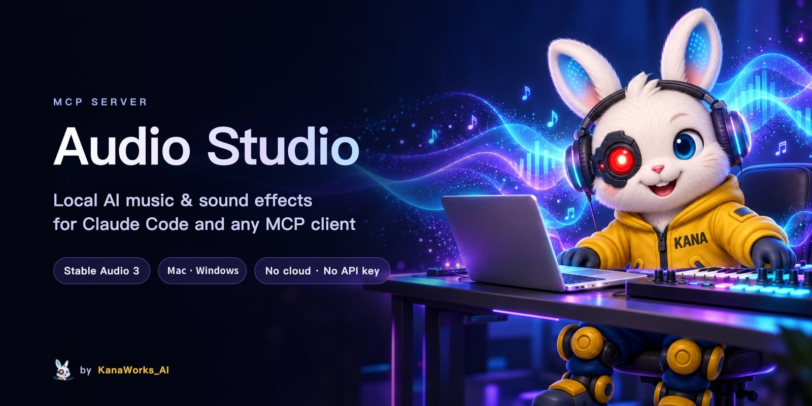
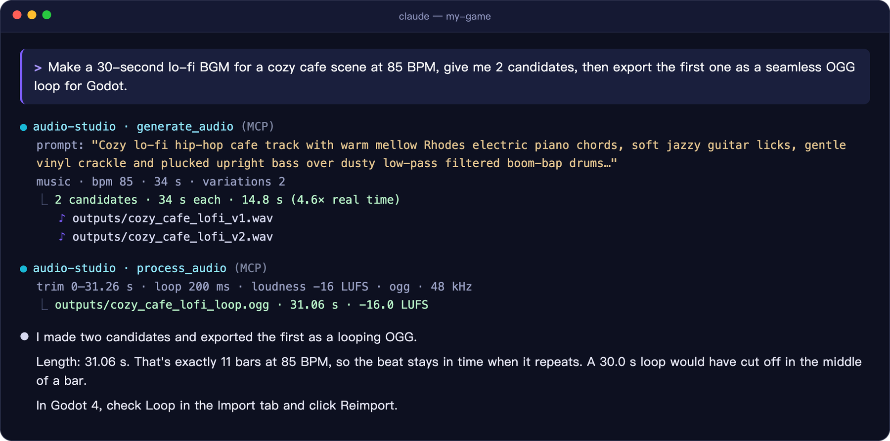
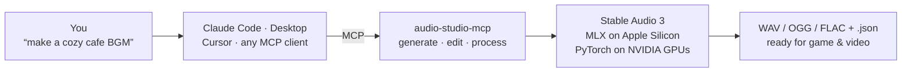

<div align="center">



<p>
  <a href="LICENSE"></a>
  
  
  <a href="https://modelcontextprotocol.io"></a>
  
  <a href="https://github.com/kanaworksai-hue/audio-studio-mcp/actions/workflows/tests.yml"></a>
  <a href="https://github.com/kanaworksai-hue/audio-studio-mcp/stargazers"></a>
</p>

<p><a href="https://github.com/kanaworksai-hue"></a>&nbsp;<a href="https://github.com/kanaworksai-hue"><b>A KanaWorks_AI project</b></a></p>

**English** | [简体中文](README.zh-CN.md) | [日本語](README.ja.md)

[🎧 Listen to samples](https://kanaworksai-hue.github.io/audio-studio-mcp/) · [Quick start](#-quick-start) · [Tools](#-tools) · [FAQ](#-faq) · [⭐ Star](#-like-it-star-it)

</div>

**Audio Studio MCP** gives Claude Code, Claude Desktop, Cursor and any other [MCP](https://modelcontextprotocol.io) client a sound studio that runs on your own Mac or Windows PC. Ask for background music or a sound effect in plain language; the model generates it locally with [Stable Audio 3](https://github.com/Stability-AI/stable-audio-3). Then it can loop it, normalize the loudness and export it for your game engine or video editor. There is no cloud service and no API key, and generating doesn't cost anything.

<p align="center">
  
  <br><sub>A real session, shortened. Claude picked a loop length of exactly 11 bars so the beat stays in time when it repeats.</sub>
</p>

## ✨ Highlights

<table>
<tr>
<td align="center" width="25%"><br><b>Generate</b><br><sub>BGM, instrument loops and sound effects from one sentence, 1–4 candidates per call</sub></td>
<td align="center" width="25%"><br><b>Edit</b><br><sub>Re-style a whole clip, regenerate a time range, or extend a track</sub></td>
<td align="center" width="25%"><br><b>Finish</b><br><sub>Seamless loops, fades, loudness (LUFS), 48 kHz WAV / OGG / FLAC</sub></td>
<td align="center" width="25%"><br><b>Local</b><br><sub>Runs on Apple Silicon (MLX) or an NVIDIA GPU (PyTorch). Nothing is uploaded</sub></td>
</tr>
</table>

- **Reproducible:** every file gets a `.json` sidecar with its prompt, seed and settings.
- **Prompting built in:** the server teaches the client the official Stable Audio 3 prompt format, so a request like "make it sound like a creaky door" becomes a prompt the model understands.
- **Same output as upstream:** on a Mac, results for the same seed are bit-for-bit identical to the official `sa3` CLI. On Windows it calls the official Stable Audio 3 PyTorch API.

## 🎧 Hear it

All of these were generated by this server on an M1 Mac and were not edited by hand. **[Open the sample page →](https://kanaworksai-hue.github.io/audio-studio-mcp/)**

| | Sample | Prompt |
|---|---|---|
|  | [**Lo-fi cafe**](https://kanaworksai-hue.github.io/audio-studio-mcp/#lofi_cafe)<br><sub>music · 30 s · 85 BPM</sub> | Lo-fi hip-hop chill track with mellow electric piano, soft vinyl crackle, low-pass filtered drums… |
|  | [**Epic orchestral**](https://kanaworksai-hue.github.io/audio-studio-mcp/#epic_orchestral)<br><sub>music · 30 s</sub> | Epic cinematic orchestral trailer music with thundering taiko drums, soaring French horns… |
|  | [**Chiptune adventure**](https://kanaworksai-hue.github.io/audio-studio-mcp/#chiptune_adventure)<br><sub>music · 20 s · 150 BPM</sub> | Upbeat 8-bit chiptune adventure theme with a bright square wave lead… |
|  | [**Glass shatter**](https://kanaworksai-hue.github.io/audio-studio-mcp/#glass_shatter)<br><sub>sfx · 3 s</sub> | source: glass bottle · action: shattering on impact · material: thick green glass · space: concrete floor |
|  | [**Rain & thunder**](https://kanaworksai-hue.github.io/audio-studio-mcp/#rain_thunder)<br><sub>sfx · 12 s</sub> | source: heavy rain and distant thunder · space: outdoor forest at night, wide stereo |
|  | [**Synthwave, extended**](https://kanaworksai-hue.github.io/audio-studio-mcp/#synthwave_drive_extended)<br><sub>edit · 20 s → 40 s</sub> | `edit_audio` continue: a 20-second track extended to 40 seconds |

MP3s are in [`docs/samples/`](docs/samples), with prompts and seeds in [`samples.json`](docs/samples/samples.json).

## 🧭 How it works



## 🚀 Quick start

### macOS (Apple Silicon)

**Requirements:**

- Apple Silicon Mac (M1 or later), 16 GB RAM recommended
- About 6 GB of disk for the model
- `git` and [`ffmpeg`](https://ffmpeg.org) (`brew install ffmpeg`)

```bash
git clone https://github.com/kanaworksai-hue/audio-studio-mcp.git
cd audio-studio-mcp
./install.sh
```

The installer sets up [`uv`](https://docs.astral.sh/uv/) if needed, clones the official Stable Audio 3 runtime into `vendor/` at a tested commit, creates `.venv/`, and downloads the **medium** model (1.4B, ~5.9 GB) from [Hugging Face](https://huggingface.co/stabilityai/stable-audio-3-optimized). It finishes by printing the exact command to register the server:

```bash
claude mcp add --scope user audio-studio -- /path/to/audio-studio-mcp/.venv/bin/audio-studio-mcp
```

### Windows (NVIDIA GPU)

**Requirements:**

- 64-bit Windows 10 or 11 with an NVIDIA GPU (8 GB of VRAM or more) and a current driver. Tested on an RTX 3060 12 GB
- About 14 GB of disk for the model and PyTorch
- `git` (`winget install Git.Git`) and [`ffmpeg`](https://ffmpeg.org) (`winget install Gyan.FFmpeg`)
- A free [Hugging Face](https://huggingface.co) account. The PyTorch weights are gated: open [stabilityai/stable-audio-3-medium](https://huggingface.co/stabilityai/stable-audio-3-medium) and accept the license once

```powershell
git clone https://github.com/kanaworksai-hue/audio-studio-mcp.git
cd audio-studio-mcp
powershell -ExecutionPolicy Bypass -File install.ps1
```

The installer does the same steps as on macOS, but installs PyTorch with CUDA and downloads the official PyTorch checkpoint of the **medium** model (~10.4 GB). If you aren't logged in to Hugging Face yet, it asks for an access token with read permission ([create one here](https://huggingface.co/settings/tokens)). It finishes by printing the command to register the server:

```powershell
claude mcp add --scope user audio-studio -- "C:\path\to\audio-studio-mcp\.venv\Scripts\audio-studio-mcp.exe"
```

Flash Attention is not needed. Without it, the runtime falls back to PyTorch's built-in attention.

<details>
<summary><b>Claude Desktop, Cursor and other clients</b></summary>

Add this to `claude_desktop_config.json`, `.cursor/mcp.json` or your client's MCP config:

```json
{
  "mcpServers": {
    "audio-studio": {
      "command": "/path/to/audio-studio-mcp/.venv/bin/audio-studio-mcp"
    }
  }
}
```

On Windows the command is `C:\\path\\to\\audio-studio-mcp\\.venv\\Scripts\\audio-studio-mcp.exe` (backslashes doubled in JSON).
</details>

<details>
<summary><b>Installer options</b></summary>

| macOS | Windows | Effect |
|---|---|---|
| `--model all` | `-Model all` | Also download the small, fast `sm-music` and `sm-sfx` models (+2.6 GB on macOS, +7 GB on Windows) |
| `--skip-weights` | `-SkipWeights` | Don't download now; the first generation downloads them |
| `-y` | `-Yes` | Install `uv` without asking |

On macOS, downloads are anonymous; logging in with `hf auth login` raises Hugging Face's rate limit. On Windows, the PyTorch weights are gated: accept the license on each model page you download ([medium](https://huggingface.co/stabilityai/stable-audio-3-medium), [small-music](https://huggingface.co/stabilityai/stable-audio-3-small-music), [small-sfx](https://huggingface.co/stabilityai/stable-audio-3-small-sfx)) and log in.
</details>

> [!TIP]
> **Let your agent install it.** Paste this into Claude Code:
> *"Install https://github.com/kanaworksai-hue/audio-studio-mcp by following its README, then register it as an MCP server."*

Then just ask:

- "Make a 60-second lo-fi BGM loop at 85 BPM for a cafe scene, give me 3 candidates."
- "I need a heavy wooden door slamming in a stone hallway. Export it as OGG for Godot."
- "Extend this track to 90 seconds and normalize it to −16 LUFS."

## 🧰 Tools

| Tool | What it does |
|---|---|
| `generate_audio` | Text to BGM, instrument loop/stem or sound effect. 1–4 candidates per call, `bpm`, structured SFX fields |
| `edit_audio` | `variation` (re-style the whole clip), `inpaint` (regenerate a time range), `continue` (extend). 1–4 candidates |
| `process_audio` | Trim → trim silence → mono → resample / loudness → seamless loop → fades → peak normalize or ceiling → WAV / OGG / FLAC. Never modifies the input |
| `unload_models` | Free the model memory right away |

<details>
<summary><b>Parameter notes</b></summary>

- **`audio_type`**: `music` / `instrument` / `sfx` / `raw`. The server adds the prefix the model was trained with (`TrackType: Music, VocalType: Instrumental,` …). Without the SFX prefix, sound effects often come out as music.
- **`variations`**: 1–4 candidates with seeds `seed, seed+1, …`. Use `seed: -1` or leave it out for a random seed.
- **`sound_source` / `sound_action` / `sound_material` / `sound_space`**: describe a sound effect by what makes it, how it evolves, its texture and the space it is in.
- **`peak_ceiling_db`** (default −1): a safety ceiling. Louder peaks are turned down and quieter audio is never boosted. Use `process_audio` to normalize.
- **`process_audio` normalization**: `peak` is common for SFX. `loudness` normalizes to a target LUFS: −14 for streaming/video, −16 for game BGM, −23 for broadcast.

Generated files are 44.1 kHz 24-bit stereo WAV, written to `outputs/` in this folder. Each one has a `<name>.json` next to it. Processed files keep the original generation info under `source`.
</details>

## ⚙️ Configuration

<details>
<summary><b>Environment variables</b></summary>

| Variable | Default | Meaning |
|---|---|---|
| `AUDIO_STUDIO_OUTPUT_DIR` | `<repo>/outputs` | Where audio files are written |
| `AUDIO_STUDIO_IDLE_UNLOAD_MIN` | `10` | Free the models after this many idle minutes (`0` = never) |
| `AUDIO_STUDIO_SA3_MODEL` | `medium` | `medium` (best quality, up to 380 s), `sm-music` or `sm-sfx` (small and fast, up to 120 s) |
| `AUDIO_STUDIO_MLX_CACHE_GB` | `1` | macOS: cap on MLX's buffer cache. Without it, a long generation can leave ~6 GB cached |
| `AUDIO_STUDIO_DEVICE` | `cuda` if available | Windows/Linux: PyTorch device, e.g. `cuda`, `cuda:1` or `cpu` |
| `AUDIO_STUDIO_SA3_DIR` | `<repo>/vendor/stable-audio-3` | Use another stable-audio-3 checkout |
| `AUDIO_STUDIO_BACKEND` | `auto` | `auto`, `sa3-mlx` (Apple Silicon) or `sa3-torch` (PyTorch, NVIDIA) |
| `AUDIO_STUDIO_FFMPEG` | `ffmpeg` on `PATH` | Path to ffmpeg |

Pass them with `claude mcp add ... -e NAME=value` or in the `env` block of your client config.
</details>

<details>
<summary><b>Share one server between sessions</b></summary>

Each client session normally starts its own server process. Models load on the first call and are freed after the idle timeout. To keep one warm process for every session, run it as a local HTTP server. It only listens on `127.0.0.1`.

```bash
.venv/bin/audio-studio-mcp --http 8765 --preload
claude mcp add --scope user --transport http audio-studio http://127.0.0.1:8765/mcp
```

On Windows, start it with `.venv\Scripts\audio-studio-mcp.exe --http 8765 --preload`.
</details>

## ⚡ Performance

Medium model on an M1 Mac with 16 GB:

| Task | Time |
|---|---|
| Two 3 s sound effects, cold start | ~13 s |
| 20 s of music, warm | ~10 s (2× real time) |
| Continue to 35 s, incl. loading the encoder | ~27 s |
| 15 s of music with `sm-music`, warm | ~1 s |

Medium model on Windows with an RTX 3060 12 GB:

| Task | Time |
|---|---|
| Two 3 s sound effects, cold start (incl. ~20 s model load) | ~25 s |
| 20 s of music, warm | ~1.3 s |
| Continue to 30 s, warm | ~2.2 s |
| 380 s of music (the maximum), warm | ~15 s |
| 15 s of music with `sm-music`, warm | ~0.7 s |

On a Mac, loaded models use about 5–7 GB of memory. On the RTX 3060, the medium model peaked at about 5.3 GB of VRAM. Models are freed after the idle timeout or by `unload_models`.

## 📝 Prompting tips

<details>
<summary><b>From the official Stable Audio 3 prompt guide</b></summary>

1. **English, 1–2 sentences, up to ~45 words.** Avoid vocal words such as vocals, singer or lyrics.
2. **Music:** genre + adjectives → lead instruments → supporting layers → drums/rhythm → mood. Put the tempo in `bpm`.
   > Lo-fi hip-hop chill track with mellow electric piano, soft vinyl crackle, low-pass filtered drums and soft plucked bass for a relaxed, dreamy vibe.
3. **Sound effects:** fill in source, action, material and space.
   > source: glass bottle / action: shattering on impact, fragments scattering / material: thick green glass, sharp bright transient / space: concrete floor, close-up, dry
4. **Match the length to the content:** impacts 1–3 s, actions 3–6 s, ambience 6–15 s+, loops 6–20 s, full tracks 120–300 s (max 380 s).
5. **Timing instructions** like "climax at 15 s" are not followed reliably. Generate first, then use `inpaint` or `continue`.
6. The defaults `steps=8` and `cfg=1.0` are the official settings. For stricter prompt adherence, or to use `negative_prompt`, try `cfg` 3–7 (about 2× slower).
7. Results vary a lot by seed. Ask for 2–4 `variations` and pick the best.

The full guide is also sent to the client as the server's instructions.
</details>

## ❓ FAQ

<details>
<summary><b>Does it run on Windows, Linux or Intel Macs?</b></summary>

**Windows:** yes, with an NVIDIA GPU. See [Quick start](#windows-nvidia-gpu).

**Linux:** with an NVIDIA GPU it uses the same PyTorch backend and should work, but it is untested and has no installer yet. Clone the upstream runtime into `vendor/stable-audio-3` at the commit pinned in `install.sh`, then run `uv sync --extra cuda` and `hf auth login`.

**Intel Macs and AMD GPUs** are not supported.
</details>

<details>
<summary><b>Can it make songs with vocals?</b></summary>

No. Stable Audio 3 generates instrumental music and sound effects. It cannot produce intelligible singing or lyrics.
</details>

<details>
<summary><b>Can I use the generated audio commercially?</b></summary>

The code here is MIT. The model weights are under the [Stability AI Community License](https://huggingface.co/stabilityai/stable-audio-3-optimized), which sets the terms for the model and what it generates. Read it before commercial use. At the time of writing it allows commercial use for individuals and organizations with less than US$1M in total annual revenue.
</details>

<details>
<summary><b>Will an 8 GB Mac work?</b></summary>

It hasn't been tested. The medium model needs about 5–7 GB while loaded, so 16 GB is recommended. The small `sm-music` / `sm-sfx` models are lighter.
</details>

<details>
<summary><b>My loop clicks at the seam.</b></summary>

Use WAV or OGG for loops. MP3 adds padding at the start and end, so it can't loop seamlessly. Also try a longer `loop_crossfade_ms`, or ask the model to cut on a bar line.
</details>

## 🗺️ Roadmap

- [x] Apple Silicon backend (Stable Audio 3, MLX)
- [x] Windows backend for NVIDIA GPUs (Stable Audio 3, PyTorch)
- [ ] LoRA support (the upstream runtime already has it)

Issues and pull requests are welcome.

## ⭐ Like it? Star it

If Audio Studio made a sound you ended up using, please click **⭐ Star** at the top of the [repository page](https://github.com/kanaworksai-hue/audio-studio-mcp). It's free, takes one second, and helps more than it looks:

- **More people find it.** Stars make the project easier to discover on GitHub, so more game developers and video makers get to use it.
- **It keeps updates coming.** Every star tells me someone finds this useful. That's what keeps me working on the next update, like LoRA support.

Other ways to help: [open an issue](https://github.com/kanaworksai-hue/audio-studio-mcp/issues) for a bug or an idea, or share a sound you made on X and tag [@KanaWorks_AI](https://x.com/KanaWorks_AI).

## 🛠️ Development

```bash
uv run pytest                              # offline tests, no model needed
.venv/bin/python scripts/smoke_test.py     # end-to-end with the real model (~30 s on an M1)
```

On Windows: `.venv\Scripts\python scripts\smoke_test.py` (~45 s on an RTX 3060, including model loading).

```
src/audio_studio_mcp/
  server.py            MCP tools (backend-independent)
  prompts.py           prompt building and the instructions sent to clients
  post.py              post-processing and export
  backends/base.py     backend interface
  backends/sa3_mlx.py  Stable Audio 3 on Apple Silicon (MLX)
  backends/sa3_torch.py  Stable Audio 3 on NVIDIA GPUs (PyTorch)
```

A new platform is added as another backend in `backends/`.

## 📄 License and credits

- **This project:** [MIT](LICENSE).
- **Stable Audio 3 runtime:** downloaded into `vendor/` at install time. It is © Stability AI and MIT-licensed.
- **Model weights:** licensed under the [Stability AI Community License](https://huggingface.co/stabilityai/stable-audio-3-optimized). They are downloaded from Hugging Face (macOS: `stable-audio-3-optimized`; Windows: `stable-audio-3-medium` and the small models), not distributed here.
- **Brand:** the KanaWorks_AI name, logo and the Kana character are © 東京AI映像合同会社 (Tokyo AI Visuals LLC) and are **not** covered by the MIT license. See [docs/brand](docs/brand/README.md).
- **Built on:** [Stable Audio 3](https://github.com/Stability-AI/stable-audio-3), [MLX](https://github.com/ml-explore/mlx), [PyTorch](https://pytorch.org) and the [Model Context Protocol](https://modelcontextprotocol.io).

This is an independent project. It is not affiliated with or endorsed by Stability AI, Apple, NVIDIA or Anthropic.

<br>

<div align="center">

<a href="https://x.com/KanaWorks_AI"></a>

<p><b>Made with ♥ by <a href="https://x.com/KanaWorks_AI">KanaWorks_AI</a></b></p>

<p><sub>If Audio Studio saves you time, a ⭐ keeps the updates coming and helps others find it. More projects: <a href="https://github.com/kanaworksai-hue">github.com/kanaworksai-hue</a></sub></p>

</div>
