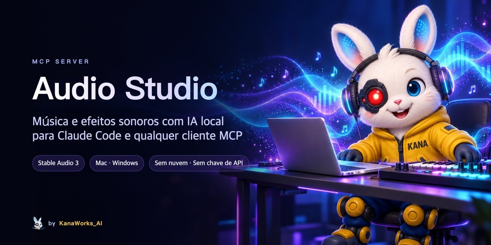
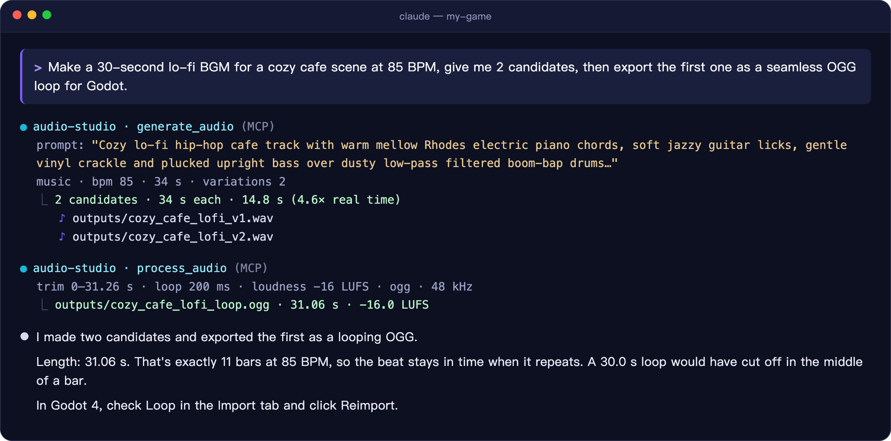
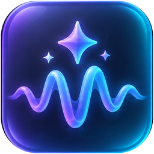
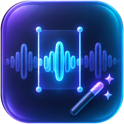
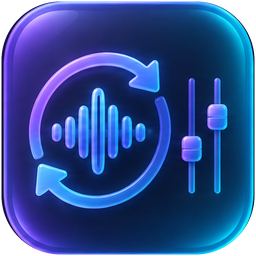
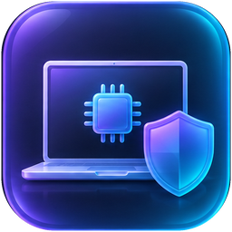
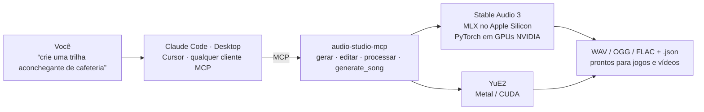
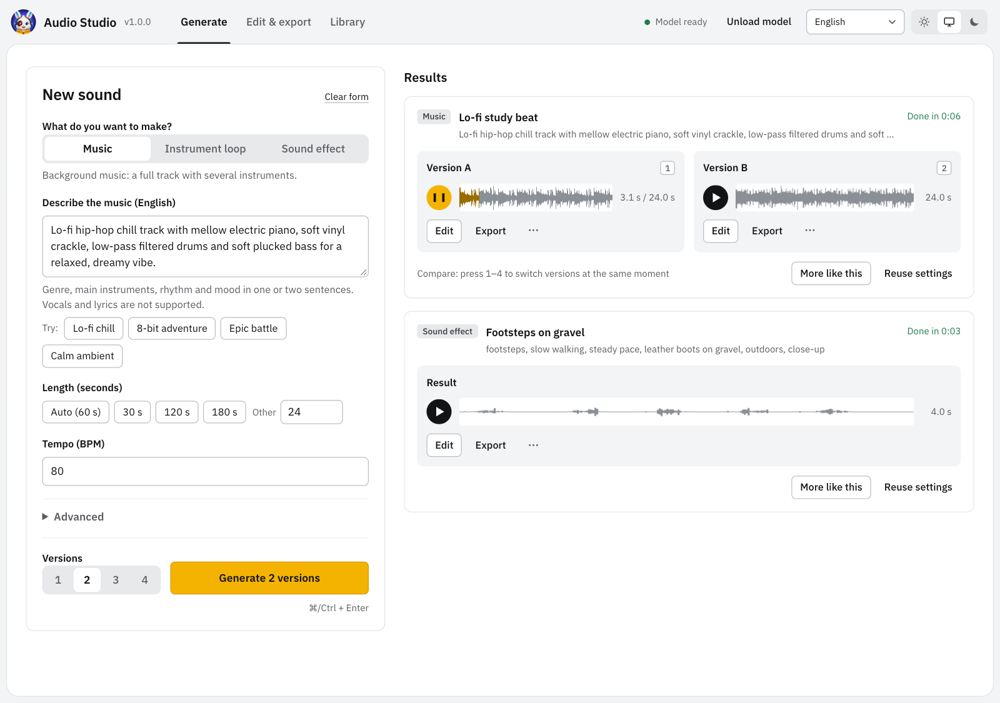
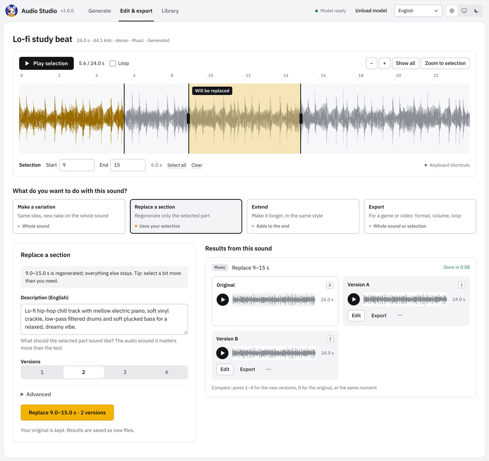
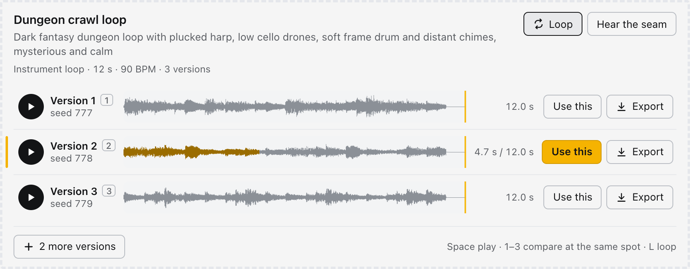

<div align="center">



<p>
  <a href="LICENSE"></a>
  
  
  <a href="https://modelcontextprotocol.io"></a>
  
  <a href="https://github.com/kanaworksai-hue/audio-studio-mcp/actions/workflows/tests.yml"></a>
  <a href="https://github.com/kanaworksai-hue/audio-studio-mcp/stargazers"></a>
</p>

<p><a href="https://github.com/kanaworksai-hue"></a>&nbsp;<a href="https://github.com/kanaworksai-hue"><b>Um projeto KanaWorks_AI</b></a></p>

[English](README.md) | [简体中文](README.zh-CN.md) | [日本語](README.ja.md) | [한국어](README.ko.md) | **Português (Brasil)** | [Español](README.es.md)

<!-- mcp-name: io.github.kanaworksai-hue/audio-studio-mcp -->

[🎧 Ouça os exemplos](https://kanaworksai-hue.github.io/audio-studio-mcp/) · [Início rápido](#-início-rápido) · [Ferramentas](#-ferramentas) · [Web UI](#-web-ui) · [FAQ](#-perguntas-frequentes) · [⭐ Dê uma estrela](#-curtiu-dê-uma-estrela)

</div>

O **Audio Studio MCP** dá ao Claude Code, ao Claude Desktop, ao Cursor e a qualquer outro cliente [MCP](https://modelcontextprotocol.io) um estúdio de som que roda no seu próprio Mac ou PC com Windows. Peça uma música de fundo ou um efeito sonoro em linguagem natural; o modelo gera tudo localmente com o [Stable Audio 3](https://github.com/Stability-AI/stable-audio-3). Em seguida, dá para transformar o áudio em loop, normalizar a loudness e exportar tudo para a sua engine de jogo ou o seu editor de vídeo. Sem serviço em nuvem, sem chave de API e sem pagar nada por geração.

Para criar músicas cantadas, forneça a letra e o estilo musical ao modelo opcional YuE2. A voz e o acompanhamento são gerados no seu computador.

<p align="center">
  
  <br><sub>Uma sessão real (em inglês), resumida. O Claude escolheu um loop de exatamente 11 compassos para que a batida não saia do tempo quando o loop recomeça.</sub>
</p>

## ✨ Destaques

<table>
<tr>
<td align="center" width="25%"><br><b>Gerar</b><br><sub>Música de fundo, loops de instrumento e efeitos sonoros a partir de uma frase, 1–4 versões por chamada</sub></td>
<td align="center" width="25%"><br><b>Editar</b><br><sub>Mude o estilo de um clipe inteiro, gere de novo um trecho ou estenda uma faixa</sub></td>
<td align="center" width="25%"><br><b>Finalizar</b><br><sub>Loops sem emenda, fades, loudness (LUFS), WAV / OGG / FLAC em 48 kHz</sub></td>
<td align="center" width="25%"><br><b>Local</b><br><sub>Roda no Apple Silicon (MLX) ou numa GPU NVIDIA (PyTorch). Nada sai da sua máquina</sub></td>
</tr>
</table>

- **Ouça no chat:** no Claude Desktop e em outros clientes com MCP Apps, os resultados aparecem como um player na própria conversa. Compare versões, exporte ou peça mais sem abrir nenhum arquivo. Veja [Ouça no chat](#-ouça-no-chat).
- **Reproduzível:** cada arquivo ganha um `.json` ao lado com o prompt, a seed e as configurações.
- **Guia de prompts embutido:** o servidor ensina ao cliente o formato oficial de prompt do Stable Audio 3, então um pedido como "faça um som de porta rangendo" vira um prompt que o modelo entende.
- **Fiel ao upstream:** no Mac, com a mesma seed, os resultados são idênticos bit a bit aos da CLI oficial `sa3`. No Windows, o servidor usa a API oficial do Stable Audio 3 em PyTorch.

## 🎧 Ouça

### Exemplos de músicas com voz

- [Voz em inglês · Porch Light at Dawn](https://kanaworksai-hue.github.io/audio-studio-mcp/#porch_light_at_dawn)
- [Voz em japonês · 雨上がりの坂道](https://kanaworksai-hue.github.io/audio-studio-mcp/#ameagari_no_sakamichi)

### Música instrumental e efeitos sonoros

As faixas instrumentais e os efeitos sonoros da tabela foram gerados com o Stable Audio 3 num Mac M1, sem edição manual. **[Abrir a página de exemplos →](https://kanaworksai-hue.github.io/audio-studio-mcp/)**

| | Exemplo | Prompt |
|---|---|---|
|  | [**Cafeteria lo-fi**](https://kanaworksai-hue.github.io/audio-studio-mcp/#lofi_cafe)<br><sub>música · 30 s · 85 BPM</sub> | Lo-fi hip-hop chill track with mellow electric piano, soft vinyl crackle, low-pass filtered drums… |
|  | [**Orquestral épico**](https://kanaworksai-hue.github.io/audio-studio-mcp/#epic_orchestral)<br><sub>música · 30 s</sub> | Epic cinematic orchestral trailer music with thundering taiko drums, soaring French horns… |
|  | [**Aventura chiptune**](https://kanaworksai-hue.github.io/audio-studio-mcp/#chiptune_adventure)<br><sub>música · 20 s · 150 BPM</sub> | Upbeat 8-bit chiptune adventure theme with a bright square wave lead… |
|  | [**Vidro estilhaçando**](https://kanaworksai-hue.github.io/audio-studio-mcp/#glass_shatter)<br><sub>efeito sonoro · 3 s</sub> | source: glass bottle · action: shattering on impact · material: thick green glass · space: concrete floor |
|  | [**Chuva e trovões**](https://kanaworksai-hue.github.io/audio-studio-mcp/#rain_thunder)<br><sub>efeito sonoro · 12 s</sub> | source: heavy rain and distant thunder · space: outdoor forest at night, wide stereo |
|  | [**Synthwave estendida**](https://kanaworksai-hue.github.io/audio-studio-mcp/#synthwave_drive_extended)<br><sub>edição · 20 s → 40 s</sub> | `edit_audio` continue: uma faixa de 20 segundos estendida para 40 segundos |

Os MP3 estão em [`docs/samples/`](docs/samples), com os prompts e as seeds em [`samples.json`](docs/samples/samples.json).

## 🧭 Como funciona



## 🚀 Início rápido

Você precisa do [uv](https://docs.astral.sh/uv/) 0.9.20 ou mais recente e do [ffmpeg](https://ffmpeg.org). Não é preciso clonar nada: o `uvx` baixa e executa o pacote publicado.

As etapas abaixo instalam o Stable Audio 3 para faixas instrumentais e efeitos sonoros. Para gerar músicas com voz, execute `song-setup` seguindo o [guia de instalação do YuE2 (em inglês)](docs/song-generation.md#install-when-needed).

| | macOS | Windows |
|---|---|---|
| **Hardware** | Apple Silicon (M1 ou mais recente), 16 GB de RAM recomendados | GPU NVIDIA com 8 GB de VRAM ou mais e driver atualizado. Testado numa RTX 3060 12 GB |
| **Disco** | Cerca de 8 GB (modelo ~6,9 GB) | Cerca de 14 GB (modelo ~10,4 GB, PyTorch) |
| **uv e ffmpeg** | `brew install uv ffmpeg` | `winget install astral-sh.uv` e `winget install Gyan.FFmpeg` |
| **Licença do modelo** | Nada a fazer | Requer uma conta gratuita no [Hugging Face](https://huggingface.co): abra [stabilityai/stable-audio-3-medium](https://huggingface.co/stabilityai/stable-audio-3-medium) e aceite a licença uma vez |

**1. Rode o setup no terminal (só uma vez).** Ele verifica o seu computador, busca o runtime oficial do Stable Audio 3 num commit testado, informa o tamanho do download do modelo e pergunta antes de baixá-lo. Pode rodar de novo sem medo: o que já foi baixado não se perde.

```bash
# macOS
uvx --python 3.11 audio-studio-mcp setup
```

```powershell
# Windows
uvx --python 3.11 --torch-backend cu126 audio-studio-mcp setup
```

`--torch-backend cu126` faz o uv instalar a build do PyTorch com CUDA (no PyPI só existe a build para CPU no Windows), e `--python 3.11` impede que o uv escolha um Python que o PyTorch ainda não suporta. Se o uvx reclamar de `unexpected argument '--torch-backend'`, o seu uv está desatualizado: atualize com `winget upgrade astral-sh.uv` (ou `uv self update`). No Windows, se você ainda não fez login no Hugging Face, o setup mostra os passos: aceite a licença na página do modelo, faça login **no seu próprio terminal** com `uvx --from huggingface_hub hf auth login` e rode o setup de novo.

O setup baixa o modelo **medium**. Para os modelos pequenos e rápidos, adicione `--model sm-music`, `--model sm-sfx` ou `--model all` e defina `AUDIO_STUDIO_SA3_MODEL` na configuração do seu cliente (veja [Configuração](#️-configuração)).

**2. Registre o servidor no seu cliente MCP.** Use o mesmo comando sem `setup`:

```bash
# Claude Code, macOS
claude mcp add --scope user audio-studio -- uvx --python 3.11 audio-studio-mcp
# Claude Code, Windows
claude mcp add --scope user audio-studio -- uvx --python 3.11 --torch-backend cu126 audio-studio-mcp
```

<details>
<summary><b>Claude Desktop, Codex, VS Code, Cursor e outros clientes</b></summary>

No Windows, adicione `"--torch-backend", "cu126"` depois de `"3.11"` em cada exemplo abaixo.

**Claude Desktop** (`claude_desktop_config.json`), **Cursor** (`.cursor/mcp.json`) e a maioria dos outros clientes:

```json
{
  "mcpServers": {
    "audio-studio": {
      "command": "uvx",
      "args": ["--python", "3.11", "audio-studio-mcp"]
    }
  }
}
```

Se o cliente disser que não encontra o `uvx`, coloque o caminho completo dele em `command` (`which uvx` no macOS, `where uvx` no Windows). Reinicie o Claude Desktop depois de editar.

**Codex** (`~/.codex/config.toml`). Por padrão, o Codex espera só 10 segundos para um servidor iniciar e 60 segundos por chamada de ferramenta; faixas longas precisam de mais:

```toml
[mcp_servers.audio-studio]
command = "uvx"
args = ["--python", "3.11", "audio-studio-mcp"]
startup_timeout_sec = 60
tool_timeout_sec = 900
```

**VS Code** (`.vscode/mcp.json`, ou **MCP: Open User Configuration**):

```json
{
  "servers": {
    "audio-studio": {
      "type": "stdio",
      "command": "uvx",
      "args": ["--python", "3.11", "audio-studio-mcp"]
    }
  }
}
```
</details>

Os arquivos gerados vão para `~/AudioStudio` (defina `AUDIO_STUDIO_OUTPUT_DIR` para mudar). O uvx continua usando a versão que já instalou; para atualizar, rode `uv cache clean audio-studio-mcp` e depois o setup de novo.

> [!TIP]
> **Deixe o agente instalar para você.** Cole isto no Claude Code:
> *"Instale o Audio Studio MCP (https://github.com/kanaworksai-hue/audio-studio-mcp) seguindo as instruções do README, inclusive as notas para agentes de IA."*
>
> **Notas para agentes de IA:**
> - Rode você mesmo o comando de setup do sistema operacional do usuário, com `-y` e um timeout longo: ele baixa cerca de 7 GB no macOS e cerca de 13 GB no Windows (modelo e PyTorch). Se for interrompido, rode de novo; o que já foi baixado é mantido. Depois, registre o servidor como mostrado acima.
> - No Windows, os pesos do modelo têm acesso restrito e exigem que o próprio usuário faça login no Hugging Face. Se o setup parar e mostrar os passos de login, repasse-os ao usuário, espere ele avisar que terminou e rode o setup de novo. Nunca peça para o usuário colar o token no chat.
> - Enquanto o setup não terminar, o servidor até inicia, mas toda chamada de ferramenta só responde com o comando de setup que falta rodar.

### Alternativa: instalar a partir do código-fonte

Os scripts de instalação das versões anteriores continuam funcionando. Eles clonam o repositório, colocam o runtime em `vendor/` e o áudio em `outputs/` dentro dele, e rodam a partir do `.venv/`.

#### macOS (Apple Silicon)

**Requisitos:**

- Mac com Apple Silicon (M1 ou mais recente), 16 GB de RAM recomendados
- Cerca de 8 GB de disco (modelo ~6,9 GB)
- `git` e [`ffmpeg`](https://ffmpeg.org) (`brew install ffmpeg`)

```bash
git clone https://github.com/kanaworksai-hue/audio-studio-mcp.git
cd audio-studio-mcp
./install.sh
```

O instalador configura o [`uv`](https://docs.astral.sh/uv/) se necessário, clona o runtime oficial do Stable Audio 3 em `vendor/` num commit testado, cria o `.venv/` e baixa o modelo **medium** (1,4B, ~6,9 GB) do [Hugging Face](https://huggingface.co/stabilityai/stable-audio-3-optimized). No final, ele mostra o comando exato para registrar o servidor:

```bash
claude mcp add --scope user audio-studio -- /path/to/audio-studio-mcp/.venv/bin/audio-studio-mcp
```

#### Windows (GPU NVIDIA)

**Requisitos:**

- Windows 10 ou 11 de 64 bits com uma GPU NVIDIA (8 GB de VRAM ou mais) e driver atualizado. Testado numa RTX 3060 12 GB
- Cerca de 14 GB de disco para o modelo e o PyTorch
- `git` (`winget install Git.Git`) e [`ffmpeg`](https://ffmpeg.org) (`winget install Gyan.FFmpeg`)
- Uma conta gratuita no [Hugging Face](https://huggingface.co). Os pesos em PyTorch têm acesso restrito: abra [stabilityai/stable-audio-3-medium](https://huggingface.co/stabilityai/stable-audio-3-medium) e aceite a licença uma vez

```powershell
git clone https://github.com/kanaworksai-hue/audio-studio-mcp.git
cd audio-studio-mcp
powershell -ExecutionPolicy Bypass -File install.ps1
```

O instalador segue os mesmos passos do macOS, mas instala o PyTorch com CUDA e baixa o checkpoint oficial em PyTorch do modelo **medium** (~10,4 GB). Se você ainda não fez login no Hugging Face, ele pede um token de acesso com permissão de leitura ([crie um aqui](https://huggingface.co/settings/tokens)). Quando roda sem console (por exemplo, iniciado por um agente de IA), ele não faz nenhuma pergunta: mostra os passos de login e sai; depois de fazer login, é só rodar o instalador de novo. No final, ele mostra o comando para registrar o servidor:

```powershell
claude mcp add --scope user audio-studio -- "C:\path\to\audio-studio-mcp\.venv\Scripts\audio-studio-mcp.exe"
```

O Flash Attention não é necessário. Sem ele, o runtime usa a atenção nativa do PyTorch.

<details>
<summary><b>Claude Desktop, Cursor e outros clientes</b></summary>

Adicione isto ao `claude_desktop_config.json`, ao `.cursor/mcp.json` ou à configuração MCP do seu cliente:

```json
{
  "mcpServers": {
    "audio-studio": {
      "command": "/path/to/audio-studio-mcp/.venv/bin/audio-studio-mcp"
    }
  }
}
```

No Windows, o comando é `C:\\path\\to\\audio-studio-mcp\\.venv\\Scripts\\audio-studio-mcp.exe` (com as barras invertidas duplicadas no JSON).
</details>

<details>
<summary><b>Opções do instalador</b></summary>

| macOS | Windows | Efeito |
|---|---|---|
| `--model all` | `-Model all` | Baixa também os modelos pequenos e rápidos `sm-music` e `sm-sfx` (+2,6 GB no macOS, +7 GB no Windows) |
| `--skip-weights` | `-SkipWeights` | Não baixa agora; a primeira geração faz o download |
| `-y` | `-Yes` | Instala o `uv` sem perguntar |

No macOS, os downloads são anônimos; fazer login com `hf auth login` aumenta o limite de requisições do Hugging Face. No Windows, os pesos em PyTorch têm acesso restrito: aceite a licença na página de cada modelo que você for baixar ([medium](https://huggingface.co/stabilityai/stable-audio-3-medium), [small-music](https://huggingface.co/stabilityai/stable-audio-3-small-music), [small-sfx](https://huggingface.co/stabilityai/stable-audio-3-small-sfx)) e faça login.
</details>

Depois, é só pedir:

- "Crie uma música de fundo lo-fi em loop, de 60 segundos e 85 BPM, para uma cena de cafeteria. Quero 3 opções."
- "Preciso do som de uma porta pesada de madeira batendo num corredor de pedra. Exporte em OGG para o Godot."
- "Estenda essa faixa até 90 segundos e normalize para −16 LUFS."

## 🧰 Ferramentas

| Ferramenta | O que faz |
|---|---|
| `generate_audio` | Gera música de fundo, loop/stem de instrumento ou efeito sonoro a partir de texto. 1–4 versões por chamada, `bpm`, campos estruturados para efeitos sonoros |
| `generate_song` | Gera voz e acompanhamento com o YuE2 a partir de uma letra e de um estilo |
| `song_status` | Consulta o progresso da geração e recupera a música quando ela estiver pronta |
| `cancel_song` | Cancela uma tarefa de geração que está na fila ou em andamento |
| `edit_audio` | `variation` (muda o estilo do clipe inteiro), `inpaint` (gera de novo um trecho), `continue` (estende). 1–4 versões |
| `process_audio` | Corte → remoção de silêncio → mono → reamostragem / loudness → loop sem emenda → fades → normalização de pico ou teto → WAV / OGG / FLAC. Nunca altera o arquivo original |
| `unload_models` | Libera a memória do modelo na hora |

<details>
<summary><b>Notas sobre os parâmetros</b></summary>

- **`audio_type`**: `music` / `instrument` / `sfx` / `raw`. O servidor adiciona o prefixo com que o modelo foi treinado (`TrackType: Music, VocalType: Instrumental,` …). Sem o prefixo de SFX, os efeitos sonoros muitas vezes saem como música.
- **`variations`**: 1–4 versões, com as seeds `seed, seed+1, …`. Use `seed: -1` ou deixe o parâmetro de fora para ter uma seed aleatória.
- **`sound_source` / `sound_action` / `sound_material` / `sound_space`**: descrevem um efeito sonoro: o que produz o som, como ele evolui, a textura e o espaço onde ele acontece.
- **`peak_ceiling_db`** (padrão −1): um teto de segurança. Picos acima dele são reduzidos, mas áudio mais baixo nunca é amplificado. Use `process_audio` para normalizar.
- **Normalização no `process_audio`**: `peak` é o mais comum para efeitos sonoros. `loudness` normaliza para um alvo em LUFS: −14 para streaming/vídeo, −16 para música de jogo, −23 para TV e rádio.

Os arquivos gerados são WAV estéreo de 44,1 kHz e 24 bits, gravados na pasta de saída (`~/AudioStudio`, ou `outputs/` numa instalação a partir do código-fonte; veja `AUDIO_STUDIO_OUTPUT_DIR`). Cada um tem um `<name>.json` ao lado. Os arquivos processados guardam as informações da geração original em `source`.
</details>

## 🌐 Web UI

Prefere clicar em vez de conversar? O mesmo servidor também traz uma página web local. Gere músicas de fundo e efeitos sonoros, compare as versões, edite (crie uma variação, substitua um trecho, estenda), exporte para o seu jogo ou vídeo e veja na biblioteca tudo o que você já criou.

<p align="center">
<picture>
  <source media="(prefers-color-scheme: dark)" srcset="docs/assets/webui-generate-en-dark.png">
  
</picture>
<br><br>
<picture>
  <source media="(prefers-color-scheme: dark)" srcset="docs/assets/webui-edit-en-dark.png">
  
</picture>
</p>

```bash
uvx --python 3.11 audio-studio-mcp --web 8765
```

A página http://127.0.0.1:8765/ abre no navegador. Adicione `--no-browser` para não abrir o navegador, ou `--preload` para carregar o modelo já na inicialização. Pressione Ctrl+C para parar. No Windows, adicione `--torch-backend cu126` depois de `3.11`. Numa instalação a partir do código-fonte: `.venv/bin/audio-studio-mcp --web 8765` (Windows: `.venv\Scripts\audio-studio-mcp.exe --web 8765`).

A página e os seus clientes MCP podem compartilhar um único processo e um único modelo carregado: a mesma porta também expõe o MCP em `/mcp`. Registre uma vez e use os dois ao mesmo tempo; os pedidos da página e dos agentes entram na mesma fila.

```bash
claude mcp add --scope user --transport http audio-studio http://127.0.0.1:8765/mcp
```

- Os arquivos são gravados na pasta de saída (`~/AudioStudio`, `outputs/` numa instalação a partir do código-fonte, ou `AUDIO_STUDIO_OUTPUT_DIR`). A biblioteca mostra essa pasta, e o editor trabalha com os arquivos dela.
- A web UI está disponível em inglês, japonês e chinês e usa o idioma do seu navegador; dá para trocar nas configurações. As capturas de tela acima mostram a interface em inglês, já que ela não tem versão em português.

> [!WARNING]
> A web UI foi feita para uso só no seu computador. Ela escuta apenas em `127.0.0.1` e não tem login. Não a exponha para outras máquinas (por redirecionamento de porta, proxy reverso ou túnel): qualquer pessoa que consiga abri-la pode usar a sua GPU e gravar arquivos na sua pasta de saída.

### Músicas com voz

A aba **Songs** da interface web e a ferramenta MCP `generate_song` geram voz e acompanhamento a partir de uma letra com o modelo opcional YuE2, em Macs com Apple Silicon ou no Windows x64 com GPU NVIDIA CUDA. Com as configurações padrão, é preciso um Mac com 32 GB de memória ou um PC Windows com 32 GB de RAM e pelo menos 6 GB de VRAM livre. Veja os termos do modelo, os tamanhos de download e as configurações do modo Auto no [guia de instalação e uso de músicas (em inglês)](docs/song-generation.md).

## 💬 Ouça no chat

Nos clientes compatíveis com [MCP Apps](https://modelcontextprotocol.io/extensions/apps/overview), os resultados de `generate_audio`, `edit_audio`, `process_audio` e `generate_song` aparecem como um player direto na conversa. Você não precisa abrir os arquivos. O card de uma música mostra o progresso até o WAV ficar pronto.

<p align="center">
<picture>
  <source media="(prefers-color-scheme: dark)" srcset="docs/assets/chat-player-en-dark.png">
  
</picture>
<br><sub>Três versões de um loop de masmorra, saída real do modelo, exibidas no host de referência do MCP Apps.</sub>
</p>

- **Ouça e compare:** forma de onda, play, pausa e avanço/retrocesso. Troque de versão durante a reprodução e a próxima continua do mesmo ponto. As teclas `1`–`9` escolhem uma versão, e `0` toca o áudio de antes da edição.
- **Confira os loops:** ative **Loop** e clique em **Hear the seam** para ouvir o final emendando no começo.
- **Escolha, exporte, gere mais:** **Use this** avisa ao assistente qual versão você escolheu. **Export** salva o áudio para um jogo ou vídeo com os mesmos presets da web UI. **2 more versions** roda o mesmo prompt de novo com as seeds seguintes.
- O player segue o idioma do cliente (inglês, japonês ou chinês) e o tema claro ou escuro; como não tem versão em português, aparece em inglês. Nada sai do seu computador: o servidor envia ao player uma prévia comprimida de cada arquivo.

| Cliente | Player |
|---|---|
| Claude Desktop | ✅ |
| VS Code (GitHub Copilot) | ✅ Ative `chat.mcp.apps.enabled` (experimental) |
| Cursor, Goose e outros clientes com MCP Apps | ✅ |
| App do Codex (desktop) | ✅ |
| Claude Code, Codex CLI e extensão para IDE, e outros clientes | Resultados em texto, como antes |
| claude.ai, ChatGPT | ❌ Eles precisam de um servidor remoto, e este roda no seu computador |

Não apareceu o player, só texto? Reinicie o cliente depois de mudar as configurações de MCP. Em algumas versões do Claude Desktop, os apps de servidores locais não aparecem nos chats normais ([anthropics/claude-ai-mcp#1069](https://github.com/anthropics/claude-ai-mcp/issues/1069)); num chat anônimo, eles aparecem. Para desativar o player, defina `AUDIO_STUDIO_CHAT_PLAYER=off`.

## ⚙️ Configuração

<details>
<summary><b>Variáveis de ambiente</b></summary>

| Variável | Padrão | Descrição |
|---|---|---|
| `AUDIO_STUDIO_OUTPUT_DIR` | `~/AudioStudio` (instalação a partir do código-fonte: `<repo>/outputs`) | Pasta onde os arquivos de áudio são gravados |
| `AUDIO_STUDIO_IDLE_UNLOAD_MIN` | `10` | Minutos sem uso até liberar os modelos (`0` = nunca) |
| `AUDIO_STUDIO_SA3_MODEL` | `medium` | `medium` (melhor qualidade, até 380 s), `sm-music` ou `sm-sfx` (pequenos e rápidos, até 120 s) |
| `AUDIO_STUDIO_MLX_CACHE_GB` | `1` | macOS: limite do cache de buffers do MLX. Sem ele, uma geração longa pode deixar ~6 GB em cache |
| `AUDIO_STUDIO_DEVICE` | `cuda` se disponível | Windows/Linux: dispositivo do PyTorch, por exemplo `cuda`, `cuda:1` ou `cpu` |
| `AUDIO_STUDIO_SA3_DIR` | baixado pelo setup (instalação a partir do código-fonte: `<repo>/vendor/stable-audio-3`) | Usa outro checkout do stable-audio-3 |
| `AUDIO_STUDIO_HOME` | macOS `~/Library/Application Support/audio-studio-mcp`, Windows `%LOCALAPPDATA%\audio-studio-mcp` | Onde o setup guarda o runtime do Stable Audio 3 (~1 MB). Os pesos ficam no cache do Hugging Face |
| `AUDIO_STUDIO_BACKEND` | `auto` | `auto`, `sa3-mlx` (Apple Silicon) ou `sa3-torch` (PyTorch, NVIDIA) |
| `AUDIO_STUDIO_FFMPEG` | `ffmpeg` no `PATH` | Caminho do ffmpeg |
| `AUDIO_STUDIO_CHAT_PLAYER` | `auto` | [Player no chat](#-ouça-no-chat): `auto` para clientes que anunciam suporte a MCP Apps, `off` para só texto em todos, `on` também para clientes que exibem MCP Apps sem anunciar o suporte (nesse caso, os clientes sem MCP Apps passam a listar a ferramenta auxiliar do player) |

Passe as variáveis com `claude mcp add ... -e NAME=value` ou no bloco `env` da configuração do seu cliente.
</details>

<details>
<summary><b>Compartilhar um servidor entre sessões</b></summary>

Normalmente, cada sessão do cliente inicia o seu próprio processo de servidor. Os modelos são carregados na primeira chamada e liberados depois de um tempo sem uso. Para manter um único processo sempre pronto para todas as sessões, rode-o como servidor HTTP local. Ele escuta apenas em `127.0.0.1`.

```bash
uvx --python 3.11 audio-studio-mcp --http 8765 --preload
claude mcp add --scope user --transport http audio-studio http://127.0.0.1:8765/mcp
```

No Windows, adicione `--torch-backend cu126` depois de `3.11`. Numa instalação a partir do código-fonte, inicie `.venv/bin/audio-studio-mcp` (Windows: `.venv\Scripts\audio-studio-mcp.exe`) com as mesmas opções.

`--web 8765` faz o mesmo e ainda adiciona a [web UI](#-web-ui) na mesma porta.
</details>

## ⚡ Desempenho

Modelo medium num Mac M1 com 16 GB:

| Tarefa | Tempo |
|---|---|
| Dois efeitos sonoros de 3 s, cold start | ~13 s |
| 20 s de música, modelo já carregado | ~10 s (2× mais rápido que o tempo real) |
| Estender até 35 s, incluindo o carregamento do encoder | ~27 s |
| 15 s de música com `sm-music`, modelo já carregado | ~1 s |

Modelo medium no Windows com uma RTX 3060 12 GB:

| Tarefa | Tempo |
|---|---|
| Dois efeitos sonoros de 3 s, cold start (incl. ~20 s de carregamento do modelo) | ~25 s |
| 20 s de música, modelo já carregado | ~1,3 s |
| Estender até 30 s, modelo já carregado | ~2,2 s |
| 380 s de música (o máximo), modelo já carregado | ~15 s |
| 15 s de música com `sm-music`, modelo já carregado | ~0,7 s |

No Mac, os modelos carregados usam cerca de 5–7 GB de memória. Na RTX 3060, o pico de uso do modelo medium foi de cerca de 5,3 GB de VRAM. Os modelos são liberados depois de um tempo sem uso ou com `unload_models`.

## 📝 Dicas de prompt

<details>
<summary><b>Do guia oficial de prompts do Stable Audio 3</b></summary>

1. **Em inglês, 1–2 frases, até ~45 palavras.** Evite palavras ligadas à voz, como vocals, singer ou lyrics.
2. **Música:** gênero + adjetivos → instrumentos principais → camadas de apoio → bateria/ritmo → clima. Coloque o andamento em `bpm`.
   > Lo-fi hip-hop chill track with mellow electric piano, soft vinyl crackle, low-pass filtered drums and soft plucked bass for a relaxed, dreamy vibe.
3. **Efeitos sonoros:** preencha fonte (source), ação (action), material e espaço (space).
   > source: glass bottle / action: shattering on impact, fragments scattering / material: thick green glass, sharp bright transient / space: concrete floor, close-up, dry
4. **Ajuste a duração ao conteúdo:** impactos 1–3 s, ações 3–6 s, ambiência 6–15 s ou mais, loops 6–20 s, faixas completas 120–300 s (máx. 380 s).
5. **Instruções de tempo** como "clímax aos 15 s" nem sempre são respeitadas. Gere primeiro e depois ajuste com `inpaint` ou `continue`.
6. Os valores padrão `steps=8` e `cfg=1.0` são as configurações oficiais. Para o modelo seguir o prompt com mais rigor, ou para usar `negative_prompt`, experimente `cfg` entre 3 e 7 (cerca de 2× mais lento).
7. Os resultados variam muito de uma seed para outra. Peça 2–4 `variations` e fique com a melhor.

O guia completo também chega ao cliente como instruções do servidor.
</details>

## ❓ Perguntas frequentes

<details>
<summary><b>Roda no Windows, no Linux ou em Macs Intel?</b></summary>

**Windows:** sim, com uma GPU NVIDIA. Veja [Início rápido](#-início-rápido).

**Linux:** com uma GPU NVIDIA, ele usa o mesmo backend em PyTorch e deve funcionar, mas não foi testado. Use o extra `cuda`: `uvx --python 3.11 --torch-backend cu126 --from "audio-studio-mcp[cuda]" audio-studio-mcp setup`, e faça login no Hugging Face como no Windows.

**Macs Intel e GPUs AMD** não são suportados.
</details>

<details>
<summary><b>Aparece "Intel Macs are not supported" num Mac com Apple Silicon?</b></summary>

O ambiente foi criado com um Python x86_64 (por exemplo, um Homebrew antigo para Intel em `/usr/local`) que roda pelo Rosetta, e por isso o MLX ficou de fora. Se você usa o uvx, peça o Python arm64 gerenciado pelo próprio uv, tanto no setup quanto na configuração do seu cliente: `uvx --python cpython-3.11-macos-aarch64 audio-studio-mcp`. Se você usa o script de instalação, rode `./install.sh` de novo: ele pede ao uv um Python arm64 e, nesse caso, recria o `.venv`. Se você mesmo definiu `UV_PYTHON`, aponte para uma build arm64: `UV_PYTHON=cpython-3.11-macos-aarch64 ./install.sh`.
</details>

<details>
<summary><b>Dá para fazer músicas com voz?</b></summary>

Sim. Instale o modelo opcional YuE2 e use a aba Songs ou a ferramenta `generate_song` para gerar voz e acompanhamento a partir de uma letra e de um estilo. O Stable Audio 3 é usado para faixas instrumentais e efeitos sonoros. Consulte o [guia de instalação do YuE2 (em inglês)](docs/song-generation.md).
</details>

<details>
<summary><b>Posso usar o áudio gerado comercialmente?</b></summary>

O código do projeto é distribuído sob a licença MIT. Antes de usar o áudio comercialmente, consulte os termos do modelo com que ele foi gerado: [Stable Audio 3](https://huggingface.co/stabilityai/stable-audio-3-optimized) ou [YuE2 (em inglês)](docs/song-generation.md#install-when-needed).
</details>

<details>
<summary><b>Funciona num Mac com 8 GB?</b></summary>

Não foi testado. O modelo medium precisa de cerca de 5–7 GB enquanto está carregado, por isso recomendamos 16 GB. Os modelos pequenos `sm-music` / `sm-sfx` são mais leves.
</details>

<details>
<summary><b>Meu loop dá um clique na emenda.</b></summary>

Use WAV ou OGG para loops. O MP3 adiciona um preenchimento (padding) no início e no fim, por isso não serve para loops sem emenda. Tente também um `loop_crossfade_ms` maior, ou peça ao modelo para cortar exatamente numa barra de compasso.
</details>

## 🗺️ Roadmap

- [x] Backend para Apple Silicon (Stable Audio 3, MLX)
- [x] Backend para Windows com GPUs NVIDIA (Stable Audio 3, PyTorch)
- [x] Web UI local (`--web`)
- [x] Instalação com um único comando via `uvx`
- [x] Ouça no chat (player com MCP Apps)
- [x] Geração local de músicas com voz a partir de letras (YuE2, Metal no macOS e CUDA no Windows)
- [ ] Suporte a LoRA (o runtime upstream já tem)

Issues e pull requests são bem-vindos.

## ⭐ Curtiu? Dê uma estrela

Se o Audio Studio criou um som que você acabou usando, clique em **⭐ Star** no topo da [página do repositório](https://github.com/kanaworksai-hue/audio-studio-mcp). É grátis, leva um segundo e ajuda mais do que parece:

- **Mais gente encontra o projeto.** As estrelas ajudam o projeto a aparecer no GitHub, e assim mais desenvolvedores de jogos e criadores de vídeo chegam até ele.
- **As atualizações continuam saindo.** Cada estrela me mostra que isto está sendo útil para alguém. É o que me motiva a seguir trabalhando na próxima atualização, como o suporte a LoRA.

Outras formas de ajudar: [abra uma issue](https://github.com/kanaworksai-hue/audio-studio-mcp/issues) para relatar um bug ou sugerir uma ideia, ou compartilhe no X um som que você criou e marque [@KanaWorks_AI](https://x.com/KanaWorks_AI).

## 🛠️ Desenvolvimento

```bash
uv run pytest                              # testes offline, sem precisar do modelo
.venv/bin/python scripts/smoke_test.py     # ponta a ponta com o modelo real (~30 s num M1)
rm -rf dist && uv build && WHL=$(ls dist/*.whl)   # o mesmo, mas com a wheel gerada, do jeito que o uvx roda:
uvx --python 3.11 --from "$WHL" audio-studio-mcp setup -y
.venv/bin/python scripts/smoke_test.py --server "uvx --python 3.11 --from $WHL audio-studio-mcp"
```

No Windows: `.venv\Scripts\python scripts\smoke_test.py` (~45 s numa RTX 3060, incluindo o carregamento do modelo).

```
src/audio_studio_mcp/
  server.py            ferramentas MCP (independentes do backend)
  runtime.py           onde ficam o runtime e as saídas; baixa o runtime nas instalações via uvx
  firstrun.py          `audio-studio-mcp setup`
  weights.py           pesos do modelo: o que já foi baixado e como baixar
  prompts.py           montagem dos prompts e as instruções enviadas aos clientes
  post.py              pós-processamento e exportação
  backends/base.py     interface dos backends
  backends/sa3_mlx.py  Stable Audio 3 no Apple Silicon (MLX)
  backends/sa3_torch.py  Stable Audio 3 em GPUs NVIDIA (PyTorch)
  web.py               servidor da web UI (--web) e a API JSON dela
  static/              web UI (HTML/JS/CSS, sem etapa de build)
```

Uma nova plataforma entra como mais um backend em `backends/`.

## 📄 Licença e créditos

- **Este projeto:** [MIT](LICENSE).
- **Runtime do Stable Audio 3:** baixado pelo `setup` (ou em `vendor/` pelos scripts de instalação) num commit fixo. É © Stability AI e licenciado sob MIT.
- **Pesos do modelo Stable Audio 3:** licenciados sob a [Stability AI Community License](https://huggingface.co/stabilityai/stable-audio-3-optimized). São baixados do Hugging Face (macOS: `stable-audio-3-optimized`; Windows: `stable-audio-3-medium` e os modelos pequenos) e não são redistribuídos aqui.
- Os pesos e o ambiente de execução do YuE2 são instalados sob demanda. Consulte os [termos de uso e o guia de instalação (em inglês)](docs/song-generation.md#install-when-needed).
- **Marca:** o nome KanaWorks_AI, o logotipo e a personagem Kana são © 東京AI映像合同会社 (Tokyo AI Visuals LLC) e **não** estão cobertos pela licença MIT. Veja [docs/brand](docs/brand/README.md).
- **Fontes:** a web UI inclui a fonte IBM Plex Sans, © IBM Corp., sob a SIL Open Font License 1.1 ([`OFL.txt`](src/audio_studio_mcp/static/fonts/OFL.txt)). As imagens da Kana na web UI ([`static/brand`](src/audio_studio_mcp/static/brand/README.md)) estão cobertas pelo item Marca acima.
- **Desenvolvido com:** [Stable Audio 3](https://github.com/Stability-AI/stable-audio-3), [MLX](https://github.com/ml-explore/mlx), [PyTorch](https://pytorch.org) e o [Model Context Protocol](https://modelcontextprotocol.io).

Este é um projeto independente, sem vínculo com a Stability AI, a Apple, a NVIDIA ou a Anthropic e sem o endosso dessas empresas.

<br>

<div align="center">

<a href="https://x.com/KanaWorks_AI"></a>

<p><b>Feito com ♥ por <a href="https://x.com/KanaWorks_AI">KanaWorks_AI</a></b></p>

<p><sub>Se o Audio Studio poupa o seu tempo, uma ⭐ ajuda a manter as atualizações saindo e faz mais gente encontrar o projeto. Mais projetos: <a href="https://github.com/kanaworksai-hue">github.com/kanaworksai-hue</a></sub></p>

</div>
