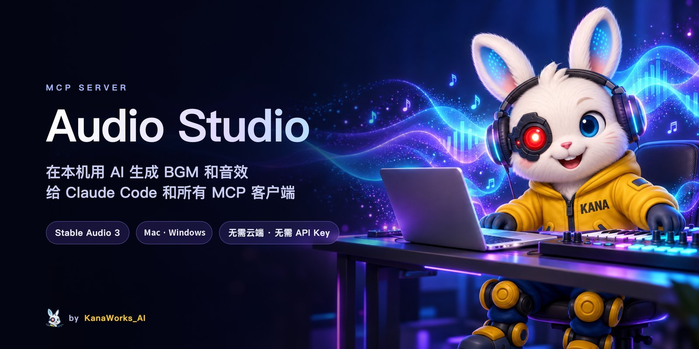
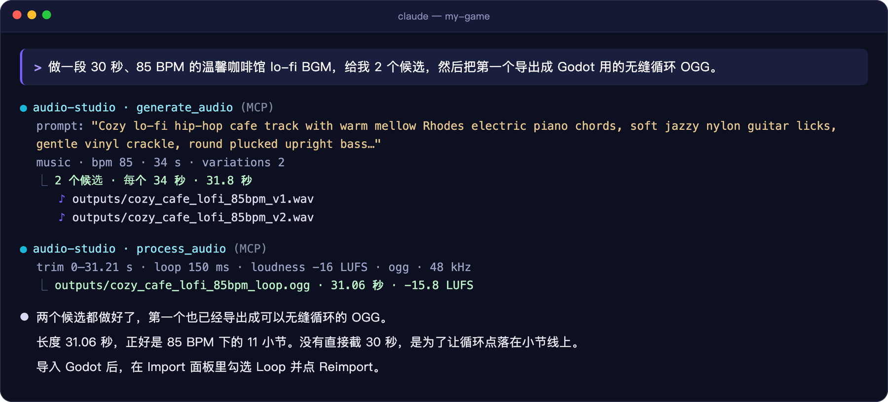
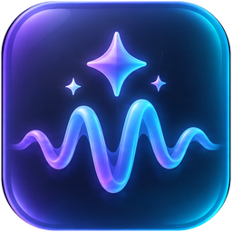
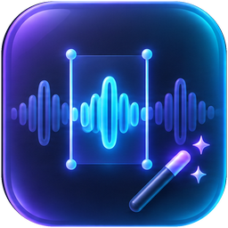
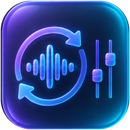
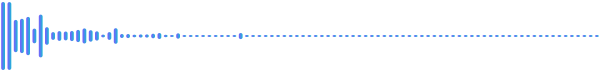
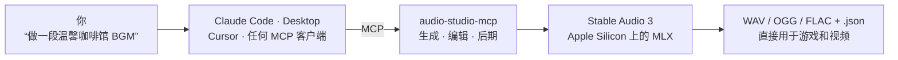

<div align="center">



<p>
  <a href="LICENSE"></a>
  
  <a href="https://modelcontextprotocol.io"></a>
  
  <a href="https://github.com/kanaworksai-hue/audio-studio-mcp/actions/workflows/tests.yml"></a>
  <a href="https://github.com/kanaworksai-hue/audio-studio-mcp/stargazers"></a>
</p>

<p><a href="https://github.com/kanaworksai-hue"></a>&nbsp;<a href="https://github.com/kanaworksai-hue"><b>KanaWorks_AI 出品</b></a></p>

[English](README.md) | **简体中文** | [日本語](README.ja.md)

[🎧 试听样例](https://kanaworksai-hue.github.io/audio-studio-mcp/) · [快速开始](#-快速开始) · [工具](#-工具) · [常见问题](#-常见问题) · [⭐ 点个 Star](#-点个-star-支持一下)

</div>

**Audio Studio MCP** 给 Claude Code、Claude Desktop、Cursor 以及任何 [MCP](https://modelcontextprotocol.io) 客户端配上一个在你自己 Mac 上运行的音频工作室。用自然语言要一段 BGM 或一个音效，模型就会用 [Stable Audio 3](https://github.com/Stability-AI/stable-audio-3) 在本机生成。之后还能做成循环、统一响度，导出给游戏引擎或剪辑软件。不用云服务，不需要 API Key，生成不花钱。

<p align="center">
  
  <br><sub>真实会话（有删减）。Claude 把循环长度定成正好 11 小节，这样循环时节拍不会乱。</sub>
</p>

## ✨ 亮点

<table>
<tr>
<td align="center" width="25%"><br><b>生成</b><br><sub>一句话生成 BGM、乐器 loop 和音效，每次 1–4 个候选</sub></td>
<td align="center" width="25%"><br><b>编辑</b><br><sub>整段换风格、重绘某个时间段、续写延长</sub></td>
<td align="center" width="25%"><br><b>后期</b><br><sub>无缝循环、淡入淡出、响度（LUFS）、48 kHz WAV / OGG / FLAC</sub></td>
<td align="center" width="25%"><br><b>本机运行</b><br><sub>在 Apple Silicon 上用 MLX 运行，不用注册账号，也不上传任何东西</sub></td>
</tr>
</table>

- **可复现：** 每个文件都带一个 `.json`，记录 prompt、seed 和参数。
- **内置 prompt 指南：** 服务器会把官方 Stable Audio 3 的 prompt 格式告诉客户端，“来个吱呀作响的木门”这种说法会被改写成模型能理解的 prompt。
- **结果和官方一致：** 同一个 seed 的输出和官方 `sa3` 命令行逐位相同。

## 🎧 试听

下面全部由这个服务器在 M1 Mac 上生成，没有人工修改。**[打开试听页面 →](https://kanaworksai-hue.github.io/audio-studio-mcp/)**

| | 样例 | Prompt |
|---|---|---|
|  | [**Lo-fi 咖啡馆**](https://kanaworksai-hue.github.io/audio-studio-mcp/#lofi_cafe)<br><sub>音乐 · 30 秒 · 85 BPM</sub> | Lo-fi hip-hop chill track with mellow electric piano, soft vinyl crackle, low-pass filtered drums… |
|  | [**史诗管弦乐**](https://kanaworksai-hue.github.io/audio-studio-mcp/#epic_orchestral)<br><sub>音乐 · 30 秒</sub> | Epic cinematic orchestral trailer music with thundering taiko drums, soaring French horns… |
|  | [**8-bit 冒险**](https://kanaworksai-hue.github.io/audio-studio-mcp/#chiptune_adventure)<br><sub>音乐 · 20 秒 · 150 BPM</sub> | Upbeat 8-bit chiptune adventure theme with a bright square wave lead… |
|  | [**玻璃碎裂**](https://kanaworksai-hue.github.io/audio-studio-mcp/#glass_shatter)<br><sub>音效 · 3 秒</sub> | source: glass bottle · action: shattering on impact · material: thick green glass · space: concrete floor |
|  | [**雨声和雷声**](https://kanaworksai-hue.github.io/audio-studio-mcp/#rain_thunder)<br><sub>音效 · 12 秒</sub> | source: heavy rain and distant thunder · space: outdoor forest at night, wide stereo |
|  | [**Synthwave 续写**](https://kanaworksai-hue.github.io/audio-studio-mcp/#synthwave_drive_extended)<br><sub>编辑 · 20 秒 → 40 秒</sub> | `edit_audio` continue：把 20 秒的曲子续写到 40 秒 |

MP3 文件在 [`docs/samples/`](docs/samples)，prompt 和 seed 在 [`samples.json`](docs/samples/samples.json) 里。

## 🧭 工作原理



## 🚀 快速开始

**环境要求：**

- Apple Silicon Mac（M1 及以上），建议 16 GB 内存
- 模型约占 6 GB 磁盘
- `git` 和 [`ffmpeg`](https://ffmpeg.org)（`brew install ffmpeg`）

```bash
git clone https://github.com/kanaworksai-hue/audio-studio-mcp.git
cd audio-studio-mcp
./install.sh
```

安装脚本会做这些事：

1. 需要时安装 [`uv`](https://docs.astral.sh/uv/)。
2. 把官方 Stable Audio 3 运行时 clone 到 `vendor/`，固定在测试过的 commit。
3. 创建 `.venv/`。
4. 从 [Hugging Face](https://huggingface.co/stabilityai/stable-audio-3-optimized) 下载 **medium** 模型（1.4B，约 5.9 GB）。

最后会打印出注册用的完整命令：

```bash
claude mcp add --scope user audio-studio -- /path/to/audio-studio-mcp/.venv/bin/audio-studio-mcp
```

<details>
<summary><b>Claude Desktop、Cursor 等客户端</b></summary>

把下面这段加到 `claude_desktop_config.json`、`.cursor/mcp.json` 或客户端的 MCP 配置里：

```json
{
  "mcpServers": {
    "audio-studio": {
      "command": "/path/to/audio-studio-mcp/.venv/bin/audio-studio-mcp"
    }
  }
}
```
</details>

<details>
<summary><b>安装选项</b></summary>

| 选项 | 作用 |
|---|---|
| `--model all` | 额外下载小而快的 `sm-music` 和 `sm-sfx` 模型（多 2.6 GB） |
| `--skip-weights` | 先不下载，第一次生成时再下载 |
| `-y` | 不询问，直接安装 `uv` |

下载不需要登录。用 `hf auth login` 登录后，Hugging Face 的限速会更宽松。
</details>

> [!TIP]
> **让 AI 帮你装。** 把这句话贴给 Claude Code：
> *“按照 https://github.com/kanaworksai-hue/audio-studio-mcp 的 README 安装它，并注册成 MCP 服务器。”*

然后直接提要求就行：

- “做一段 60 秒、85 BPM 的咖啡馆 lo-fi BGM loop，给我 3 个候选。”
- “要一个厚重木门在石头走廊里猛地关上的音效，导出成 Godot 用的 OGG。”
- “把这首曲子续写到 90 秒，再把响度标准化到 −16 LUFS。”

## 🧰 工具

| 工具 | 用途 |
|---|---|
| `generate_audio` | 文本生成 BGM、乐器 loop/分轨或音效。每次 1–4 个候选，支持 `bpm` 和结构化音效字段 |
| `edit_audio` | `variation`（整段换风格）、`inpaint`（重绘某个时间段）、`continue`（续写延长），同样 1–4 个候选 |
| `process_audio` | 裁剪 → 去首尾静音 → 单声道 → 重采样/响度 → 无缝循环 → 淡入淡出 → 峰值归一化或峰值上限 → WAV / OGG / FLAC。不修改原文件 |
| `unload_models` | 立刻释放模型占用的内存 |

<details>
<summary><b>参数说明</b></summary>

- **`audio_type`**：`music` / `instrument` / `sfx` / `raw`。服务器会自动加上模型训练时用的前缀（`TrackType: Music, VocalType: Instrumental,` 等）。不加 SFX 前缀的话，音效经常会被生成成音乐。
- **`variations`**：1–4 个候选，seed 依次为 `seed, seed+1, …`。`seed` 不传或传 `-1` 时随机。
- **`sound_source` / `sound_action` / `sound_material` / `sound_space`**：分别描述音效的声源、触发方式和变化、材质音色、所处空间。
- **`peak_ceiling_db`**（默认 −1）：安全上限。峰值超过就整体压低，低于的不会提升。需要标准化时用 `process_audio`。
- **`process_audio` 的标准化**：音效常用 `peak`；`loudness` 会标准化到目标 LUFS，−14 用于流媒体和视频，−16 用于游戏 BGM，−23 用于广播。

生成的文件是 44.1 kHz 24-bit 立体声 WAV，写到本目录的 `outputs/`，旁边各有一个 `<文件名>.json`。处理后的文件会在 `source` 里保留原始生成信息。
</details>

## ⚙️ 配置

<details>
<summary><b>环境变量</b></summary>

| 环境变量 | 默认值 | 说明 |
|---|---|---|
| `AUDIO_STUDIO_OUTPUT_DIR` | `<repo>/outputs` | 音频输出目录 |
| `AUDIO_STUDIO_IDLE_UNLOAD_MIN` | `10` | 闲置多少分钟后释放模型（`0` = 不释放） |
| `AUDIO_STUDIO_SA3_MODEL` | `medium` | `medium`（质量最好，最长 380 秒）、`sm-music` 或 `sm-sfx`（小而快，最长 120 秒） |
| `AUDIO_STUDIO_MLX_CACHE_GB` | `1` | MLX 缓冲区缓存上限。不设的话，生成长曲子后可能多占约 6 GB |
| `AUDIO_STUDIO_SA3_DIR` | `<repo>/vendor/stable-audio-3` | 使用别处的 stable-audio-3 checkout |
| `AUDIO_STUDIO_BACKEND` | `auto` | `auto` 或 `sa3-mlx` |
| `AUDIO_STUDIO_FFMPEG` | `PATH` 里的 `ffmpeg` | ffmpeg 路径 |

用 `claude mcp add ... -e 名称=值` 传入，或写在客户端配置的 `env` 里。
</details>

<details>
<summary><b>多个会话共用一个服务器</b></summary>

默认情况下，每个客户端会话都会启动自己的服务器进程，第一次调用时加载模型，闲置后释放。想让所有会话共用一个常驻的进程，可以作为本机 HTTP 服务运行，只监听 `127.0.0.1`：

```bash
.venv/bin/audio-studio-mcp --http 8765 --preload
claude mcp add --scope user --transport http audio-studio http://127.0.0.1:8765/mcp
```
</details>

## ⚡ 性能

M1 Mac 16 GB，medium 模型：

| 场景 | 耗时 |
|---|---|
| 冷启动，2 个 3 秒音效 | 约 13 秒 |
| 热状态，20 秒音乐 | 约 10 秒（2 倍实时） |
| 续写到 35 秒（含首次加载编码器） | 约 27 秒 |
| `sm-music` 热状态，15 秒音乐 | 约 1 秒 |

模型加载后占用约 5–7 GB 内存，闲置超时或调用 `unload_models` 后释放。

## 📝 Prompt 技巧

<details>
<summary><b>来自官方 Stable Audio 3 prompt 指南</b></summary>

1. **英文，1–2 句，最多约 45 词。** 不要写 vocals、singer、lyrics 这类人声词。
2. **音乐：** 曲风 + 形容词 → 主奏乐器 → 辅助层 → 鼓和节奏 → 情绪。速度放在 `bpm` 参数里。
   > Lo-fi hip-hop chill track with mellow electric piano, soft vinyl crackle, low-pass filtered drums and soft plucked bass for a relaxed, dreamy vibe.
3. **音效：** 填好声源、动作、材质、空间四个字段。
   > source: glass bottle / action: shattering on impact, fragments scattering / material: thick green glass, sharp bright transient / space: concrete floor, close-up, dry
4. **时长要和内容匹配：** 撞击 1–3 秒，动作 3–6 秒，环境声 6–15 秒以上，loop 6–20 秒，完整曲子 120–300 秒（上限 380 秒）。
5. **按秒的结构指令**（比如“15 秒处到高潮”）执行得不可靠。先生成，再用 `inpaint` 或 `continue` 调整。
6. 默认 `steps=8`、`cfg=1.0` 是官方设定。想更贴合 prompt，或让 `negative_prompt` 生效，就把 `cfg` 调到 3–7，速度会慢一倍左右。
7. 不同 seed 差别很大：要 2–4 个 `variations`，再挑最好的。

完整指南也会作为服务器说明（instructions）发送给客户端。
</details>

## ❓ 常见问题

<details>
<summary><b>能在 Windows、Linux 或 Intel Mac 上用吗？</b></summary>

暂时不行，目前需要 Apple Silicon Mac。模型运行部分已经抽成了后端接口，面向 NVIDIA 显卡的 Windows 后端在计划中。
</details>

<details>
<summary><b>能生成带人声的歌吗？</b></summary>

不能。Stable Audio 3 只生成纯音乐和音效，唱不出能听清的歌词。
</details>

<details>
<summary><b>生成的音频可以商用吗？</b></summary>

本项目代码是 MIT 协议。模型权重适用 [Stability AI Community License](https://huggingface.co/stabilityai/stable-audio-3-optimized)，模型和生成内容的使用条件由它规定，商用前请先阅读。截至本文撰写时，该许可证允许个人和年收入低于 100 万美元的组织商用。
</details>

<details>
<summary><b>8 GB 内存的 Mac 能用吗？</b></summary>

没有测试过。medium 模型加载后需要约 5–7 GB，所以建议 16 GB。小模型 `sm-music` / `sm-sfx` 会轻一些。
</details>

<details>
<summary><b>循环的接缝处有咔哒声。</b></summary>

循环请用 WAV 或 OGG。MP3 会在头尾加入填充，没法无缝循环。也可以把 `loop_crossfade_ms` 调长一些，或者让模型在小节线上裁切。
</details>

## 🗺️ 路线图

- [x] Apple Silicon 后端（Stable Audio 3、MLX）
- [ ] 面向 NVIDIA 显卡的 Windows 后端
- [ ] LoRA 支持（上游运行时已经支持）

欢迎提 Issue 和 Pull Request。

## ⭐ 点个 Star 支持一下

如果 Audio Studio 帮你做出了真正用上的声音，请在[仓库页面](https://github.com/kanaworksai-hue/audio-studio-mcp)顶部点一下 **⭐ Star**。免费，只要一秒，作用却不小：

- **让更多人发现它。** Star 越多，项目在 GitHub 上越容易被看到，更多做游戏、做视频的人就能用上。
- **让更新更有动力。** 每一个 Star 都在告诉我“这个东西有人在用”。这就是我继续做下一版（比如 Windows 后端和 LoRA 支持）的动力。

其他支持方式：遇到问题或有新想法，欢迎[提 Issue](https://github.com/kanaworksai-hue/audio-studio-mcp/issues)；也欢迎在 X 上分享你做的声音，并 @[KanaWorks_AI](https://x.com/KanaWorks_AI)。

## 🛠️ 开发

```bash
uv run pytest                              # 离线测试，不需要模型
.venv/bin/python scripts/smoke_test.py     # 用真实模型的端到端测试（约 30 秒）
```

```
src/audio_studio_mcp/
  server.py            MCP 工具（与后端无关）
  prompts.py           prompt 拼接，以及发给客户端的说明
  post.py              后期处理和导出
  backends/base.py     后端接口
  backends/sa3_mlx.py  Apple Silicon 上的 Stable Audio 3
```

新平台以新后端的形式加到 `backends/` 里。

## 📄 许可证与致谢

- **本项目：** [MIT](LICENSE)。
- **Stable Audio 3 运行时：** 安装时下载到 `vendor/`，© Stability AI，MIT 协议。
- **模型权重：** 适用 [Stability AI Community License](https://huggingface.co/stabilityai/stable-audio-3-optimized)。权重从 Hugging Face 下载，本项目不分发。
- **品牌：** KanaWorks_AI 名称、logo 和 Kana 形象版权归 KanaWorks_AI 所有，**不在** MIT 授权范围内。详见 [docs/brand](docs/brand/README.md)。
- **基于：** [Stable Audio 3](https://github.com/Stability-AI/stable-audio-3)、[MLX](https://github.com/ml-explore/mlx) 和 [Model Context Protocol](https://modelcontextprotocol.io)。

本项目是独立项目，与 Stability AI、Apple、Anthropic 都没有关联，也未获其背书。

<br>

<div align="center">

<a href="https://x.com/KanaWorks_AI"></a>

<p><b><a href="https://x.com/KanaWorks_AI">KanaWorks_AI</a> 用 ♥ 制作</b></p>

<p><sub>如果 Audio Studio 帮你省了时间，点个 ⭐ 就是对更新最好的鼓励，也能让更多人看到它。更多项目：<a href="https://github.com/kanaworksai-hue">github.com/kanaworksai-hue</a></sub></p>

</div>
